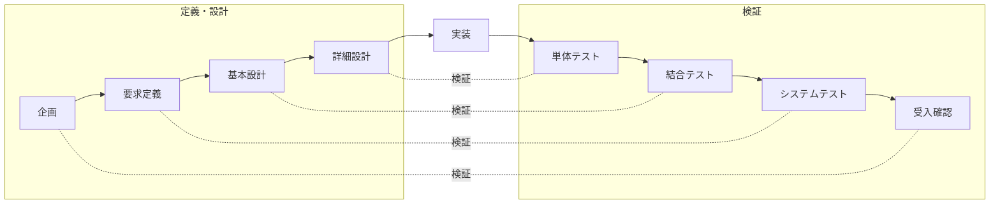

# プロジェクト計画書

- 文書 ID: PLAN-001
- 版: 0.1（ドラフト）
- 作成日: 2026-10-13

## 1. 目的

ゲーム「ふしぎ錬金」を題材に、要求定義から設計・実装・試験までのソフトウェアエンジニアリング工程を一通り実践し、各工程の成果物をトレーサブルな形で残す。

## 2. スコープ

### 2.1 対象

- **MVP（Minimum Viable Product）**: 1 プレイ（開始〜クリアまたはゲームオーバー）が成立する最小構成
- MVP の具体的な範囲は、企画案の決定後に要求仕様書（SRS）で確定する

### 2.2 対象外（MVP では扱わない）

- サウンド、凝ったグラフィック（図形や簡易スプライトで代用する）
- オンライン機能、ランキング
- スマートフォン向けの最適化

## 3. 開発プロセス

**反復型ウォーターフォール（V 字モデル＋反復）** を採用する。

- 各工程の成果物とレビューは V 字モデルに沿ってきちんと作る（授業課題として評価しやすくするため）
- 実装は小さな反復（イテレーション）に分け、反復ごとに動くものを作る（MVP を早く遊べる状態にするため）

## 4. マイルストーン

| # | マイルストーン | 完了条件 |
|---|---|---|
| M0 | 企画確定 | 企画案を 1 つ選び、技術選定 ADR が承認されている |
| M1 | 要求定義完了 | SRS・ユースケースのレビューが完了している |
| M2 | 設計完了 | アーキテクチャ・詳細設計・テスト計画のレビューが完了している |
| M3 | MVP 実装（反復 1〜n） | 全 FR（MVP 分）が実装され、単体・結合テストが通る |
| M4 | 試験・受入 | システムテストが完了し、トレーサビリティマトリクスが埋まっている |

## 5. 品質管理

- **レビュー**: 各工程の成果物はレビューし、指摘と対応を `docs/reviews/` に記録する
- **自動テスト**: ゲームロジックは単体テストで検証し、カバレッジ目標は SRS の非機能要求で定める
- **CI**: プッシュごとに lint・型チェック・テストを自動実行する
- **構成管理**: Git で管理し、1 機能 1 ブランチ、プルリクエスト経由で `main` にマージする

## 6. リスク

| リスク | 影響 | 対策 |
|---|---|---|
| スコープが膨らむ | MVP が完成しない | SRS で MVP 範囲を固定し、追加要望は「将来要求」に分ける |
| 文書作成に時間を取られすぎる | 実装の時間が足りない | 図は Mermaid で書き、文書テンプレートを使い回す |
| 文書とコードが食い違う | トレーサビリティが崩れる | コミットやプルリクエストに FR/DES の ID を書き、マトリクスを反復ごとに更新する |
