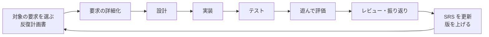

# プロジェクト計画書

- 文書 ID: PLAN-001
- 版: 0.4（案）
- 作成日: 2026-10-13
- 更新日: 2026-10-15

## 1. 目的

ゲーム「ふしぎ錬金」を題材に、要求定義から設計・実装・試験までのソフトウェアエンジニアリング工程を一通り実践し、各工程の成果物をトレーサブルな形で残す。

## 2. スコープ

### 2.1 対象

- **MVP（Minimum Viable Product）**: 1 プレイ（開始からクリアまで）が成立する最小構成
- MVP の範囲は、プロトタイプの結果を踏まえて SRS の優先度から選ぶ

### 2.2 対象外（MVP では扱わない）

- サウンド、凝ったグラフィック（図形や簡易スプライトで代用する）
  - 注記: 16×16 の CC0 のタイル（反復 5 から工房と街の地図と主人公に使う）は、簡易スプライトに当たる。[ADR-0003](../adr/0003-image-assets.md) を参照
- オンライン機能、ランキング
- スマートフォン向けの最適化

## 3. 開発プロセス

**反復型（インクリメンタル）開発**を採用する。1 回の反復の中で、小さな V 字（要求の詳細化 → 設計 → 実装 → 試験）を回す。

### 3.1 採用の理由

- ゲームは、遊んでみるまで面白いかどうか分からない。全体を先に設計すると、遊んで「違った」ときの手戻りが大きい（E-63）
- 開発者は「細部は作りながら決める」方針である（E-55）
- 文書の量は減らさない。文書を作る時期を反復ごとに分散させ、要求の変更の経緯も記録として残す

### 3.2 文書の位置付け

| 文書 | 位置付け |
|---|---|
| 要求仕様書（SRS） | ゲーム全体の要求の台帳。全体は粗いままにし、反復で扱う要求だけを詳しくする。反復の結果を反映して版を上げる |
| 反復計画書 | 反復ごとに作る。目的（確かめたい仮説）、対象の要求 ID、作らないもの、完了条件を書く |
| 設計書 | 反復で扱う範囲だけを書き足していく |
| テスト仕様書 | 反復で扱う要求ごとに書き足していく |
| 反復の振り返り | 反復の終わりに、仮説の検証結果と SRS への変更点を書く |

### 3.3 1 回の反復の流れ

- 反復の期間は 1〜2 週間を目安とする
- 最初の反復は、ゲームの核が面白いかを確かめる**プロトタイプ**とする

## 4. マイルストーン

| # | マイルストーン | 完了条件 | 状態 |
|---|---|---|---|
| M0 | 企画確定 | 企画書と技術選定 ADR が承認されている | 完了（2026-10-14） |
| M1 | 要求の台帳の完成 | SRS v0.1 が確定している | 完了（2026-10-14） |
| M2 | プロトタイプ（反復 1） | 核のループが動き、仮説の検証結果が振り返りに記録されている | 完了（2026-10-14） |
| M3 | MVP の範囲の確定 | プロトタイプの結果を踏まえ、MVP に含める要求が SRS 上で決まっている | 未着手 |
| M4 | MVP の完成（反復 2〜n） | MVP の要求が実装され、テストが通り、トレーサビリティマトリクスが埋まっている | 着手（反復 2） |

## 5. 品質管理

- **レビュー**: 各工程の成果物はレビューし、指摘と対応を `docs/reviews/` に記録する
- **自動テスト**: ゲームロジックは単体テストで検証し、カバレッジ目標は SRS の非機能要求で定める
- **CI**: プッシュごとに lint・型チェック・テストを自動実行する
- **構成管理**: Git で管理し、1 Issue 1 ブランチ、プルリクエスト経由で `main` にマージする。個人開発のため、CI の成功・別エージェントによるレビュー・要求と設計の変更に対する人の承認、を条件にエージェントが自動でマージする（AGENTS.md「自動マージの条件」）

## 6. リスク

| リスク | 影響 | 対策 |
|---|---|---|
| スコープが膨らむ | MVP が完成しない | 反復ごとに対象の要求 ID を決め、それ以外は作らない。追加要望は SRS の「将来の要求」に分ける |
| 遊んでみると面白くない | 作り直しが大きくなる | 最初の反復をプロトタイプにして、核の面白さを先に確かめる |
| 文書作成に時間を取られすぎる | 実装の時間が足りない | 図は Mermaid で書き、文書テンプレートを使い回す |
| 文書とコードが食い違う | トレーサビリティが崩れる | コミットやプルリクエストに FR/DES の ID を書き、マトリクスを反復ごとに更新する |

## 7. 変更履歴

| 版 | 日付 | 内容 |
|---|---|---|
| 0.1 | 2026-10-13 | 初版（V 字モデル＋反復） |
| 0.2 | 2026-10-14 | 開発プロセスを反復型（インクリメンタル）に変更（E-63）。マイルストーンを見直し |
| 0.3 | 2026-10-14 | 条件付きの自動マージを導入（個人開発のため） |
| 0.4（案） | 2026-10-15 | 2.2 に、CC0 のタイルは簡易スプライトに当たるという注記を足した（ADR-0003、REV-044） |
