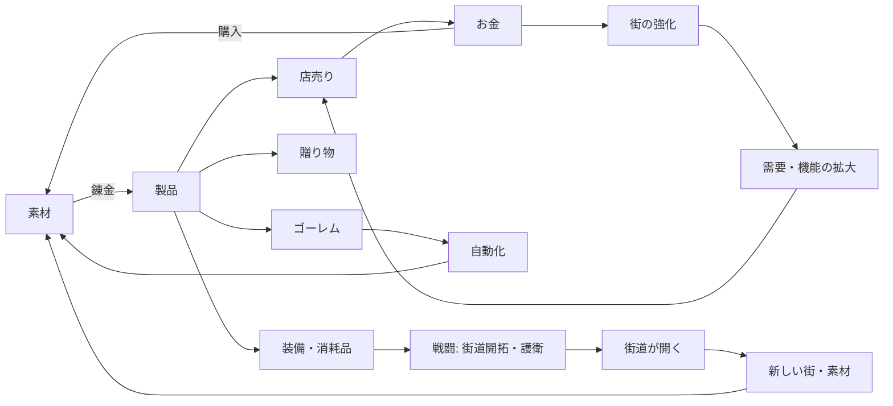

# 企画書「ふしぎ錬金」

- 文書 ID: CON-002
- 版: 0.2（ドラフト）
- 更新日: 2026-10-14
- 根拠: [要求抽出記録 ELI-001](elicitation-notes.md)。各項目の末尾の `E-xx` は、その根拠となった発言を指す
- 前版: [企画案の比較 CON-001](concept-proposals.md)（ローグライク案は E-30 により不採用）

## 1. ひとことで

> モンスターが当たり前にいる世界で、錬金術師が街を育て、街道を切り開き、街と街を生産網でつないでいく。

## 2. 体験の軸

**「ズルと拡大」**（E-10）

- **拡大**: 作れる物、自動化の範囲、つながる街が、少しずつ積み上がって広がっていく（E-11, E-22, E-26）
- **ズル**: ときどき手に入る格上の素材や、手作りの逸品で、バランスを一気に崩せる（E-15, E-24）

本人によるキーワード: 自動化、ズル、工業、作成、キャラ差、戦略、拡大、変換（ELI-001 の 3 章「本人によるまとめ」）

## 3. 世界観

| 項目 | 内容 | 根拠 |
|---|---|---|
| 時代 | 現代に近い。ハンバーガーのような身近な物も作れる | E-56 |
| 技術 | 電気技術は薄く、戦車などはない。代わりに魔法と錬金術がある | E-56 |
| モンスター | ドラクエのように当たり前にいる。発生の原因や災厄の設定はない | E-51 |
| 雰囲気 | アトリエ並みにゆるい。死は描かず、怪我をする程度 | E-52 |
| 冒険 | 気軽に出かけられる | E-54 |
| 街 | 複数あり、それぞれ個性がある（苔むした街、栄えた街、崖の上の街など） | E-54 |
| ゴーレム | 古代の錬金術に由来する存在。設定は最小限 | E-53 |
| 物語 | 主役にしない。スタートとゴールだけが決まっている | E-23, E-27 |

## 4. 基本ループ

- 製品の使い道は、店売り・ゴーレム・贈り物・装備（消耗品を含む）（E-34）
- お金が、素材の購入と強化を仲介する（E-36）
- コストと報酬は**街**に集まる。街が本筋（E-37, E-42）
- 街を強化すると、製品の買い取りが強くなり、ほかの機能も開く（E-35）。研究や遠征などの別方向も、街の施設を通して開く案が候補

## 5. 生産と品質

| 項目 | 内容 | 根拠 |
|---|---|---|
| 変換 | 入出力は単純。1 つの物に複数の作り方がある。物が足りない状態が工夫を生む | E-20, E-21 |
| 素材 | 1 つの素材が持つ値は少なくする（選ぶストレスを避ける） | E-17 |
| 品質 | 等級制（例: ★1〜★5）。同じ等級の物はまとめて数える | E-40 |
| 品質の基準 | 素材の品質で決まる | E-45 |
| 自動品 | ゴーレムが量産する。品質は**素材の品質の平均** | E-44 |
| 手作り | 同じ製品を、錬金の仕組み次第で**平均を上回る品質**で作れる。逸品は高く売れる | E-43, E-44 |
| 品質向上の自動化 | 中盤から終盤に解放する（またはコープで解放） | E-47 |
| テンポ | 錬金の流れを物語イベントで止めない | E-16 |

## 6. 戦闘

| 項目 | 内容 | 根拠 |
|---|---|---|
| 形式 | グリッド上で位置取りをする戦術型（FE 型）。コマンドバトルにはしない。配置で後衛を守れる | E-28, E-29 |
| 頻度 | 多くしない | E-25 |
| 自動と手動 | 日常の戦闘は自動（ゴーレムや防衛設備）。大事な戦闘だけプレイヤーが指揮する | E-50 |
| 消耗品 | 製品を戦闘で消費する。自動品は量（たくさん投げる）、手作りは質（一撃が強い） | E-46 |
| 戦闘の種類 | **街道開拓**と**物流路の護衛**に力を入れる。ほかに街道のモンスター狩り、街の防衛、ボス戦 | E-48, E-57 |

## 7. MOD

- 素材・レシピ・依頼などを、データ（設定ファイル）で追加できる（ADR-0001 第 1 段階）
- 本体のデータも MOD と同じ仕組みで読み込む
- スクリプト MOD は第 2 段階で検討する
- MOD は「自分で作れるズル」でもある

## 8. 作らないもの

| 作らないもの | 根拠 |
|---|---|
| ローグライク（不思議のダンジョン）の要素 | E-30 |
| 物語が中心の進行、錬金を止める物語イベント | E-16, E-23 |
| コマンドバトル | E-29 |
| 期限（1 年など）、熟練度 | E-27 |
| パラメータの多い素材 | E-17 |
| 死の描写 | E-52 |
| 固定された単一の拠点にこもる構成 | E-26 |

## 9. 未決事項

| # | 論点 | メモ |
|---|---|---|
| Q-01 | 本筋の「街」は 1 つ（ホームの街）か、複数の街すべてか | E-42 は「街が本筋」、E-54 は「街は複数ある」。どの街を強化するのかを決める |
| Q-02 | 街ごとの個性が、ゲームの仕組みとしてどう違うか | E-54 で要検討とされている |
| Q-03 | 手作りの錬金で品質を上げる仕組み | パズル、特性の組み合わせ、など |
| Q-04 | 贈り物を誰に渡し、何が返ってくるか | コープを後回しにしたため、行き先が空いている |
| Q-05 | ゲームのゴール | スタートとゴールだけ決める方針（E-27） |
| Q-06 | キャラの物語（コープ）を入れるか | 後回し（E-33） |
| Q-07 | キャラ差と役割の具体的な形 | FE 型の役割分担（E-28） |
| — | その他の細部 | 作りながら決める（E-55） |
