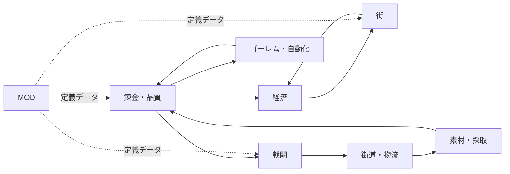

# 要求仕様書（SRS）「ふしぎ錬金」

- 文書 ID: SRS-001
- 版: 0.3（ドラフト。開発者の承認待ち）
- 作成日: 2026-10-14
- 位置付け: ゲーム全体の要求の台帳。開発は反復型で進め、反復で分かったことを反映して版を上げる（PLAN-001 3 章）
- 構成の参考: ISO/IEC/IEEE 29148、IEEE 830

## 1. はじめに

### 1.1 目的

本書は、ゲーム「ふしぎ錬金」が満たすべき要求を定義する。設計・実装・試験は本書の要求 ID を基準に行い、トレーサビリティマトリクスで対応を管理する。

### 1.2 範囲

本書はゲーム全体の要求を扱う。MVP に含める要求の選定は、本書のレビュー後に別途行う（MVP 列は空欄）。

### 1.3 用語

| 用語 | 定義 |
|---|---|
| 素材 | 錬金の入力となる物。採取・購入・戦闘報酬などで得る |
| 製品 | 錬金の出力となる物。別のレシピの素材にもなりうる |
| アイテム | 素材と製品の総称 |
| レシピ | 錬金の規則。入力（アイテムの種類と数）と出力（アイテムの種類と数）の組 |
| 品質 | アイテムの良さを表す整数値。1〜200 |
| 手作り | プレイヤーが自分で行う錬金 |
| 自動生産 | ゴーレムが行う錬金や採取 |
| 自動品 | 自動生産で作られたアイテム |
| 逸品 | 手作りで、素材の平均を上回る品質で作られたアイテム |
| ゴーレム | 古代の錬金術に由来する、作業を自動で行う存在。製品から作る |
| ホームの街 | プレイヤーが拠点とし、中心的に強化する街。1 つだけ |
| 支店 | ホーム以外の街に出す、プレイヤーの出先の店舗 |
| 施設 | 街に建設・強化する設備。街の機能を増やす |
| 街道 | 地点（街・採取地）どうしを結ぶ道。開拓すると通れるようになる |
| 物流路 | 街道の上に設定する、アイテムの自動輸送の経路 |
| 手動戦闘 | プレイヤーが指揮する戦闘 |
| 自動戦闘 | プレイヤーが指揮せず、結果がシミュレーションで決まる戦闘 |
| ユニット | 戦闘に参加する個体（仲間、ゴーレムなど） |
| MOD | ゲームの定義データを追加・変更する外部パッケージ |
| 定義データ | アイテム・レシピ・施設などを記述したデータ。本体のデータも MOD と同じ形式で持つ |

### 1.4 参考文献

| ID | 文書 |
|---|---|
| ELI-001 | [要求抽出記録](../01_concept/elicitation-notes.md) |
| CON-002 | [企画書](../01_concept/concept.md) |
| ADR-0001 | [技術スタックの選定](../adr/0001-tech-stack.md) |
| PLAN-001 | [プロジェクト計画書](../00_plan/project-plan.md) |

## 2. 全体の記述

### 2.1 製品の位置付け

PC で動く 1 人用の 2D ゲーム。素材を錬金して製品を作り、ホームの街を強化しながら、街道を開拓して生産網を広げる。体験の軸は「ズルと拡大」（CON-002 2 章）。

### 2.2 製品の主な機能

### 2.3 利用者

| 利用者 | 特性 | 主な関心 |
|---|---|---|
| プレイヤー | PC ゲームに慣れている。物語より、仕組みを組み立てて広げる遊びを好む | 生産の拡大、ズル、戦術 |
| MOD 作者 | テキストエディタで定義データを書ける。Go のコードは書かない前提 | 書式が分かりやすいこと、誤りをすぐ見つけられること |
| 開発者 | 本プロジェクトの保守者 | テストしやすさ、文書とコードの対応 |

### 2.4 制約

| ID | 制約 | 根拠 |
|---|---|---|
| CST-01 | 実装言語は Go、ゲームライブラリは Ebitengine を使う | ADR-0001 |
| CST-02 | 表現として、死を描かない。戦闘で倒れても負傷として扱う | E-52 |
| CST-03 | 物語を進行の中心にしない | E-23 |

### 2.5 前提と依存

- プレイヤーの PC は OpenGL などの GPU 描画に対応している
- 開発・試験の環境は WSL2（WSLg）と Windows

## 3. 機能要求

### 要求の書き方

- **優先度**（MoSCoW）: M = 必須、S = あるべき、C = あると良い、W = 今回は作らない
- **検証方法**: T = テスト、D = 実演、I = 査閲（文書やコードを読んで確認）、A = 分析
- **TBD**: 未決の値。9 章の一覧で管理する

### 3.1 錬金（ALC）

| ID | 要求 | 根拠 | 優先度 | 検証 |
|---|---|---|---|---|
| FR-ALC-01 | プレイヤーはレシピを選び、必要な素材を投入して製品を作れること | E-34 | M | T |
| FR-ALC-02 | レシピは、入力（アイテムの種類と数）と出力（アイテムの種類と数）で定義されること | E-20 | M | T |
| FR-ALC-03 | 1 種類の製品に対して、複数のレシピを定義できること | E-21 | M | T |
| FR-ALC-04 | 手作りの錬金では、品質を上げる仕組みにより、投入した素材の平均を上回る品質の製品を作れること。仕組みの内容は TBD-03 | E-44 | M | T |
| FR-ALC-05 | 錬金の操作中と完了直後に、物語イベントで操作を中断しないこと | E-16 | M | D |
| FR-ALC-06 | 製品は、別のレシピの素材として使えること | E-11 | M | T |
| FR-ALC-07 | 作れるレシピは、進行（街の強化など）に応じて解放されること | E-11 | S | T |
| FR-ALC-08 | 手作りの錬金で素材を選ぶとき、レシピの入力枠の条件に合う素材だけを選べること | E-67 | M | D |

### 3.2 アイテムと品質（ITM）

| ID | 要求 | 根拠 | 優先度 | 検証 |
|---|---|---|---|---|
| FR-ITM-01 | アイテムは、種類と品質を持つこと。それ以外に選択に影響する属性は、1 種類につき最大 3 個とすること | E-17, E-45 | M | I |
| FR-ITM-02 | 品質は、1〜200 の整数で表すこと | E-40 | M | T |
| FR-ITM-03 | 種類と品質が同じアイテムは、1 つの在庫単位にまとめて数えること | E-40 | M | T |
| FR-ITM-04 | 自動品の品質は、投入した素材の品質の平均とし、端数は切り捨てること | E-44 | M | T |
| FR-ITM-05 | 手作りと自動生産は、同じ種類の製品を作れること（違いは品質のみ） | E-43 | M | T |
| FR-ITM-06 | 自動生産で品質を上げる手段は、ゲームの中盤以降に解放されること | E-47 | S | T |
| FR-ITM-07 | プレイヤーが、アイテムの属性を画面で確かめられること | E-68 | M | D |
| FR-ITM-08 | 製品の威力（回復量、攻撃力など）は、品質に応じて連続的に大きくなること（例: 品質 29 と 60 で威力が違う） | E-79 | M | T |
| FR-ITM-09 | 製品の効果は、品質 50・100・150・200 の段階に達するごとに増えること（例: 爆弾の範囲が広がる、ハンバーガーに攻撃アップが付く）。どの段階で何の効果が付くかは、アイテムごとに定義データで決める | E-79 | M | T |

### 3.3 素材の入手（MAT）

| ID | 要求 | 根拠 | 優先度 | 検証 |
|---|---|---|---|---|
| FR-MAT-01 | プレイヤーは、採取地で素材を採取できること | E-34 | M | T |
| FR-MAT-02 | プレイヤーは、街の店でお金を払って素材を購入できること | E-36 | M | T |
| FR-MAT-03 | 依頼や戦闘の報酬として、その時点で手に入る物より高い品質のアイテムが得られることがあること（ズル） | E-15 | S | T |

### 3.4 経済（ECO）

| ID | 要求 | 根拠 | 優先度 | 検証 |
|---|---|---|---|---|
| FR-ECO-01 | プレイヤーは、製品をホームの街の店で売ってお金を得られること | E-34 | M | T |
| FR-ECO-02 | 売値は、製品の種類と品質で決まること | E-43 | M | T |
| FR-ECO-03 | 街の強化に応じて、買い取りの能力（売れる量、種類、価格の少なくとも 1 つ）が上がること | E-35 | M | T |
| FR-ECO-04 | お金は、素材の購入と街の強化に使えること | E-36 | M | T |
| FR-ECO-05 | 街から依頼が出され、指定の製品を納品すると報酬が得られること | E-15, E-80 | M | T |

### 3.5 街（TWN）

| ID | 要求 | 根拠 | 優先度 | 検証 |
|---|---|---|---|---|
| FR-TWN-01 | プレイヤーはホームの街を 1 つ持つこと | E-58 | M | T |
| FR-TWN-02 | ホームの街に、お金と製品を消費して施設を建設・強化できること | E-34, E-36 | M | T |
| FR-TWN-03 | 施設によって、買い取り以外の機能（例: 研究、遠征）が解放されること | E-35, E-42 | S | T |
| FR-TWN-04 | 街道でつながった他の街に、支店を出せること | E-58 | S | T |
| FR-TWN-05 | 支店は、ホームの街より限られた範囲で強化できること | E-58 | C | T |
| FR-TWN-06 | 街ごとに、仕組みとしての個性を持つこと。内容は TBD-06 | E-54 | C | I |
| FR-TWN-07 | 街の強化の状態が、画面上の見た目の変化として分かること | E-37 | S | D |

### 3.6 ゴーレムと自動化（GOL）

| ID | 要求 | 根拠 | 優先度 | 検証 |
|---|---|---|---|---|
| FR-GOL-01 | 製品を材料にしてゴーレムを作れること | E-34, E-53 | M | T |
| FR-GOL-02 | ゴーレムに 1 つのレシピを割り当てると、素材がある限り、そのレシピの錬金を繰り返すこと | E-11 | M | T |
| FR-GOL-03 | ゴーレムの入出力は、在庫または隣接するゴーレム・物流路との単純な受け渡しで表せること | E-20 | M | T |
| FR-GOL-04 | ゴーレムを採取地に置くと、素材を自動で採取すること | E-11, E-69 | M | T |
| FR-GOL-05 | ゴーレムの種類によって、能力（速度、扱える作業など）が異なること | E-53 | C | T |
| FR-GOL-06 | プレイヤーが操作していない間も、自動生産がゲーム内時間に応じて進むこと | E-11 | M | T |

### 3.7 街道と物流（RD）

| ID | 要求 | 根拠 | 優先度 | 検証 |
|---|---|---|---|---|
| FR-RD-01 | ワールドマップ上に地点（街、採取地）と、それらを結ぶ街道があること | E-22, E-54 | M | D |
| FR-RD-02 | 未開拓の街道は、開拓のための戦闘に勝つと通れるようになること | E-57 | M | T |
| FR-RD-03 | 開拓済みの街道の上に物流路を設定し、地点の間でアイテムを自動で輸送できること | E-22 | S | T |
| FR-RD-04 | 物流路はモンスターに襲われることがあり、護衛によって被害を防げること | E-57 | S | T |
| FR-RD-05 | 街道のモンスターを狩り、素材を得られること | E-57 | C | T |

### 3.8 戦闘（BTL）

| ID | 要求 | 根拠 | 優先度 | 検証 |
|---|---|---|---|---|
| FR-BTL-01 | 手動戦闘は、グリッド状のマップ上でユニットを移動・行動させるターン制で行うこと | E-28, E-29 | M | T |
| FR-BTL-02 | ユニットは役割を持ち、役割ごとに性能がはっきり異なること | E-28 | M | I |
| FR-BTL-03 | 配置によって、後衛のユニットを敵の攻撃から守れること（例: 前衛が敵の進路を塞ぐ） | E-29 | M | T |
| FR-BTL-04 | 戦闘中に、製品（消耗品）を使用でき、使用すると在庫から減ること | E-46 | M | T |
| FR-BTL-05 | 消耗品の効果は品質に応じて強くなること | E-46 | M | T |
| FR-BTL-06 | ユニットは製品を装備でき、装備の品質に応じて能力が上がること | E-34 | M | T |
| FR-BTL-07 | 戦闘で倒れたユニットは死亡せず、負傷として扱うこと。負傷からの回復の規則は TBD-07 | E-52 | M | T |
| FR-BTL-08 | 街の防衛と物流路の護衛は、プレイヤーが指揮しない自動戦闘で解決できること | E-50 | S | T |
| FR-BTL-09 | 街道の開拓とボス戦は、手動戦闘で行うこと | E-50, E-57 | M | D |
| FR-BTL-10 | 手動戦闘の発生は、プレイヤーが自分で開始するものに限ること（勝手に始まらない） | E-25 | S | D |

### 3.9 進行（PRG）

| ID | 要求 | 根拠 | 優先度 | 検証 |
|---|---|---|---|---|
| FR-PRG-01 | ゲームには 1 つのゴールがあり、達成するとクリアになること。ゴールの内容は TBD-05 | E-27 | M | D |
| FR-PRG-02 | ゲーム内に期限を設けないこと | E-27 | M | I |
| FR-PRG-03 | 熟練度（繰り返し作業で上がる能力値）を設けないこと | E-27 | M | I |
| FR-PRG-04 | 新しいレシピ・施設・地点などの解放によって、できることが段階的に増えること | E-11, E-22 | M | D |

### 3.10 その他の要素

| ID | 要求 | 根拠 | 優先度 | 検証 |
|---|---|---|---|---|
| FR-GFT-01 | 製品を贈り物として渡せること。渡す相手と見返りは TBD-08 | E-34 | C | T |
| FR-CHR-01 | 仲間ごとの物語（コープ）を持つこと | E-33 | W | — |

### 3.11 システム（SYS）

| ID | 要求 | 根拠 | 優先度 | 検証 |
|---|---|---|---|---|
| FR-SYS-01 | ゲームの状態をセーブし、ロードして再開できること | — | M | T |
| FR-SYS-02 | 一定の契機（TBD-09）で自動セーブすること | — | S | T |
| FR-SYS-03 | タイトル画面から、新規開始・続きから・終了を選べること | — | M | D |

### 3.12 MOD

| ID | 要求 | 根拠 | 優先度 | 検証 |
|---|---|---|---|---|
| FR-MOD-01 | アイテム・レシピを、定義データのファイルで追加できること | E-04 | M | T |
| FR-MOD-02 | 本体のアイテム・レシピも、MOD と同じ形式の定義データから読み込むこと | ADR-0001 | M | I |
| FR-MOD-03 | 施設・ゴーレム・ユニット・依頼・地点も、定義データで追加できること | E-04 | S | T |
| FR-MOD-04 | 起動時に定義データを検証し、誤りがあれば、ファイル名・位置・理由を表示すること | E-04 | M | T |
| FR-MOD-05 | 誤りのある MOD は無効にし、その他の MOD と本体は起動を続けること | E-04 | M | T |
| FR-MOD-06 | 複数の MOD の読み込み順と、同じ ID の定義が重なったときの規則を定めること | E-04 | S | T |
| FR-MOD-07 | MOD は対応するゲームの定義データ形式のバージョンを宣言し、非対応の MOD は読み込まないこと | E-04 | S | T |
| FR-MOD-08 | プレイヤーがゲーム内で MOD の有効・無効を切り替えられること | E-04 | C | D |
| FR-MOD-09 | スクリプト MOD（新しい効果をコードで定義する） | ADR-0001 | W | — |

## 4. 外部インタフェース要求

| ID | 要求 | 優先度 | 検証 |
|---|---|---|---|
| IF-01 | 操作はマウスとキーボードで行えること | M | D |
| IF-02 | 画面の表示言語は日本語とすること | M | I |
| IF-03 | 定義データは、人がテキストエディタで読み書きできる形式（形式は設計で決める）とすること | M | I |
| IF-04 | セーブデータはユーザーのデータ用ディレクトリ（OS の慣例に従う）に保存すること | M | T |
| IF-05 | MOD は、所定の MOD ディレクトリにフォルダを置くことで導入できること | M | T |
| IF-06 | 画面は場面（工房、街、採取地、戦闘など）ごとに分かれ、プレイヤーが場面を行き来できること | M | D |

## 5. 非機能要求

| ID | 区分 | 要求 | 優先度 | 検証 |
|---|---|---|---|---|
| NFR-01 | 性能 | 推奨環境で 60 fps を保つこと。ゴーレム TBD-10 体が稼働していても下回らないこと | M | T |
| NFR-02 | 性能 | 起動からタイトル画面の表示まで 5 秒以内であること | S | T |
| NFR-03 | 移植性 | Windows 11 と Linux（Ubuntu 24.04）で動作すること | M | D |
| NFR-04 | 保守性 | ゲームの規則を実装するパッケージ（core）は、Ebitengine に依存しないこと | M | I（依存関係の検査を CI で自動化する） |
| NFR-05 | 保守性 | core パッケージの命令網羅率（ステートメントカバレッジ）が 80% 以上であること | S | T |
| NFR-06 | 試験性 | 乱数の種（シード）と入力が同じなら、戦闘と自動生産の結果が同じになること | M | T |
| NFR-07 | 信頼性 | セーブの途中で強制終了しても、直前の正常なセーブデータが壊れないこと | M | T |
| NFR-08 | 信頼性 | どんな定義データを読み込んでも、ゲームが異常終了しないこと（誤りとして報告する） | M | T（ファジングを含む） |
| NFR-09 | 安全性 | 定義データの読み込みで、任意のコードが実行されないこと | M | I |
| NFR-10 | 互換性 | セーブデータにバージョンを持ち、旧い版のセーブデータを読み込めること | S | T |
| NFR-11 | 使用性 | 錬金の 1 回の操作（レシピ選択から完了まで）が、TBD-11 クリック以内で終わること | S | T |
| NFR-12 | 使用性 | 素材の選択画面で、比べる値が品質と最大 3 個の属性だけで済むこと | M | I |

## 6. 品質保証の要求

| ID | 要求 |
|---|---|
| QA-01 | プッシュごとに CI で、フォーマット確認・静的解析・単体テストを実行すること |
| QA-02 | すべての M・S 要求は、トレーサビリティマトリクスで設計要素とテストケースに対応付けること |
| QA-03 | 各工程の成果物はレビューし、記録を `docs/reviews/` に残すこと |

## 7. 将来の要求（今回は作らない）

| ID | 内容 |
|---|---|
| FR-CHR-01 | 仲間ごとの物語（コープ） |
| FR-MOD-09 | スクリプト MOD |
| — | 多言語対応、サウンド、オンライン機能 |

## 8. 要求の一覧（集計）

| 区分 | M | S | C | W |
|---|---|---|---|---|
| 機能要求（71 件） | 49 | 14 | 6 | 2 |

## 9. 未決事項（TBD）

| ID | 内容 | 関連 | 状態 |
|---|---|---|---|
| TBD-01 | 品質以外の属性の最大数 | FR-ITM-01, NFR-12 | **解決（v0.1）: 3 個**（E-60） |
| TBD-02 | 品質の段階数 | FR-ITM-02 | **解決（v0.1）: 1〜200**（E-59） |
| TBD-03 | 手作りで品質を上げる仕組み | FR-ALC-04 | 保留（プロトタイプで候補を試す） |
| TBD-04 | 平均品質の端数の扱い | FR-ITM-04 | **解決（v0.1）: 切り捨て**（E-61） |
| TBD-05 | ゲームのゴール | FR-PRG-01 | 保留 |
| TBD-06 | 街ごとの個性の内容 | FR-TWN-06 | 保留 |
| TBD-07 | 負傷からの回復の規則 | FR-BTL-07 | 保留 |
| TBD-08 | 贈り物の相手と見返り | FR-GFT-01 | 保留 |
| TBD-09 | 自動セーブの契機 | FR-SYS-02 | 保留 |
| TBD-10 | 性能要求の基準とするゴーレムの数 | NFR-01 | 保留（ゲームの仕様が固まってから決める）（E-62） |
| TBD-11 | 錬金 1 回の操作のクリック数の上限 | NFR-11 | 保留（ゲームの仕様が固まってから決める）（E-62） |

保留の TBD は、関係する要求を反復で扱うときに決める。

## 10. 変更履歴

| 版 | 日付 | 内容 |
|---|---|---|
| 0.1 | 2026-10-14 | 初版。レビューで TBD-01・02・04 を解決し、確定 |
| 0.2 | 2026-10-14 | 反復 1 の振り返りを反映（E-74、REV-016）。FR-GOL-04 の優先度を S から M に上げた。FR-ALC-08、FR-ITM-07 を追加した |
| 0.3 | 2026-10-14 | 反復 2 の振り返りを反映（E-79、E-80）。FR-ITM-08、FR-ITM-09、IF-06 を追加した。FR-ECO-05 の優先度を S から M に上げた |
