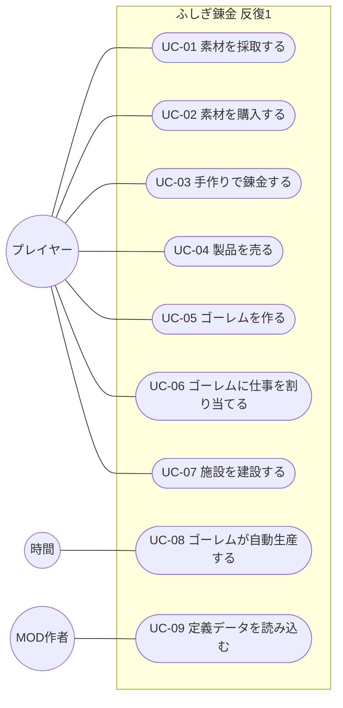

# ユースケース

- 文書 ID: UC-DOC-001
- 版: 0.1（反復 1 の範囲）
- 作成日: 2026-10-14
- 対象: [反復 1 計画書](../iterations/it01/plan.md) の範囲。反復ごとに書き足す

## 1. アクター

| アクター | 説明 |
|---|---|
| プレイヤー | ゲームを遊ぶ人 |
| MOD 作者 | 定義データを書いてゲームを拡張する人 |
| 時間 | ゲーム内の時間の経過。ゴーレムの自動生産を進める（システム内部のアクター） |

## 2. ユースケース図

## 3. ユースケース記述

### UC-01 素材を採取する

| 項目 | 内容 |
|---|---|
| アクター | プレイヤー |
| 関連要求 | FR-MAT-01 |
| 事前条件 | 採取地が 1 つ以上定義されている |
| 事後条件 | 採取した素材が在庫に加わっている |

**基本フロー**
1. プレイヤーは採取地を選ぶ
2. システムは、採取地の定義に従って素材の種類と品質を決める（乱数を使う）
3. システムは素材を在庫に加え、手に入れた物を表示する

**代替フロー**
- 2a. 採取地が再使用待ちのとき、システムは残り時間を表示して終了する

### UC-02 素材を購入する

| 項目 | 内容 |
|---|---|
| アクター | プレイヤー |
| 関連要求 | FR-MAT-02, FR-ECO-04 |
| 事前条件 | 店に売り物が定義されている |
| 事後条件 | お金が減り、素材が在庫に加わっている |

**基本フロー**
1. プレイヤーは店の売り物と数を選ぶ
2. システムは代金を計算して表示する
3. プレイヤーは購入を確定する
4. システムはお金を減らし、素材を在庫に加える

**代替フロー**
- 3a. お金が足りないとき、システムは購入できない理由を表示し、確定できないようにする

### UC-03 手作りで錬金する

| 項目 | 内容 |
|---|---|
| アクター | プレイヤー |
| 関連要求 | FR-ALC-01〜04, 06, FR-ITM-01〜05 |
| 事前条件 | 解放済みのレシピがある |
| 事後条件 | 投入した素材が在庫から減り、製品が在庫に加わっている |

**基本フロー**
1. プレイヤーはレシピを選ぶ
2. システムは、レシピの入力枠（必要な素材の種類または属性と数）を表示する
3. プレイヤーは、各入力枠に入れる在庫（種類と品質）を選ぶ
4. システムは、予想される品質と、満たしている品質ボーナスの条件を表示する
5. プレイヤーは錬金を確定する
6. システムは素材を在庫から減らし、製品を在庫に加える
7. システムは、できた製品と品質を表示する

**代替フロー**
- 3a. 入力枠の条件に合う在庫が足りないとき、システムは不足を表示し、確定できないようにする
- 5a. プレイヤーが取り消したとき、在庫は変わらない

**補足**
- 錬金の途中と完了の直後に、物語イベントで操作を中断しない（FR-ALC-05）

### UC-04 製品を売る

| 項目 | 内容 |
|---|---|
| アクター | プレイヤー |
| 関連要求 | FR-ECO-01, 02, 03 |
| 事前条件 | 在庫に売れるアイテムがある |
| 事後条件 | アイテムが在庫から減り、お金が増えている |

**基本フロー**
1. プレイヤーは在庫から売るアイテム（種類と品質）と数を選ぶ
2. システムは、品質と街の施設を反映した売値を表示する
3. プレイヤーは売却を確定する
4. システムはアイテムを在庫から減らし、お金を増やす

### UC-05 ゴーレムを作る

| 項目 | 内容 |
|---|---|
| アクター | プレイヤー |
| 関連要求 | FR-GOL-01 |
| 事前条件 | ゴーレムの定義がある |
| 事後条件 | 材料が在庫から減り、未割り当てのゴーレムが 1 体増えている |

**基本フロー**
1. プレイヤーはゴーレムの作成を選ぶ
2. システムは必要な材料と、ゴーレムの所有枠の空きを表示する
3. プレイヤーは作成を確定する
4. システムは材料を在庫から減らし、未割り当てのゴーレムを加える

**代替フロー**
- 3a. 材料が足りない、または所有枠に空きがないとき、システムは理由を表示し、確定できないようにする

### UC-06 ゴーレムに仕事を割り当てる

| 項目 | 内容 |
|---|---|
| アクター | プレイヤー |
| 関連要求 | FR-GOL-02, 03 |
| 事前条件 | ゴーレムが 1 体以上いる |
| 事後条件 | ゴーレムにレシピと、各入力枠に使うアイテムの種類が割り当てられている |

**基本フロー**
1. プレイヤーはゴーレムを選ぶ
2. プレイヤーはレシピを選ぶ
3. プレイヤーは、属性で指定された入力枠ごとに、使うアイテムの種類を選ぶ
4. システムは割り当てを記録し、ゴーレムの生産を始める（UC-08）

**代替フロー**
- 2a. プレイヤーが「割り当てを外す」を選んだとき、ゴーレムは作業を中止する。作業中に消費した素材は戻らない

### UC-07 施設を建設する

| 項目 | 内容 |
|---|---|
| アクター | プレイヤー |
| 関連要求 | FR-TWN-02, FR-ECO-04 |
| 事前条件 | 施設の定義がある |
| 事後条件 | お金と材料が減り、施設の段階が 1 上がり、効果が反映されている |

**基本フロー**
1. プレイヤーは施設を選ぶ
2. システムは、次の段階に必要なお金と材料、効果を表示する
3. プレイヤーは建設を確定する
4. システムはお金と材料を減らし、施設の段階を上げる

**代替フロー**
- 3a. お金や材料が足りない、または最大段階に達しているとき、システムは理由を表示し、確定できないようにする

### UC-08 ゴーレムが自動生産する

| 項目 | 内容 |
|---|---|
| アクター | 時間 |
| 関連要求 | FR-GOL-02, 03, 06, FR-ITM-04 |
| 事前条件 | 仕事を割り当てられたゴーレムがいる |
| 事後条件 | 素材が消費され、製品が在庫に加わっている |

**基本フロー**
1. ゴーレムは、割り当てられた入力を在庫から取り出す
2. ゴーレムは、レシピの所要時間だけ作業する
3. 時間が経つと、ゴーレムは製品を在庫に加える。品質は投入した素材の品質の平均（端数切り捨て）とする
4. 1 に戻る

**代替フロー**
- 1a. 在庫に入力が足りないとき、ゴーレムは素材待ちになり、足りた時点で 1 から再開する

### UC-09 定義データを読み込む

| 項目 | 内容 |
|---|---|
| アクター | MOD 作者 |
| 関連要求 | FR-MOD-01, 02, 04 |
| 事前条件 | 本体の定義データがゲームに組み込まれている |
| 事後条件 | 誤りのない定義データがゲームに反映されている |

**基本フロー**
1. MOD 作者は定義データのファイルを書き、所定の場所に置く
2. MOD 作者はゲームを起動する
3. システムは、本体の定義データと追加の定義データを読み込み、検証する
4. システムは、定義された内容でゲームを始める

**代替フロー**
- 3a. 誤りがあるとき、システムはファイル名・位置・理由を表示する。本体の定義データに誤りがある場合は、起動を中止する
