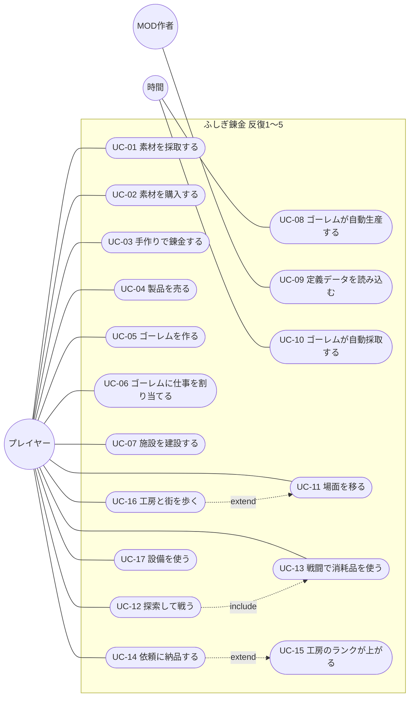

# ユースケース

- 文書 ID: UC-DOC-001
- 版: 0.5（反復 5 の範囲を追加。承認、REV-044、E-98）
- 作成日: 2026-10-14
- 更新日: 2026-10-15
- 対象: [反復 1 計画書](../iterations/it01/plan.md)、[反復 2 計画書](../iterations/it02/plan.md)、[反復 3 計画書](../iterations/it03/plan.md)、[反復 4 計画書](../iterations/it04/plan.md)、[反復 5 計画書](../iterations/it05/plan.md) の範囲。反復ごとに書き足す

## 1. アクター

| アクター | 説明 |
|---|---|
| プレイヤー | ゲームを遊ぶ人 |
| MOD 作者 | 定義データを書いてゲームを拡張する人 |
| 時間 | ゲーム内の時間の経過。ゴーレムの自動生産と自動採取を進める（システム内部のアクター） |

## 2. ユースケース図

- 図の矢印の約束（反復 3 からの書き方）: `-. include .->` と `-. extend .->` は、どちらも基本のユースケースから、含まれる（または拡張する）ユースケースへ向けて書く。UML の extend の矢印（拡張する側から基本の側へ）とは向きが逆なので注意する
- UC-17 の窓の中で行うユースケース（UC-02〜07、UC-14）は、図が込み合うので矢印を引かず、UC-17 の補足に書く

## 3. ユースケース記述

### UC-01 素材を採取する

| 項目 | 内容 |
|---|---|
| アクター | プレイヤー |
| 関連要求 | FR-MAT-01 |
| 事前条件 | 採取地が 1 つ以上定義されている |
| 事後条件 | 採取した素材が在庫に加わっている |

**基本フロー**
1. プレイヤーは採取地を選ぶ
2. システムは、採取地の定義に従って素材の種類と品質を決める（乱数を使う）
3. システムは素材を在庫に加え、手に入れた物を表示する

**代替フロー**
- 2a. 採取地が再使用待ちのとき、システムは残り時間を表示して終了する

### UC-02 素材を購入する

| 項目 | 内容 |
|---|---|
| アクター | プレイヤー |
| 関連要求 | FR-MAT-02, FR-ECO-04 |
| 事前条件 | 店に売り物が定義されている |
| 事後条件 | お金が減り、素材が在庫に加わっている |

**基本フロー**
1. プレイヤーは店の売り物と数を選ぶ
2. システムは代金を計算して表示する
3. プレイヤーは購入を確定する
4. システムはお金を減らし、素材を在庫に加える

**代替フロー**
- 3a. お金が足りないとき、システムは購入できない理由を表示し、確定できないようにする

### UC-03 手作りで錬金する

| 項目 | 内容 |
|---|---|
| アクター | プレイヤー |
| 関連要求 | FR-ALC-01〜04, 06, 08, FR-ITM-01〜05, 07 |
| 事前条件 | 解放済みのレシピがある |
| 事後条件 | 投入した素材が在庫から減り、製品が在庫に加わっている |

**基本フロー**
1. プレイヤーはレシピを選ぶ
2. システムは、レシピの入力枠（必要な素材の種類または属性と数）を表示する
3. プレイヤーは入力枠を選ぶ。システムは、その枠の条件に合う在庫だけを、種類・品質・属性とともに候補として表示する（FR-ALC-08、FR-ITM-07）。プレイヤーは候補から、枠に入れる在庫と数を選ぶ。これを入力枠ごとに繰り返す
4. システムは、予想される品質と、満たしている品質ボーナスの条件を表示する
5. プレイヤーは錬金を確定する
6. システムは素材を在庫から減らし、製品を在庫に加える
7. システムは、できた製品と品質を表示する

**代替フロー**
- 3a. 入力枠の条件に合う在庫が足りないとき、システムは不足を表示し、確定できないようにする
- 5a. プレイヤーが取り消したとき、在庫は変わらない

**補足**
- 錬金の途中と完了の直後に、物語イベントで操作を中断しない（FR-ALC-05）

### UC-04 製品を売る

| 項目 | 内容 |
|---|---|
| アクター | プレイヤー |
| 関連要求 | FR-ECO-01, 02, 03 |
| 事前条件 | 在庫に売れるアイテムがある |
| 事後条件 | アイテムが在庫から減り、お金が増えている |

**基本フロー**
1. プレイヤーは在庫から売るアイテム（種類と品質）と数を選ぶ
2. システムは、品質と街の施設を反映した売値を表示する
3. プレイヤーは売却を確定する
4. システムはアイテムを在庫から減らし、お金を増やす

### UC-05 ゴーレムを作る

| 項目 | 内容 |
|---|---|
| アクター | プレイヤー |
| 関連要求 | FR-GOL-01 |
| 事前条件 | ゴーレムの定義がある |
| 事後条件 | 材料が在庫から減り、未割り当てのゴーレムが 1 体増えている |

**基本フロー**
1. プレイヤーはゴーレムの作成を選ぶ
2. システムは必要な材料と、ゴーレムの所有枠の空きを表示する
3. プレイヤーは作成を確定する
4. システムは材料を在庫から減らし、未割り当てのゴーレムを加える

**代替フロー**
- 3a. 材料が足りない、または所有枠に空きがないとき、システムは理由を表示し、確定できないようにする

### UC-06 ゴーレムに仕事を割り当てる

| 項目 | 内容 |
|---|---|
| アクター | プレイヤー |
| 関連要求 | FR-GOL-02, 03, 04 |
| 事前条件 | ゴーレムが 1 体以上いる |
| 事後条件 | ゴーレムに、レシピと各入力枠に使うアイテムの種類、または採取地が割り当てられている |

**基本フロー**
1. プレイヤーはゴーレムを選ぶ
2. プレイヤーはレシピを選ぶ
3. プレイヤーは、属性で指定された入力枠ごとに、使うアイテムの種類を選ぶ
4. システムは割り当てを記録し、ゴーレムの生産を始める（UC-08）

**代替フロー**
- 2a. プレイヤーが「割り当てを外す」を選んだとき、ゴーレムは作業を中止する。作業中に消費した素材は戻らない
- 2b. プレイヤーがレシピの代わりに採取地を選んだとき、システムは割り当てを記録し、ゴーレムの採取を始める（UC-10）。手順 3 は行わない。レシピの作業中だったときに取り出した素材は戻らない

### UC-07 施設を建設する

| 項目 | 内容 |
|---|---|
| アクター | プレイヤー |
| 関連要求 | FR-TWN-02, FR-ECO-04 |
| 事前条件 | 施設の定義がある |
| 事後条件 | お金と材料が減り、施設の段階が 1 上がり、効果が反映されている |

**基本フロー**
1. プレイヤーは施設を選ぶ
2. システムは、次の段階に必要なお金と材料、効果を表示する
3. プレイヤーは建設を確定する
4. システムはお金と材料を減らし、施設の段階を上げる

**代替フロー**
- 3a. お金や材料が足りない、または最大段階に達しているとき、システムは理由を表示し、確定できないようにする

### UC-08 ゴーレムが自動生産する

| 項目 | 内容 |
|---|---|
| アクター | 時間 |
| 関連要求 | FR-GOL-02, 03, 06, FR-ITM-04 |
| 事前条件 | レシピを割り当てられたゴーレムがいる |
| 事後条件 | 素材が消費され、製品が在庫に加わっている |

**基本フロー**
1. ゴーレムは、割り当てられた入力を在庫から取り出す
2. ゴーレムは、レシピの所要時間だけ作業する
3. 時間が経つと、ゴーレムは製品を在庫に加える。品質は投入した素材の品質の平均（端数切り捨て）とする
4. 1 に戻る

**代替フロー**
- 1a. 在庫に入力が足りないとき、ゴーレムは素材待ちになり、足りた時点で 1 から再開する

### UC-09 定義データを読み込む

| 項目 | 内容 |
|---|---|
| アクター | MOD 作者 |
| 関連要求 | FR-MOD-01, 02, 04 |
| 事前条件 | 本体の定義データがゲームに組み込まれている |
| 事後条件 | 誤りのない定義データがゲームに反映されている |

**基本フロー**
1. MOD 作者は定義データのファイルを書き、所定の場所に置く
2. MOD 作者はゲームを起動する
3. システムは、本体の定義データと追加の定義データを読み込み、検証する
4. システムは、定義された内容でゲームを始める

**代替フロー**
- 3a. 誤りがあるとき、システムはファイル名・位置・理由を表示する。本体の定義データに誤りがある場合は、起動を中止する

### UC-10 ゴーレムが自動採取する

| 項目 | 内容 |
|---|---|
| アクター | 時間 |
| 関連要求 | FR-GOL-04, 06 |
| 事前条件 | 採取地を割り当てられたゴーレムがいる |
| 事後条件 | 採取した素材が在庫に加わっている |

**基本フロー**
1. ゴーレムは、採取地の再使用待ちと同じ時間（ゴーレムの速度で増減する）だけ作業する
2. 時間が経つと、システムは採取地の定義に従って素材の種類と品質を決め（UC-01 と同じ規則）、在庫に加える
3. 1 に戻る

**代替フロー**
- 1a. プレイヤーが割り当てを外したとき、ゴーレムは作業を中止する。途中までの作業で素材は手に入らない

**補足**
- ゴーレムの採取は、プレイヤーの採取（UC-01）の再使用待ちに影響しない（IT02 P-03）
- 1 つの採取地に置けるゴーレムの数は制限しない（IT02 P-04）

### UC-11 場面を移る

| 項目 | 内容 |
|---|---|
| アクター | プレイヤー |
| 関連要求 | IF-06, FR-FLD-03 |
| 事前条件 | 主人公が工房か街の地図の上にいる（UC-16）、または採取地の一覧の画面にいる。戦闘中でない |
| 事後条件 | 出入り口の先の場面が表示されている |

**基本フロー**
1. プレイヤーは、主人公を地図の出入り口（工房の扉、または街の工房の扉）まで歩かせ、出入り口に入る（UC-16）
2. システムは、行き先の地図を表示し、主人公を行き先の地図の出入り口の前に置く。主人公は出入り口から地図の中へ向く
3. お金と時刻は、どの場面でも表示する

**代替フロー**
- 1a. プレイヤーが主人公を街の出口に入れたとき、システムは採取地の一覧の画面を表示する（UC-01、UC-12 はこの画面から行う）
- 1b. 採取地の一覧の画面で、プレイヤーが「街へ戻る」を選んだとき、システムは街の地図を表示し、主人公を街の出口の前に置く
- 1c. 戦闘中は、採取地の一覧の画面に戻るまで、場面を移れない

**補足**
- 反復 4 までの場面のタブはなくす（IT05 P-07）
- 場面を移っても、ゲーム内の時間とゴーレムの作業は止まらない（IT03 P-08）

### UC-12 探索して戦う

| 項目 | 内容 |
|---|---|
| アクター | プレイヤー |
| 関連要求 | FR-BTL-01, 02, 07, 10, FR-MAT-03, IF-07 |
| 事前条件 | 採取地の一覧の画面にいる（UC-11）。戦闘のある採取地がある |
| 事後条件 | 勝てば報酬の素材が在庫に加わっている。負ければ仲間が負傷している |

**基本フロー**
1. プレイヤーは採取地を選び、「探索する」を選ぶ
2. システムは戦闘の画面を表示し、仲間と敵を盤面に置き、行動順を決める
3. 仲間の番では、プレイヤーは仲間を移動させ（しなくてもよい）、攻撃・アイテム（UC-13）・待機のどれかを選ぶ
4. 敵の番では、システムが敵を動かし、攻撃させる。システムは、仲間と敵の行動を 1 つずつ間を置いて見せ、行動したユニットと相手を強調する（IF-07）
5. 3〜4 を、敵か仲間がすべて倒れるまで繰り返す
6. 敵がすべて倒れたら、システムは報酬の素材を決めて在庫に加え、結果を表示する
7. システムは採取地の一覧の画面に戻る

**代替フロー**
- 1a. 仲間が負傷しているとき、システムは残り時間を表示し、探索を始めない
- 3a. 移動や攻撃の先が届かないとき、システムは理由を戦闘の画面の中に表示し、その操作をしない
- 3b. 届く敵がいないとき、システムは攻撃を選べないようにし、移動するか待機で番を終えるよう案内する（IF-07）
- 6a. 仲間がすべて倒れたとき、報酬はなく、仲間は一定時間負傷する（TBD-07 の仮置き: 60 秒）。システムは結果を表示し、7 に進む

### UC-13 戦闘で消耗品を使う

| 項目 | 内容 |
|---|---|
| アクター | プレイヤー |
| 関連要求 | FR-BTL-04, 05, FR-ITM-08, 09, IF-07 |
| 事前条件 | 戦闘中で、仲間の番である。在庫に戦闘で使えるアイテムがある |
| 事後条件 | アイテムが在庫から 1 個減り、効果がユニットに与えられている |

**基本フロー**
1. プレイヤーは、在庫から使うアイテム（種類と品質）を選ぶ
2. システムは、品質に応じた効果（威力と範囲）と、狙えるマスを表示する
3. プレイヤーは、狙うマスを選ぶ
4. システムは、範囲内の該当するユニットに効果を与え、アイテムを在庫から 1 個減らす。その仲間の番は終わる

**代替フロー**
- 1a. そのアイテムで狙える相手がいないとき、システムはそのアイテムを選べないようにし、理由を表示する（IF-07）
- 3a. 狙えないマスを選んだとき、システムは理由を表示し、アイテムを使わない

### UC-14 依頼に納品する

| 項目 | 内容 |
|---|---|
| アクター | プレイヤー |
| 関連要求 | FR-ECO-05, FR-PRG-04 |
| 事前条件 | 依頼板の窓を開いている（UC-17）。依頼板に依頼がある |
| 事後条件 | アイテムが在庫から減り、お金と評判（依頼に評判があれば）が増え、依頼板に新しい依頼が入っている |

**基本フロー**
1. システムは、依頼板に依頼（アイテム、品質の条件、個数、報酬）を表示する
2. プレイヤーは依頼を選び、納品を確定する
3. システムは、条件を満たす在庫を品質の低い順に使ってアイテムを減らし、報酬をお金に、評判を評判の合計に加える
4. 評判が次のランクに届いたら、工房のランクが上がる（UC-15）
5. システムは、その依頼を外し、解放されている依頼から新しい依頼を依頼板に入れる

**代替フロー**
- 2a. 条件を満たす在庫が足りないとき、システムは不足を表示し、納品できないようにする

### UC-15 工房のランクが上がる

| 項目 | 内容 |
|---|---|
| アクター | プレイヤー |
| 関連要求 | FR-PRG-04, FR-ALC-07 |
| 事前条件 | 依頼に納品して、評判が次のランクに要る量に届いた（UC-14 の 4） |
| 事後条件 | 工房のランクが上がり、新しいレシピ・採取地が使えるようになり、新しい依頼が依頼板の候補に入っている |

**基本フロー**
1. システムは工房のランクを上げる
2. システムは、新しく作れるようになったレシピ、行けるようになった採取地、出るようになった依頼を知らせる
3. プレイヤーは、設備の窓（UC-17）と採取地の一覧の画面で、解放された物を使える

**代替フロー**
- 1a. 評判が 2 つ以上先のランクに届いたとき、システムはまとめてランクを上げ、上がったランクごとに知らせる

**補足**
- まだ解放されていないレシピと採取地は、一覧に出さない
- 知らせは短い文だけで、物語のイベントで操作を中断しない（FR-ALC-05）

### UC-16 工房と街を歩く

| 項目 | 内容 |
|---|---|
| アクター | プレイヤー |
| 関連要求 | FR-FLD-01, 02, IF-08 |
| 事前条件 | 主人公が工房か街の地図の上にいる。窓を開いていない |
| 事後条件 | 主人公の位置と向きが変わっている |

**基本フロー**
1. システムは、場面の地図（地形、設備、出入り口）と主人公を表示する
2. プレイヤーは、キーボードの移動のキーで、主人公を動かしたい向き（上下左右と斜め）を押す
3. システムは、押されている間、主人公をその向きへ動かし、主人公の向きを変える
4. 主人公が設備の前でその設備を向いたら、システムは、決定のキーでその設備を使えることを表示する（UC-17）

**代替フロー**
- 3a. 動かす先に壁や設備があるとき、主人公はその手前で止まり、通り抜けない。向きは変わる。斜めに押していて片方の向きだけがふさがっているときは、もう片方の向きにだけ進む
- 3b. 主人公が出入り口に入ったとき、場面を移る（UC-11）

**補足**
- 歩いている間も、ゲーム内の時間とゴーレムの作業は進む（IT05 P-08）
- 時間の倍率（テスト用のチート）を変えても、歩く速さは変わらない（IT05 P-11）

### UC-17 設備を使う

| 項目 | 内容 |
|---|---|
| アクター | プレイヤー |
| 関連要求 | IF-08, IF-01 |
| 事前条件 | 主人公が工房か街の地図の上にいて、設備の前でその設備を向いている。窓を開いていない |
| 事後条件 | 設備の窓を閉じ、主人公は窓を開く前と同じ位置と向きで地図の上にいる |

**基本フロー**
1. プレイヤーは、決定のキー（E かスペース）を押す
2. システムは、その設備の窓を開く（錬金釜: 手作り錬金、在庫の棚: 在庫、ゴーレムの作業台: ゴーレムの作成と割り当て、店: 購入と売却、依頼板: 依頼、施設の看板: 施設の建設）
3. プレイヤーは、窓の中をマウスで操作する（UC-02〜UC-07、UC-14）
4. プレイヤーは、Esc のキーか、窓の「閉じる」を押す
5. システムは窓を閉じ、地図を表示する

**代替フロー**
- 1a. 主人公がどの設備も向いていないとき、決定のキーを押しても何も起きない
- 3a. 窓を開いている間、移動のキーを押しても主人公は動かない

**補足**
- 窓を開いている間も、ゲーム内の時間とゴーレムの作業は進む（IT05 P-08）
- 手順 3 で行うユースケースは、設備ごとに次のとおり。錬金釜: UC-03。在庫の棚: 在庫を見るだけ。ゴーレムの作業台: UC-05、UC-06。店: UC-02、UC-04。依頼板: UC-14。施設の看板: UC-07
- 採取（UC-01）と探索（UC-12）は設備の窓ではなく、採取地の一覧の画面で行う（UC-11 代替フロー 1a）

## 4. 変更履歴

| 版 | 日付 | 内容 |
|---|---|---|
| 0.1 | 2026-10-14 | 初版（反復 1 の範囲） |
| 0.2 | 2026-10-14 | 反復 2 の範囲を追加。UC-10 を追加し、UC-03・UC-06・UC-08 を更新。UC-01 は見直したが変更なし（REV-017） |
| 0.3 | 2026-10-14 | 反復 3 の範囲を追加。UC-11〜14 を追加 |
| 0.4 | 2026-10-15 | 反復 4 の範囲を追加。UC-15 を追加し、UC-12・UC-13・UC-14 を更新（REV-034） |
| 0.5（案） | 2026-10-15 | 反復 5 の範囲を追加。UC-16・UC-17 を追加し、UC-11 を書き直した（タブをなくし、地図の出入り口で場面を移る）。UC-14 の事前条件を依頼板の窓に変えた。REV-044 を反映し、UC-12・UC-15 の言葉を UC-11 にそろえ、UC-17 と UC-02〜07・UC-14 の関係と図の矢印の約束を書いた |
