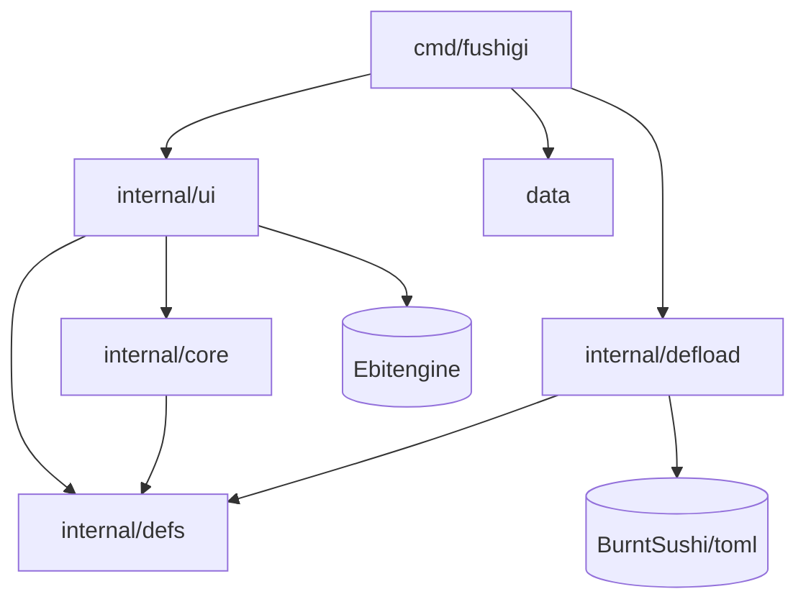
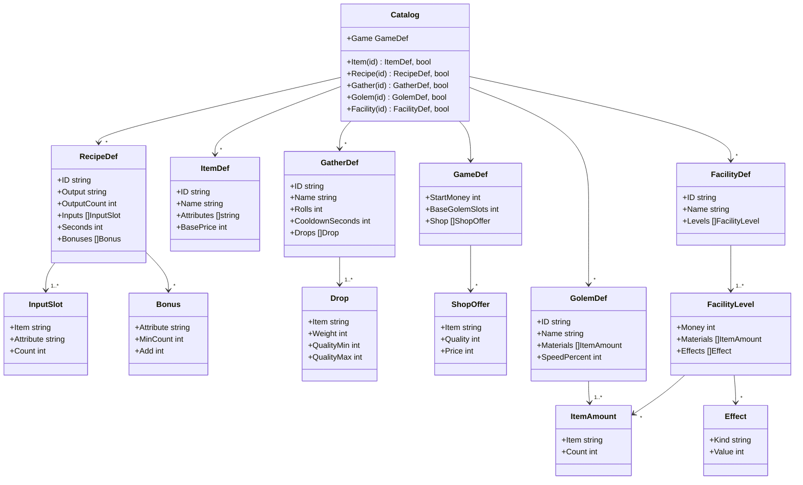
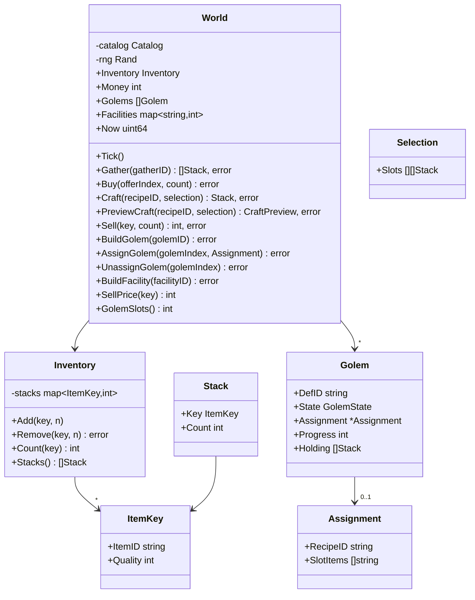
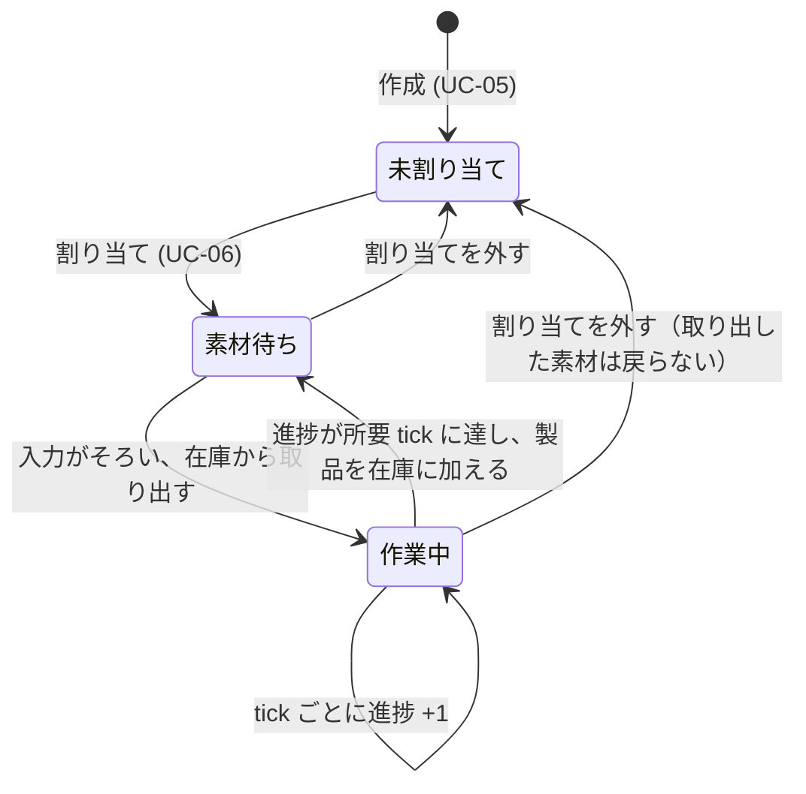
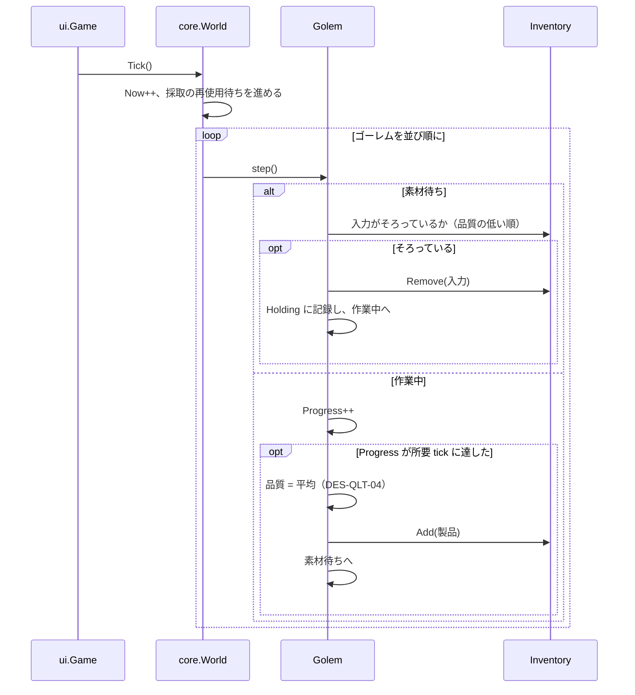
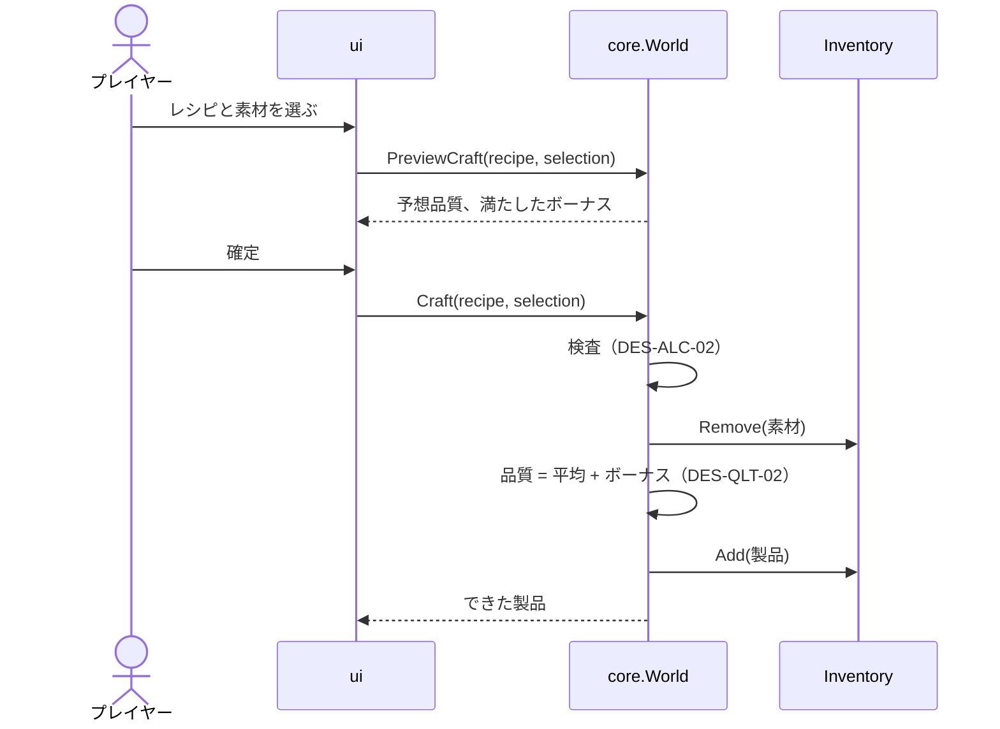

# 設計書（反復 1: プロトタイプ）

- 文書 ID: DES-IT01
- 版: 0.2（承認、REV-003）
- 作成日: 2026-10-14
- 対象: [反復 1 計画書](../iterations/it01/plan.md) の範囲
- 入力: [SRS-001](../02_requirements/srs.md) v0.1、[ユースケース](../02_requirements/use-cases.md)、[ADR-0001](../adr/0001-tech-stack.md)、[ADR-0002](../adr/0002-definition-data-format.md)

反復型の方針（PLAN-001 3 章）に従い、反復 1 で作る範囲だけを設計する。後の反復で書き足す。

## 1. アーキテクチャ

### 1.1 パッケージ構成

| ID | パッケージ | 責務 | 依存してよい先 |
|---|---|---|---|
| DES-PKG-01 | `cmd/fushigi` | 起動。定義データを読み込み、World を作り、UI を動かす | すべて |
| DES-PKG-02 | `internal/defs` | 定義データの型（アイテム、レシピなど）と、ID で引ける目録（Catalog） | なし |
| DES-PKG-03 | `internal/defload` | TOML の読み込みと、意味の検証 | `defs`、TOML ライブラリ |
| DES-PKG-04 | `internal/core` | ゲームの規則と状態（在庫、錬金、ゴーレム、経済、施設、時間） | `defs` |
| DES-PKG-05 | `internal/ui` | Ebitengine による描画と入力。使い捨て前提（IT01 P-02） | `core`、`defs`、Ebitengine |
| DES-PKG-06 | `data` | 本体の定義データ（組み込み MOD）。`go:embed` でバイナリに埋め込む | なし |



- `core` は Ebitengine に依存しない（NFR-04）。依存していないことを、テストで `go list` の結果を調べて自動で確かめる
- `core` は定義データの読み方を知らない。`defs.Catalog` を受け取るだけにして、テストでは Go のコードで目録を組み立てられるようにする

### 1.2 時間のモデル（DES-TIME-01）

- `core` の時間は整数の **tick** で数える。1 秒 = 60 tick とする
- UI は Ebitengine の `Update`（毎秒 60 回）ごとに `World.Tick()` を 1 回呼ぶ。これでリアルタイムに進む（IT01 P-03）
- `core` は実時間（`time.Now`）を使わない。テストでは `Tick()` を必要な回数だけ呼ぶ。これで結果が決まる（NFR-06）
- 乱数は、シードを指定して作った `math/rand/v2` の PCG を World が持つ

## 2. 定義データ（defs）

### 2.1 クラス図



- **入力枠（InputSlot）** は、`Item`（特定のアイテム）か `Attribute`（その属性を持つ任意のアイテム）の**どちらか一方**を指定する（DES-DEF-01）
- 属性は、アイテムの種類ごとに固定する（DES-DEF-02）。個体ごとに変えると、同じ種類・同じ品質をまとめて数える規則（FR-ITM-03）が成り立たなくなるため
- 目録（Catalog）の検索は、定義と「見つかったか」の 2 つを返す。存在しない ID を渡したときに、呼び出し側が `ErrUnknownID` などの誤りを返せるようにするため（DES-DEF-04）
- **ItemAmount** は、アイテムの種類と個数の組。ゴーレムや施設の材料に使い、品質は問わない（DES-GOL-06）
- 効果（Effect）の種類は、コードで決めた固定の一覧から選ぶ（DES-DEF-03）。反復 1 では次の 2 つ

| Kind | 意味 |
|---|---|
| `golem_slots` | ゴーレムの所有枠を Value だけ増やす |
| `sell_rate` | 売値を Value % 上げる |

### 2.2 TOML の例

```toml
# data/base/items.toml
[[item]]
id = "herb"
name = "薬草"
attributes = ["草", "癒し"]
base_price = 10

# data/base/recipes.toml
[[recipe]]
id = "potion"
output = "potion"
output_count = 1
seconds = 5
inputs = [
  { attribute = "草", count = 2 },
  { item = "water", count = 1 },
]
bonuses = [
  { attribute = "癒し", min_count = 2, add = 15 },
]
```

### 2.3 意味の検証規則（defload）

TOML の文法の誤りと未知のキーは、ライブラリの結果をそのまま誤りとして報告する。そのうえで、次の規則を検証する。

| ID | 規則 | 関連要求 |
|---|---|---|
| DES-VAL-01 | 同じ種類の定義の中で、ID が重複しない | FR-MOD-04 |
| DES-VAL-02 | 参照している ID（アイテム、レシピなど）が存在する | FR-MOD-04 |
| DES-VAL-03 | アイテムの属性は 0〜3 個で、重複しない | FR-ITM-01 |
| DES-VAL-04 | 個数・秒数・重みは 1 以上 | FR-MOD-04 |
| DES-VAL-05 | 品質は 1〜200 で、`quality_min <= quality_max` | FR-ITM-02 |
| DES-VAL-06 | 入力枠は `item` と `attribute` のどちらか一方だけを持つ | DES-DEF-01 |
| DES-VAL-07 | 属性で指定した入力枠やボーナスの属性は、どれかのアイテムが持っている | FR-MOD-04 |
| DES-VAL-08 | 効果の種類は既知のもの | DES-DEF-03 |

- 誤りは「ファイル名、キーの経路（例: `recipe[id=potion].inputs[1]`）、理由」の形で、すべて集めてから返す（1 つ目で止めない）
- 本体の定義データに誤りがあれば起動を中止する（UC-09 代替フロー 3a）

## 3. ゲームの規則と状態（core）

### 3.1 クラス図



- 在庫は「アイテムの種類と品質の組（ItemKey）→ 個数」の対応で持つ（FR-ITM-03）（DES-INV-01）
- 状態を変える操作はすべて World のメソッドにする。失敗したときは状態を変えずに、理由が分かる誤り（例: `ErrNotEnoughMoney`）を返す（UC の代替フロー）（DES-WLD-01）

### 3.2 品質の規則（DES-QLT）

| ID | 規則 | 関連要求 |
|---|---|---|
| DES-QLT-01 | **平均品質** = 投入したすべての素材の品質の合計 ÷ 個数（端数切り捨て）。個数で重み付けする | FR-ITM-04 |
| DES-QLT-02 | **手作りの品質** = 平均品質 ＋ 満たしたボーナスの加算値の合計。1〜200 に収める | FR-ALC-04 |
| DES-QLT-03 | **ボーナスの条件**: 投入した素材のうち、その属性を持つ物の個数が `min_count` 以上なら満たす。属性はアイテムの種類から決まる | FR-ALC-04（IT01 P-01 案 c） |
| DES-QLT-04 | **自動品の品質** = 平均品質。ボーナスは付かない | FR-ITM-04 |

計算例（レシピ `potion`: 草 ×2、水 ×1、ボーナス「癒し 2 個以上で +15」）

| 投入 | 平均品質 | ボーナス | 手作り | 自動 |
|---|---|---|---|---|
| 薬草(草・癒し) Q40 ×2、水 Q31 ×1 | (40+40+31) ÷ 3 = 37 | 癒し 2 個 → +15 | 52 | 37 |
| 雑草(草) Q60 ×2、水 Q31 ×1 | (60+60+31) ÷ 3 = 50 | 癒し 0 個 → なし | 50 | 50 |

属性の組み合わせを選ぶと、品質の低い素材からでも手作りで上回れる。これが「手で作る動機」（仮説 H-02）になるかを確かめる。

### 3.3 ゴーレム

#### 状態遷移図（DES-GOL-01）



- 「素材待ち」に入った tick のうちに入力がそろっていれば、同じ tick で「作業中」に移る
- **所要 tick** = レシピの秒数 × 60 × 100 ÷ ゴーレムの `speed_percent`（端数切り上げ、最小 1）（DES-GOL-02）
- 属性で指定された入力枠には、割り当て時に決めたアイテムの種類（`SlotItems`）を使う（DES-GOL-03）
- 同じ種類で品質の違う在庫があるときは、**品質の低いものから**使う（DES-GOL-04）。品質の高い素材を手作り用に残せるようにするため（仮置き。プロトタイプで確かめる）
- World の `Tick()` は、ゴーレムを並び順に 1 体ずつ処理する。順序を固定して、結果が決まるようにする（NFR-06）（DES-GOL-05）

#### シーケンス図: 1 tick の処理



### 3.4 手作りの錬金（DES-ALC）

- `Selection` は、入力枠ごとに「どの在庫（ItemKey）を何個使うか」の並び（DES-ALC-01）
- `Craft` は、次をすべて満たすときだけ実行し、満たさなければ状態を変えずに誤りを返す（DES-ALC-02）
  - 各入力枠の合計個数が枠の `count` と等しい
  - 各在庫が枠の条件（アイテム、または属性）に合う
  - 在庫に十分な数がある
- `PreviewCraft` は同じ検査と品質の計算だけを行い、状態を変えない。UC-03 の手順 4（予想品質の表示）に使う（DES-ALC-03）



### 3.5 経済と施設（DES-ECO, DES-TWN）

| ID | 規則 | 関連要求 |
|---|---|---|
| DES-ECO-01 | **売値**（1 個あたり）= `base_price × (50 + 品質) ÷ 100 × (100 + sell_rate の合計) ÷ 100`（各段階で切り捨て）。品質 50 で基本価格になる。式は仮置き | FR-ECO-02, 03 |
| DES-ECO-02 | 店の売り物（品質と価格が固定）は `[game]` の `shop` に定義する | FR-MAT-02 |
| DES-TWN-01 | 施設は段階（0 = 未建設）を持つ。建設すると段階が 1 上がり、その段階の効果が加わる。効果は段階 1 から現在の段階までを合計する | FR-TWN-02 |
| DES-TWN-02 | ゴーレムの所有枠 = `base_golem_slots` ＋ `golem_slots` 効果の合計 | FR-TWN-02 |
| DES-GOL-06 | ゴーレムの材料は種類と個数で指定し、品質は問わない（品質の低いものから使う） | FR-GOL-01 |

### 3.6 採取（DES-GAT）

- 採取 1 回につき、`rolls` 回だけ抽選する。各回、`drops` から重みに比例してアイテムを選び、品質を `quality_min`〜`quality_max` の一様乱数で決める（DES-GAT-01）
- 採取すると、その採取地は `cooldown_seconds` の間使えない（DES-GAT-02）

## 4. 画面（ui、使い捨て前提）

1 画面に、在庫・お金・採取地・店・レシピ・ゴーレム・施設の一覧を並べ、マウスのクリックで操作する。見た目は四角と文字だけにする。画面の設計書は、プロトタイプの評価の後に作る（反復 1 では作らない）。

## 5. 設計とSRSの対応

| 要求 | 設計要素 |
|---|---|
| FR-ALC-01, 02 | DES-ALC-01, 02, defs.RecipeDef |
| FR-ALC-03 | defs.RecipeDef（同じ `output` のレシピを複数定義できる） |
| FR-ALC-04 | DES-QLT-02, 03 |
| FR-ALC-06 | defs.RecipeDef（入力にも出力にも同じアイテム ID を使える） |
| FR-ITM-01 | DES-DEF-02, DES-VAL-03 |
| FR-ITM-02 | DES-VAL-05、品質を 1〜200 に収める（DES-QLT-02） |
| FR-ITM-03 | DES-INV-01 |
| FR-ITM-04 | DES-QLT-01, 04 |
| FR-ITM-05 | DES-QLT-02, 04（同じ RecipeDef を手作りと自動で共有する） |
| FR-MAT-01 | DES-GAT-01, 02 |
| FR-MAT-02 | DES-ECO-02 |
| FR-ECO-01, 02, 03 | DES-ECO-01 |
| FR-ECO-04 | World.Buy, World.BuildFacility |
| FR-TWN-02 | DES-TWN-01, 02 |
| FR-GOL-01 | World.BuildGolem, DES-GOL-06 |
| FR-GOL-02, 03 | DES-GOL-01, 03, 04 |
| FR-GOL-06 | DES-TIME-01, DES-GOL-05 |
| FR-MOD-01, 02 | DES-PKG-03, 06 |
| FR-MOD-04 | DES-VAL-01〜08 |
| NFR-04 | DES-PKG-04（依存の自動検査） |
| NFR-06 | DES-TIME-01, DES-GOL-05 |

## 6. この設計で仮置きした事項

プロトタイプで確かめ、振り返りで見直す。DES-GOL-04・DES-ECO-01・DES-DEF-02 はレビューで承認済み（REV-002）。

| ID | 仮置きの内容 |
|---|---|
| DES-QLT-02, 03 | 手作りの品質ボーナスの仕組み（属性の組み合わせ） |
| DES-GOL-04 | ゴーレムは品質の低い素材から使う |
| DES-ECO-01 | 売値の式 |
| DES-GAT-01 | 採取は即時で、再使用待ちがある |

## 7. 変更履歴

| 版 | 日付 | 内容 |
|---|---|---|
| 0.1 | 2026-10-14 | 初版（REV-002 で承認） |
| 0.2 | 2026-10-14 | 目録の検索の戻り値に「見つかったか」を追加（DES-DEF-04）、ItemAmount を明記（REV-003） |
