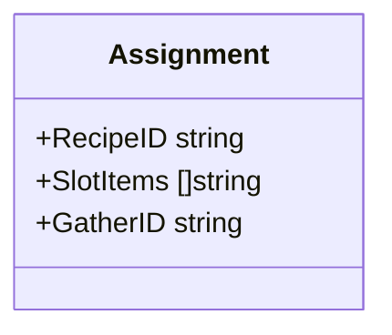
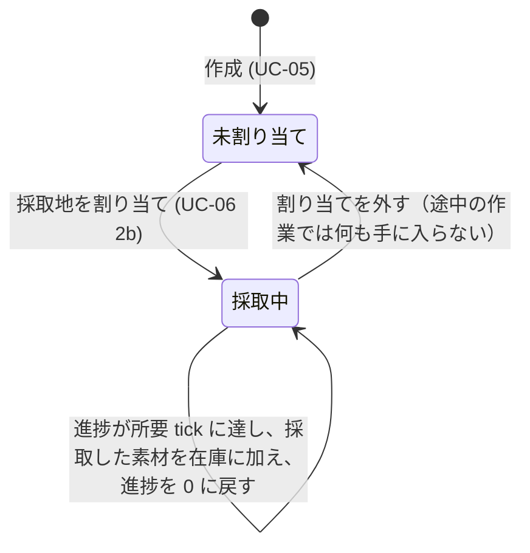

# 設計書（反復 2: 素材の自動採取と錬金画面の改善）

- 文書 ID: DES-IT02
- 版: 0.1（ドラフト。開発者の承認待ち）
- 作成日: 2026-10-14
- 対象: [反復 2 計画書](../iterations/it02/plan.md) の範囲
- 入力: [SRS-001](../02_requirements/srs.md) v0.2、[ユースケース](../02_requirements/use-cases.md) v0.2、[設計書（反復 1）](design-it01.md) v0.3

反復 1 の設計書（DES-IT01）に書き足す形で、反復 2 で変える点だけを書く。ここに書いていない規則は DES-IT01 のまま使う。

## 1. ゴーレムの自動採取（FR-GOL-04）

### 1.1 割り当て（DES-GOL-07）

`Assignment` に採取地の ID（`GatherID`）を足す。1 体のゴーレムは、錬金か採取のどちらか一方をする（IT02 P-01）。

- `GatherID` が空でなければ採取の割り当て、空ならレシピの割り当てとする
- `AssignGolem` は、次のときに状態を変えずに誤りを返す（DES-WLD-01）
  - `GatherID` と `RecipeID` の両方が空でない、または `GatherID` があるのに `SlotItems` が空でない（`ErrInvalidSelection`）
  - `GatherID` が目録にない（`ErrUnknownID`）
- レシピの割り当ての検査は DES-GOL-03 のまま

### 1.2 状態遷移（DES-GOL-08）

採取のゴーレムは素材を待たないので、「素材待ち」を通らない。

- 状態の値は、レシピのゴーレムと同じ `GolemWorking` を使う（新しい状態を足さない）
- **所要 tick** = 採取地の `cooldown_seconds` × 60 × 100 ÷ ゴーレムの `speed_percent`（端数切り上げ、最小 1）。DES-GOL-02 の式で、レシピの秒数の代わりに再使用待ちの秒数を使う（IT02 P-02）
- 所要 tick に達した tick のうちに採取し、進捗を 0 に戻して次の採取を始める

### 1.3 採取の規則（DES-GAT-03）

- 手に入る物と品質は、プレイヤーの採取と同じ規則（DES-GAT-01）で、World のシード付きの乱数で決める（IT02 P-02、NFR-06）
- ゴーレムの採取は、採取地の再使用待ち（DES-GAT-02）を確かめず、更新もしない（IT02 P-03）
- 1 つの採取地に割り当てられるゴーレムの数は制限しない（IT02 P-04）
- 抽選の処理は、プレイヤーの採取（`World.Gather`）とゴーレムの採取で共通の関数にする
- 在庫に加えられなかったとき（個数のあふれなど）は、在庫と乱数の状態を変えず、進捗を所要 tick のままにして、次の tick にやり直す（DES-WLD-01 と同じ考え方）

### 1.4 1 tick の処理の順序

DES-GOL-05 のとおり、ゴーレムを並び順に 1 体ずつ処理する。採取のゴーレムが手に入れた素材は、同じ tick のうちに、並び順で後ろにいるレシピのゴーレムが使える。順序が固定なので、同じシードなら結果は同じになる（NFR-06）。

## 2. 錬金の素材選び（FR-ALC-08、FR-ITM-07）

### 2.1 入力枠の候補（DES-ALC-04）

`World.SlotCandidates(recipeID, slotIndex) ([]Stack, error)` を足す。

- 在庫のうち、指定した入力枠の条件（アイテム、または属性）に合うものを、在庫の並び順（DES-INV-01）で返す。状態は変えない
- 条件の判定は、`Craft` の検査（DES-ALC-02）と同じ関数を使う。候補に出た物は、その枠の条件で必ず `Craft` に通る
- `slotIndex` は `Selection.Slots` と同じく 0 始まりとする。レシピがない、または枠の番号が範囲外なら `ErrUnknownID` を返す（誤り文に出す番号は 1 始まり。#21 に合わせる）

### 2.2 属性の表示（DES-ITM-01）

- アイテムの属性は、定義データの `attributes`（DES-DEF-02）をそのまま表示する。core に新しい規則は足さない
- 属性を持たないアイテムは「属性なし」と表示する

## 3. 画面（ui、使い捨て前提）（DES-UI-01〜05）

反復 2 で触る部分だけを決める。見た目は四角と文字のまま。

| ID | 画面の決まり | 関連 |
|---|---|---|
| DES-UI-01 | 錬金では、レシピを選んだあと入力枠を選ぶと、その枠の候補（DES-ALC-04）だけを一覧に出す。候補をクリックすると、その枠に 1 個入れる | FR-ALC-08、UC-03 |
| DES-UI-02 | 在庫の一覧と錬金の候補の一覧では、各行に種類・品質・個数・属性を表示する | FR-ITM-07 |
| DES-UI-03 | 在庫の一覧のクリックは「売る物の選択」だけにする。錬金の枠への追加は、DES-UI-01 の候補一覧からだけ行う | 振り返り 6 章 |
| DES-UI-04 | ゴーレムの割り当てでは、レシピの一覧に加えて採取地の一覧から選べる。ゴーレムの一覧には、割り当て先（レシピ名または採取地名）と進捗を表示する | FR-GOL-04、UC-06 |
| DES-UI-05 | 一覧（在庫、レシピ、ゴーレム、採取地）は、表示しきれないときにページ送りする。レシピの一覧の方式（反復 1）に合わせる。画面と誤り文には内部 ID を出さず表示名を使い、番号は 1 始まりにする | 振り返り 6 章 |

## 4. 設計と SRS の対応（反復 2 の追加分）

| 要求 | 設計要素 |
|---|---|
| FR-GOL-04 | DES-GOL-07, 08, DES-GAT-03, DES-UI-04 |
| FR-ALC-08 | DES-ALC-04, DES-UI-01, 03 |
| FR-ITM-07 | DES-ITM-01, DES-UI-02 |

## 5. この設計で仮置きした事項

| ID | 仮置きの内容 |
|---|---|
| DES-GOL-08 | 採取の所要時間を、採取地の再使用待ちと同じにする（IT02 P-02） |
| DES-GAT-03 | ゴーレムの採取は、品質がプレイヤーの採取と同じで、再使用待ちに縛られない（IT02 P-02、P-03） |

## 6. 変更履歴

| 版 | 日付 | 内容 |
|---|---|---|
| 0.1 | 2026-10-14 | 初版 |
