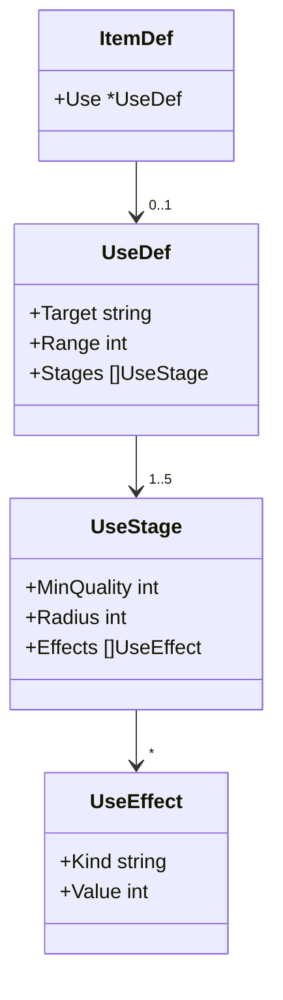
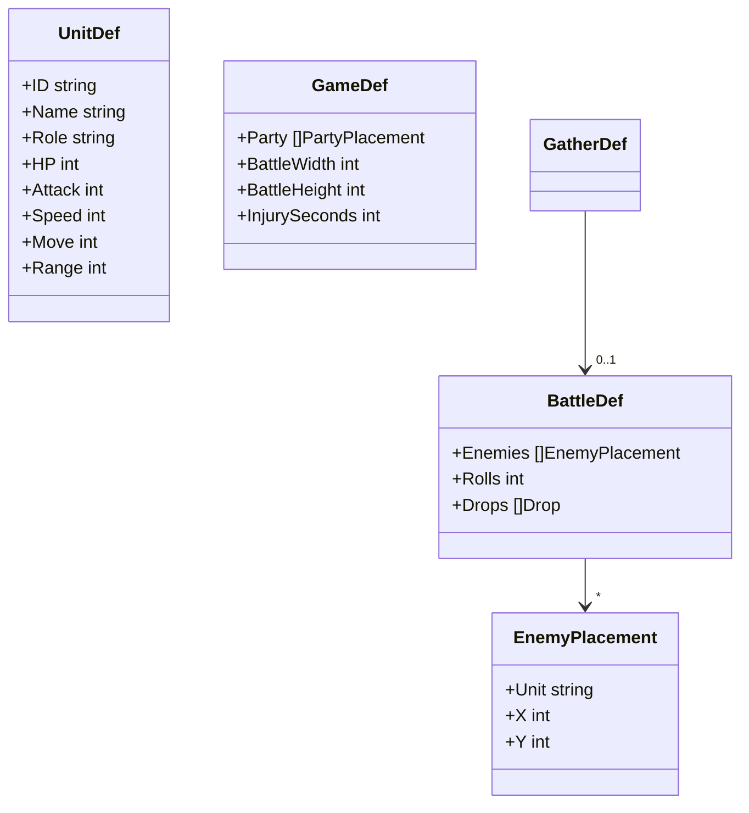
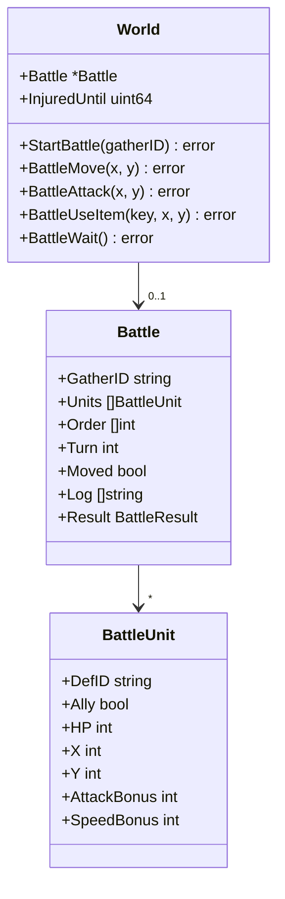
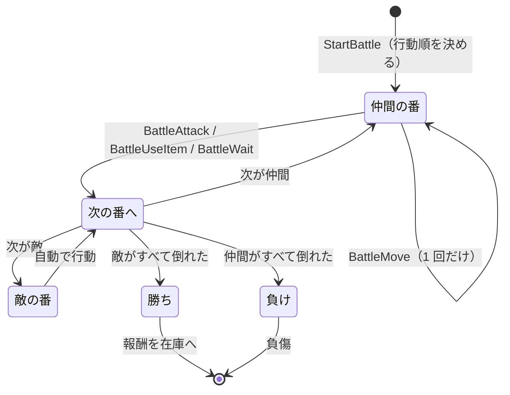
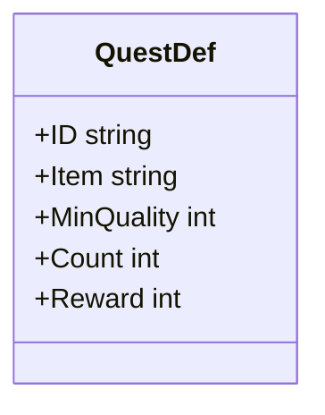

# 設計書（反復 3: 品質が効く小さな戦闘と依頼、場面ごとの画面）

- 文書 ID: DES-IT03
- 版: 0.1（ドラフト。開発者の承認待ち）
- 作成日: 2026-10-14
- 対象: [反復 3 計画書](../iterations/it03/plan.md) の範囲
- 入力: [SRS-001](../02_requirements/srs.md) v0.3、[ユースケース](../02_requirements/use-cases.md) v0.3、[設計書（反復 1）](design-it01.md) v0.3、[設計書（反復 2）](design-it02.md) v0.2

反復 1・2 の設計書に書き足す形で、反復 3 で増やす点だけを書く。ここに書いていない規則は、前の設計書のまま使う。

## 1. 品質による効果（FR-ITM-08、09）

### 1.1 使用の定義（DES-DEF-05）

戦闘で使えるアイテムは、`ItemDef` に `Use`（使用の定義）を持つ。`Use` がないアイテムは戦闘で使えない。

| 項目 | 意味 |
|---|---|
| `Target` | 狙う相手。`ally`（仲間のいるマス）か `enemy`（敵のいるマス） |
| `Range` | 使う仲間から狙うマスまでの距離の上限（マンハッタン距離。0 なら自分だけ） |
| `Stages` | 品質の段階ごとの効果。`MinQuality` は 1・50・100・150・200 のどれかで、1 の段階（基本の効果）が必ずある |
| `Radius` | 効果の範囲。狙ったマスからのマンハッタン距離。0 なら狙ったマスだけ、1 なら周囲 4 マスも |
| `Effects` | 効果。`Kind` は `heal`（体力を回復）、`damage`（体力を減らす）、`attack_up`（攻撃力を上げる）、`speed_up`（素早さを上げる） |

### 1.2 効果の決め方（DES-QLT-05）

品質 q のアイテムを使ったときの効果は、次のとおり決める。

1. `MinQuality` が q 以下の段階を、すべて選ぶ（品質 50 未満でも、`MinQuality` = 1 の基本の段階は必ず選ばれる。IT03 P-02）
2. 選んだ段階の `Effects` をすべて足し合わせる。同じ `Kind` が複数あれば値を合計する
3. 範囲は、選んだ段階の `Radius` の最大値とする
4. 各効果の値は **値 × q ÷ 100（切り捨て、最小 1）** とする（IT03 P-01）。品質が上がるほど、威力は連続的に上がる

計算例（爆弾。`Target` = `enemy`、`Range` = 3）

| 段階の定義 | 品質 20 | 品質 60 | 品質 120 |
|---|---|---|---|
| `MinQuality` 1: `Radius` 0、`damage` 40 | 選ぶ | 選ぶ | 選ぶ |
| `MinQuality` 50: `Radius` 1 | — | 選ぶ | 選ぶ |
| `MinQuality` 100: `damage` 20 | — | — | 選ぶ |
| 結果 | 範囲 0（1 マス）、ダメージ 40 × 20 ÷ 100 = 8 | 範囲 1（5 マス）、ダメージ 40 × 60 ÷ 100 = 24 | 範囲 1、ダメージ (40 + 20) × 120 ÷ 100 = 72 |

計算例（ハンバーガー。`Target` = `ally`、`Range` = 1）

| 段階の定義 | 品質 30 | 品質 100 | 品質 160 |
|---|---|---|---|
| `MinQuality` 1: `heal` 30 | 回復 9 | 回復 30 | 回復 48 |
| `MinQuality` 100: `attack_up` 5 | — | 攻撃 +5 | 攻撃 +8 |
| `MinQuality` 150: `speed_up` 3 | — | — | 素早さ +4 |

- 効果の決め方は core の関数 `UseEffectOf(item, quality)` にまとめ、戦闘の処理と画面の表示（DES-UI-09）の両方で使う
- `attack_up` と `speed_up` は、その戦闘が終わるまで続き、重ねて使うと足し合わされる
- `heal` は最大体力を超えない。`damage` で体力が 0 以下になったユニットは倒れる（盤面から除く）

## 2. 戦闘（FR-BTL-01、02、04、05、07、10）

### 2.1 定義データ（DES-DEF-06）

- 仲間と敵は同じ `UnitDef` で定義し、`Role` で区別する（`front` = 前衛、`back` = 後衛、`enemy` = 敵）（FR-BTL-02）
- 戦闘は採取地ごとに定義する（`GatherDef.Battle`）。`Battle` がない採取地では探索できない
- 仲間の顔ぶれと初期位置、盤面の大きさ（8 × 6）、負傷の秒数（60）は `GameDef` に書く
- `Drops` は採取の `Drops` と同じ形で、勝ったときの報酬を決める。採取地の採取より品質の高い範囲にする（IT03 P-03）

### 2.2 戦闘の状態（DES-BTL-01）

- 戦闘中は `World.Battle` が nil でない。戦闘は tick ではなく、プレイヤーの操作で進む。戦闘中も `World.Tick()` は進み、ゴーレムは動く（IT03 P-08）
- 状態を変える操作が失敗したら、状態を変えずに誤りを返す（DES-WLD-01）。誤り文は表示名を使う（DES-WLD-02）

### 2.3 戦闘の流れ（DES-BTL-02）

- **開始**（`StartBattle`）: 次のときは誤りを返す。戦闘中、`Now < InjuredUntil`（負傷中）、採取地に `Battle` がない。開始すると、仲間を `Party` の位置に、敵を `Enemies` の位置に置く
- **行動順**: 戦闘の最初と、全員が 1 回ずつ行動するたびに（これを 1 巡とする）、生きているユニットを「素早さ（`Speed` ＋ `SpeedBonus`）の高い順。同じなら仲間が先、さらに同じなら置いた順」に並べ直す
- **仲間の番**: プレイヤーは、移動（`BattleMove`）を 0 回か 1 回したあと、攻撃・アイテム・待機のどれか 1 つをする。それで番が終わる
  - 移動: 今の位置からマンハッタン距離 `Move` 以内で、盤面の中の、誰もいないマスへ。途中のマスに誰がいても通れる（経路は考えない）
  - 攻撃: 距離 `Range` 以内の敵に、`Attack` ＋ `AttackBonus` のダメージを与える
  - アイテム: 在庫のアイテム（種類と品質）を 1 個使う（FR-BTL-04）。狙うマスは `Use.Target` と `Use.Range` を満たす。効果は DES-QLT-05 で決め、範囲内の該当するユニット（`ally` なら仲間、`enemy` なら敵）に与える。使ったアイテムは在庫から 1 個減る（IT03 P-05）
- **敵の番**（DES-BTL-03）: 敵は自動で、次の順に動く
  1. いちばん近い仲間（マンハッタン距離。同じなら行動順で先の仲間）を狙う
  2. すでに `Range` 以内なら移動しない。そうでなければ、`Move` 以内の空いたマスのうち、狙う仲間に最も近いマスへ移る（同じなら、y の小さい順、次に x の小さい順）
  3. `Range` 以内に入れば攻撃する
- 敵の番は、プレイヤーの操作のあとに続けて処理し、次の仲間の番か、戦闘の終わりまで進める。敵の動きに乱数は使わない（NFR-06）
- **勝ち**: 報酬を採取と同じ規則（DES-GAT-01）で `Drops` から抽選し、在庫に加える（IT03 P-03）。`Battle` を nil に戻す
- **負け**: 報酬はない。`InjuredUntil` = `Now` ＋ `InjurySeconds` × 60 とし、`Battle` を nil に戻す（IT03 P-06、TBD-07 の仮置き）

計算例（行動順）: 剣士（素早さ 5）、術士（7）、スライム A（4）、オオカミ（8）なら、オオカミ → 術士 → 剣士 → スライム A の順。術士にハンバーガー（品質 160、素早さ +4）を使うと、次の巡からは術士（11）→ オオカミ（8）→ 剣士 → スライム A になる。

### 2.4 負傷（DES-BTL-04）

- 負けると、`InjuredUntil` まで探索できない（`StartBattle` が誤りを返す）。回復薬では治らない（IT03 P-06）
- 負傷の残り時間は、採取の再使用待ちと同じく秒に切り上げて表示する

## 3. 依頼（FR-ECO-05）

### 3.1 定義データ（DES-DEF-07）

- 依頼の候補は `quests.toml` に書く。`Reward` はお金
- 報酬の目安は、同じ物を品質 `MinQuality` で売った代金より多くする（IT03 P-07）。この目安は定義データを作る人の指針で、検証はしない

### 3.2 依頼板（DES-QST-01）

- `World.Quests` は依頼板で、最大 3 件の依頼（`QuestDef` の ID）を持つ
- 依頼の抽選には、`World` の乱数とは別の乱数列（同じシードから作る）を使う。採取や戦闘の報酬の乱数の並びを変えないため（NFR-06）
- `NewWorld` で、候補から重なりなく 3 件を選ぶ（候補が 3 件より少なければ全部）
- 納品すると、その依頼を外し、そのときに板にない候補から 1 件を選んで同じ位置に入れる。候補が残っていなければ空のままにする

### 3.3 納品（DES-QST-02）

`World.Deliver(index) error` を足す。

- 在庫のうち、依頼のアイテムで品質が `MinQuality` 以上のものを、**品質の低い順に** `Count` 個使う（高品質の物を残すため。DES-GOL-04 と同じ考え方）
- 足りなければ、状態を変えずに `ErrNotEnoughItems` を返す
- 納品すると、アイテムを在庫から減らし、`Reward` をお金に加え、依頼板を入れ替える（DES-QST-01）

## 4. 画面（ui）（IF-06、DES-UI-06〜10）

反復 1・2 の画面（1 画面）を、場面ごとの画面に分ける。見た目は図形と文字のまま。

| ID | 画面の決まり | 関連 |
|---|---|---|
| DES-UI-06 | 画面の上に、場面のタブ（工房・街・採取地）を常に出し、クリックで切り替える。戦闘中はタブを押せない。お金、時刻、時間の倍率、操作の結果は、どの場面でも上に出す | IF-06、IT03 P-08 |
| DES-UI-07 | **工房**: 手作り錬金（候補の一覧を含む）、ゴーレムの作成と割り当て、在庫。**街**: 店、施設、依頼板、在庫（売る物の選択と売却）。**採取地**: 採取地ごとに「採取」と「探索」（戦闘の開始）。負傷中は「探索」を押せず、残り秒数を出す | IF-06、UC-01〜08、UC-12、UC-14 |
| DES-UI-08 | **戦闘**: 8 × 6 の盤面に、ユニットを名前の頭文字と体力で描く。今の番のユニットを強調する。右側に、今の番の仲間の能力、操作のボタン（移動・攻撃・アイテム・待機）、使えるアイテムの一覧、戦闘の記録を出す。移動・攻撃・アイテムは、ボタンを選んでから盤面のマスをクリックする。届くマスは色を変える | FR-BTL-01、04、UC-12、UC-13 |
| DES-UI-09 | 使えるアイテムは、在庫と戦闘のアイテムの一覧で、品質に応じた効果（例:「回復 9」「範囲 1・ダメージ 24」）を DES-QLT-05 で求めて表示する | FR-ITM-08、09 |
| DES-UI-10 | 戦闘が終わったら、勝ち負けと報酬（または負傷の時間）を出し、採取地の場面に戻る | UC-12 |

## 5. 設計と SRS の対応（反復 3 の追加分）

| 要求 | 設計要素 |
|---|---|
| FR-ITM-08 | DES-QLT-05（値 × 品質 ÷ 100） |
| FR-ITM-09 | DES-DEF-05、DES-QLT-05（段階と範囲） |
| FR-BTL-01 | DES-BTL-01、02、DES-UI-08 |
| FR-BTL-02 | DES-DEF-06（`Role`） |
| FR-BTL-04 | DES-BTL-02（アイテム） |
| FR-BTL-05 | DES-QLT-05 |
| FR-BTL-07 | DES-BTL-04 |
| FR-BTL-10 | DES-BTL-02（開始）、DES-UI-07 |
| FR-ECO-05 | DES-DEF-07、DES-QST-01、02 |
| IF-06 | DES-UI-06、07 |
| NFR-06 | DES-BTL-03（敵の動きに乱数を使わない）、DES-QST-01（別の乱数列） |

## 6. 定義データの検証（defload）

DES-VAL-01〜08 に、次を足す。

| ID | 規則 | 関連要求 |
|---|---|---|
| DES-VAL-09 | `Use` の `Target` は `ally` か `enemy`、`Range` と `Radius` は 0 以上、`Kind` は既知のもの、効果の値は 1 以上 | FR-ITM-09 |
| DES-VAL-10 | `Use` の段階の `MinQuality` は 1・50・100・150・200 のどれかで、重複せず、1 の段階がある | FR-ITM-09 |
| DES-VAL-11 | ユニットの `Role` は `front`・`back`・`enemy` のどれか。`HP`・`Attack`・`Speed`・`Move`・`Range` は 1 以上 | FR-BTL-02 |
| DES-VAL-12 | 仲間と敵の初期位置は盤面の中で、重ならない。`Party` のユニットは `front` か `back`、`Enemies` のユニットは `enemy` | FR-BTL-01 |
| DES-VAL-13 | 依頼の `MinQuality` は 1〜200、`Count` と `Reward` は 1 以上 | FR-ECO-05 |

## 7. この設計で仮置きした事項

| ID | 仮置きの内容 |
|---|---|
| DES-QLT-05 | 効果の値は「値 × 品質 ÷ 100」。序盤（品質 20 前後）でも戦えるかは、定義データの値で調整する |
| DES-BTL-02 | 移動は経路を考えない。撤退はない |
| DES-BTL-03 | 敵は近い仲間に寄って攻撃するだけ |
| DES-BTL-04 | 負傷は 60 秒で治る（TBD-07 の仮置き） |
| DES-QST-01 | 依頼板は 3 件。候補から重なりなく選ぶ |

## 8. 変更履歴

| 版 | 日付 | 内容 |
|---|---|---|
| 0.1 | 2026-10-14 | 初版 |
