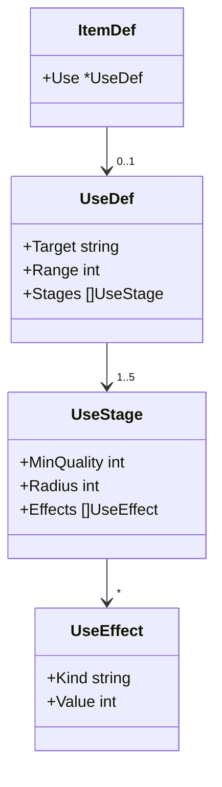
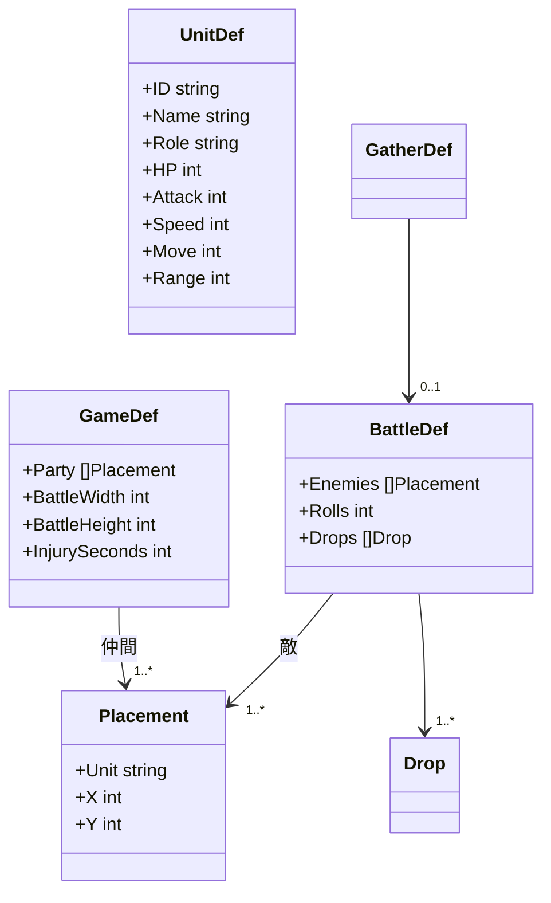
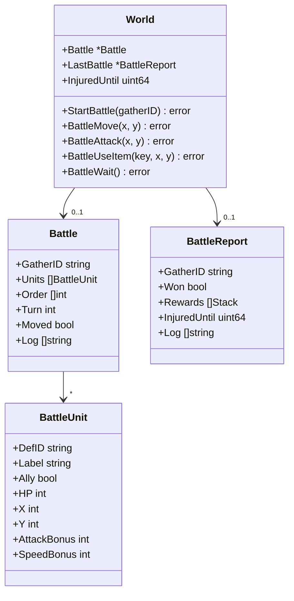
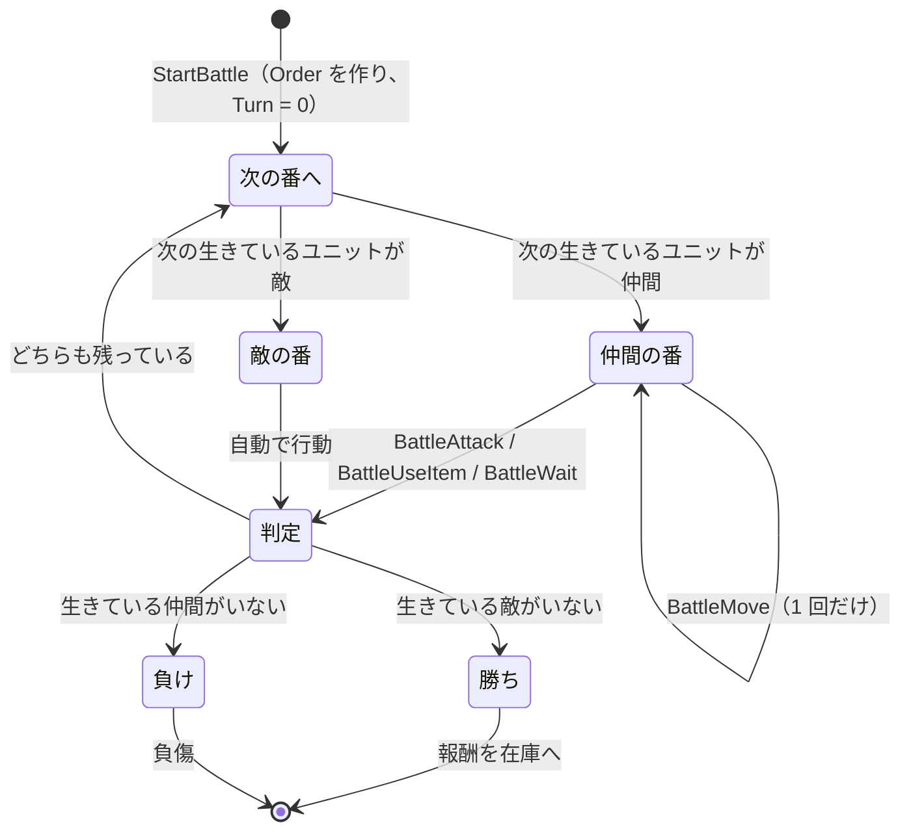

# 設計書（反復 3: 品質が効く小さな戦闘と依頼、場面ごとの画面）

- 文書 ID: DES-IT03
- 版: 0.2（REV-024 の指摘を反映。開発者の承認待ち）
- 作成日: 2026-10-14
- 対象: [反復 3 計画書](../iterations/it03/plan.md) の範囲
- 入力: [SRS-001](../02_requirements/srs.md) v0.3、[ユースケース](../02_requirements/use-cases.md) v0.3、[設計書（反復 1）](design-it01.md) v0.3、[設計書（反復 2）](design-it02.md) v0.2

反復 1・2 の設計書に書き足す形で、反復 3 で増やす点だけを書く。ここに書いていない規則は、前の設計書のまま使う。

## 1. 品質による効果（FR-ITM-08、09）

### 1.1 使用の定義（DES-DEF-05）

戦闘で使えるアイテムは、`ItemDef` に `Use`（使用の定義）を持つ。`Use` がないアイテムは戦闘で使えない。



| 項目 | 意味 |
|---|---|
| `Target` | 狙う相手。`ally`（仲間のいるマス）か `enemy`（敵のいるマス） |
| `Range` | 使う仲間から狙うマスまでの距離の上限（マンハッタン距離）。`ally` なら 0 以上（0 は自分だけ）、`enemy` なら 1 以上 |
| `Stages` | 品質の段階ごとの効果。`MinQuality` は 1・50・100・150・200 のどれかで重複しない。`MinQuality` = 1 の段階（基本の段階）が必ずあり、その `Effects` は 1 個以上 |
| `Radius` | 効果の範囲。狙ったマスからのマンハッタン距離。0 なら狙ったマスだけ、1 なら周囲 4 マスも |
| `Effects` | 効果。`Kind` は `heal`（体力を回復）、`damage`（体力を減らす）、`attack_up`（攻撃力を上げる）、`speed_up`（素早さを上げる）。`Value` は 1 以上 |

```toml
# data/base/items.toml（例。値は 7 章の目安による）
[[item]]
id = "bomb"
name = "爆弾"
attributes = ["鉱石", "発光"]
base_price = 30
[item.use]
target = "enemy"
range = 3
stages = [
  { min_quality = 1, radius = 0, effects = [{ kind = "damage", value = 40 }] },
  { min_quality = 50, radius = 1 },
  { min_quality = 100, effects = [{ kind = "damage", value = 20 }] },
]
```

### 1.2 効果の決め方（DES-QLT-05）

品質 q のアイテムを使ったときの効果は、次のとおり決める。

1. `MinQuality` が q 以下の段階を、すべて選ぶ（品質 50 未満でも、基本の段階は必ず選ばれる。IT03 P-02、E-81）
2. 選んだ段階の `Effects` をすべて足し合わせる。同じ `Kind` が複数あれば値を合計する
3. 範囲は、選んだ段階の `Radius` の最大値とする
4. 各効果の値は **合計した値 × q ÷ 100（切り捨て、最小 1）** とする（IT03 P-01）。品質が上がるほど、威力は連続的に上がる

計算例（爆弾。上の TOML の定義）

| | 品質 20 | 品質 60 | 品質 120 |
|---|---|---|---|
| 選ぶ段階 | 1 | 1、50 | 1、50、100 |
| 範囲 | 0（1 マス） | 1（5 マス） | 1（5 マス） |
| ダメージ | 40 × 20 ÷ 100 = 8 | 40 × 60 ÷ 100 = 24 | (40 + 20) × 120 ÷ 100 = 72 |

計算例（ハンバーガー。`Target` = `ally`、`Range` = 1。基本の段階に `heal` 30、100 の段階に `attack_up` 5、150 の段階に `speed_up` 3）

| | 品質 30 | 品質 100 | 品質 160 |
|---|---|---|---|
| 効果 | 回復 9 | 回復 30、攻撃 +5 | 回復 48、攻撃 +8、素早さ +4 |

- 効果の決め方は core の関数 `UseEffectOf(item, quality)` にまとめ、戦闘の処理と画面の表示（DES-UI-09）の両方で使う
- `attack_up` と `speed_up` は、その戦闘が終わるまで続き、重ねて使うと足し合わされる
- `heal` は最大体力を超えない。倒れたユニット（2.2 節）には効かない

## 2. 戦闘（FR-BTL-01、02、04、05、07、10、FR-MAT-03 の一部）

### 2.1 定義データ（DES-DEF-06）



- 仲間と敵は同じ `UnitDef` で定義し、`Role` で区別する（`front` = 前衛、`back` = 後衛、`enemy` = 敵）（FR-BTL-02）
- `Catalog` に `Units`（`units.toml` の `[[unit]]`）と `Quests`（3.1 節）を足し、`Unit(id)`・`Quest(id)` で引く（DES-DEF-04 と同じ形）
- 戦闘は採取地ごとに `[gather.battle]` で定義する。`Battle` がない採取地では探索できない
- 仲間の顔ぶれと初期位置（`party`）、盤面の大きさ（`battle_width` = 8、`battle_height` = 6）、負傷の秒数（`injury_seconds` = 60）は `[game]` に書く
- 座標は左上を (0, 0) とし、x は右へ、y は下へ増える
- `Drops` は採取の `Drops` と同じ形で、勝ったときの報酬を決める。採取地の採取より品質の高い範囲にする（IT03 P-03）

```toml
# data/base/units.toml（例）
[[unit]]
id = "swordsman"
name = "剣士"
role = "front"
hp = 30
attack = 6
speed = 5
move = 2
range = 1

# data/base/game.toml（追加分の例）
battle_width = 8
battle_height = 6
injury_seconds = 60
party = [{ unit = "swordsman", x = 1, y = 2 }, { unit = "mage", x = 0, y = 3 }]

# data/base/gathers.toml（追加分の例）
[gather.battle]
rolls = 2
enemies = [{ unit = "slime", x = 6, y = 2 }, { unit = "slime", x = 6, y = 4 }]
drops = [{ item = "herb", weight = 1, quality_min = 40, quality_max = 90 }]
```

### 2.2 戦闘の状態（DES-BTL-01）



- 戦闘中は `World.Battle` が nil でない。戦闘は tick ではなく、プレイヤーの操作で進む。戦闘中も `World.Tick()` は進み、ゴーレムは動く（IT03 P-08）
- `Units` の並びは、`Party` の順、次に `Enemies` の順とする（これを「置いた順」とする）。毎回の戦闘は、体力が最大、強化（`AttackBonus`・`SpeedBonus`）が 0 で始まる
- `Label` は記録と画面に出す名前。同じ名前の敵が 2 体以上いるときは、置いた順に「スライム 1」「スライム 2」とする
- **倒れたユニット**: 体力が 0 以下になったら HP を 0 にする。`Units` からは消さない。倒れたユニットはマスを占めず、狙えず、行動順では飛ばす
- `Order` は今の巡の行動順（`Units` の添字の並び）、`Turn` は `Order` の中の今の番の位置
- 戦闘が終わると `Battle` を nil に戻し、結果を `LastBattle` に残す。ui は `LastBattle` から勝ち負け、報酬、負傷、記録を読む（DES-UI-10）。`LastBattle` は次の `StartBattle` で置き換わる
- 戦闘中も、core は他の操作（売る、納品する、錬金する など）を止めない。戦闘中に場面を移れないようにするのは ui の役目（DES-UI-06）

### 2.3 戦闘の流れ（DES-BTL-02）



- **開始**（`StartBattle`）: 次の順に検査し、最初に見つかった誤りを、状態を変えずに返す。採取地が目録にない（`ErrUnknownID`）→ 採取地に `Battle` がない（`ErrNoBattle`）→ 戦闘中（`ErrInBattle`）→ 負傷中、すなわち `Now < InjuredUntil`（`ErrInjured`）。通れば、仲間と敵を置き、行動順を作って「次の番へ」に進む。最初の番が敵なら、仲間の番が来るか戦闘が終わるまで、敵の番を続けて処理してから戻る
- **行動順**: 巡の始めに、生きているユニットを「素早さ（`Speed` ＋ `SpeedBonus`）の高い順。同じなら仲間が先、さらに同じなら置いた順」に並べて `Order` とする。`Turn` が `Order` の最後を越えたら、次の巡として並べ直し、`Turn` = 0 にする。巡の途中で素早さが変わっても、並べ直すのは次の巡から
- **次の番へ**: `Turn` を進め、倒れたユニットは飛ばす。`Moved` を false に戻す
- **勝ち負けの判定**: 毎回の行動（仲間の攻撃・アイテム・待機、敵の行動）の直後に行う。巡の途中でも、その時点で終わる
- **仲間の番**: プレイヤーは、移動（`BattleMove`）を 0 回か 1 回したあと、攻撃・アイテム・待機のどれか 1 つをする。それで番が終わり、続く敵の番は、次の仲間の番か戦闘の終わりまで続けて処理する
  - 移動: 今の位置からマンハッタン距離 `Move` 以内で、盤面の中の、生きているユニットのいないマスへ。途中のマスに誰がいても通れる（経路は考えない）
  - 攻撃: 距離 `Range` 以内の生きている敵に、`Attack` ＋ `AttackBonus` のダメージを与える
  - アイテム: 在庫のアイテム（種類と品質）を 1 個使う（FR-BTL-04）。狙うマスは盤面の中で、使う仲間から `Use.Range` 以内にあり、`Use.Target` の種類の生きているユニットがいるマス。効果（DES-QLT-05）は、狙ったマスから範囲内にいる、`Target` の種類の生きているユニットすべてに与える（巻き込みはない）。使ったアイテムは在庫から 1 個減る（IT03 P-05）
- **仲間の操作の誤り**（DES-WLD-01、状態を変えない）: 戦闘中でない（`ErrNotInBattle`）、盤面の外・届かない（`ErrOutOfRange`）、マスがふさがっている（`ErrCellOccupied`）、すでに移動した（`ErrAlreadyMoved`）、狙う相手がいない（`ErrNoTarget`）、戦闘で使えないアイテム（`ErrNotUsable`）、在庫が足りない（`ErrNotEnoughItems`）
- **勝ち**: 報酬を採取と同じ規則（DES-GAT-01）で `Drops` から `Rolls` 回抽選し、在庫に加える（IT03 P-03）。在庫に入らない（個数があふれる）報酬は捨て、記録に書く
- **負け**: 報酬はない。`InjuredUntil` = `Now` ＋ `InjurySeconds` × 60 とする（IT03 P-06、E-82）
- 勝っても、倒れた仲間は負傷にしない（E-82。FR-BTL-07 の負傷は、反復 3 では負けたときだけに仮置きする。TBD-07）

### 2.4 敵の動き（DES-BTL-03）

敵は自動で、次の順に動く。乱数は使わない（NFR-06）。

1. いちばん近い生きている仲間（マンハッタン距離。同じなら置いた順で先の仲間）を狙う
2. すでに `Range` 以内なら移動しない。そうでなければ、今のマスと、`Move` 以内で盤面の中の空いたマスを候補にし、狙う仲間に最も近いマスへ移る。今のマスより近いマスがなければ動かない。最も近いマスが複数あれば、y の小さい順、次に x の小さい順で選ぶ。途中のマスは通り抜けられる（仲間と同じ）
3. 移動のあと、狙った仲間が `Range` 以内なら、その仲間に `Attack` のダメージを与える。いなければ攻撃しない

計算例: 剣士が (2, 2)、術士が (0, 3)、オオカミ（`Move` 3、`Range` 1）が (6, 2)

- 狙う相手: 剣士との距離は 4、術士との距離は 7 なので、剣士を狙う
- 移動先: (6, 2) から 3 以内の空いたマスのうち、剣士に最も近いのは距離 1 の (3, 2)（(2, 1) と (2, 3) は (6, 2) から 5 なので届かない）。(3, 2) へ移る
- 攻撃: 剣士との距離は 1 なので、剣士に 5 のダメージ

### 2.5 戦闘の流れの計算例

剣士（体力 30、攻撃 6、素早さ 5、移動 2、射程 1）が (1, 2)、術士（18、5、7、2、2）が (0, 3)、スライム 1（14、3、4、1、1）が (3, 2)、オオカミ（18、5、8、3、1）が (5, 3)。行動順は、オオカミ（8）→ 術士（7）→ 剣士（5）→ スライム 1（4）

| 巡 | 番 | 操作・動き | 結果 |
|---|---|---|---|
| 1 | オオカミ | `StartBattle` の中で処理する。剣士・術士とも距離 5 なので、置いた順で先の剣士を狙う。(5, 3) から 3 以内の空いたマスで剣士に最も近いのは (2, 3)（剣士から 2。(3, 2) はスライム 1 がいて空いていない）。剣士は射程外なので攻撃しない | オオカミ (2, 3) |
| 1 | 術士 | `StartBattle` から戻ると術士の番。移動せず (2, 3) のオオカミを攻撃（距離 2） | オオカミ 13 |
| 1 | 剣士 | (2, 2) へ移動（距離 1）し、オオカミを攻撃（距離 1） | オオカミ 7 |
| 1 | スライム 1 | 剣士（距離 1）を狙い、射程内なので移動せずに攻撃 | 剣士 27 |
| 2 | オオカミ | 並べ直しても順は同じ。剣士（距離 1）を攻撃 | 剣士 22 |
| 2 | 術士 | オオカミを攻撃 | オオカミ 2 |
| 2 | 剣士 | オオカミを攻撃 | オオカミ 0（倒れる）。スライム 1 が残るので続く |
| 2 | スライム 1 | 剣士を攻撃 | 剣士 19 |
| 3 | 術士 | 並べ直すと術士 → 剣士 → スライム 1。(2, 3) へ移動（オオカミが倒れて空いた）し、スライム 1 を攻撃（距離 2） | スライム 1 9 |
| 3 | 剣士 | スライム 1 を攻撃 | スライム 1 3 |
| 3 | スライム 1 | 剣士を攻撃 | 剣士 16 |
| 4 | 術士 | スライム 1 を攻撃 | スライム 1 0。生きている敵がいないので、この時点で勝ち。剣士の番は来ない |

- 術士が 3 巡目に移動せずにスライム 1（距離 4）を攻撃しようとすると `ErrOutOfRange` になり、状態は変わらない
- テストでは、この表のように座標と期待値を並べたケースを、行動順・移動先・勝ち負けの時点ごとに作る

### 2.6 負傷（DES-BTL-04）

- 負けると、`InjuredUntil` まで探索できない（`StartBattle` が `ErrInjured` を返す）。回復薬では治らない（IT03 P-06）
- 残り時間は、採取の再使用待ちと同じく秒に切り上げて表示する
- 計算例: `Now` = 1000 で負けると、`InjuredUntil` = 1000 ＋ 60 × 60 = 4600。`Now` = 1001 では残り 3599 tick で「60 秒」、`Now` = 4599 で「1 秒」、`Now` = 4600 で探索できる
- 探索には再使用待ちがなく、採取の再使用待ちとも関係しない（E-82）。戦闘にかかる手間を代償とする

## 3. 依頼（FR-ECO-05）

### 3.1 定義データ（DES-DEF-07）

```toml
# data/base/quests.toml（例）
[[quest]]
id = "q_burger"
item = "burger"
min_quality = 20
count = 2
reward = 120
```

- `Item` は、どれかのレシピの出力（製品）でなければならない（DES-VAL-13）。店で買える素材を買って納品するだけで儲かることを防ぐ
- 報酬の目安は、同じ物を品質 `MinQuality` で売った代金より多く、材料を店で買った額より少なくならないようにする。目安は定義データを作る人の指針で、検証はしない

### 3.2 依頼板（DES-QST-01）

- `World.Quests` は依頼板で、`[3]string`（依頼の ID）。空いた位置は ""
- 依頼の抽選には、`World` の乱数とは別の乱数列 `rand.NewPCG(seed, 1)` を使う。採取や戦闘の報酬の乱数の並びを変えないため（NFR-06）
- 抽選のしかた: 候補を「目録の依頼のうち、今の依頼板にないもの」とし、ID の昇順に並べ、`IntN(候補の数)` で 1 つ選ぶ
- `NewWorld` で、位置 0・1・2 の順に 1 件ずつ選ぶ（候補が 3 件より少なければ、残りの位置は空）
- 納品すると、その位置を空にしてから、同じ規則で 1 件を選んで入れる。納品した依頼も、また候補になる（今の依頼板に残っている他の依頼だけを除く）

### 3.3 納品（DES-QST-02）

`World.Deliver(index) error` を足す。

- 次の順に検査し、最初に見つかった誤りを、状態を変えずに返す。位置が範囲外（`ErrUnknownID`）→ 位置が空（`ErrNoQuest`）→ 条件を満たす在庫が足りない（`ErrNotEnoughItems`）→ お金があふれる（`ErrInvalidCount`。Sell と同じ）
- 在庫のうち、依頼のアイテムで品質が `MinQuality` 以上のものを、**品質の低い順に** `Count` 個使う（高品質の物を残すため。DES-GOL-04 と同じ考え方）
- 納品すると、アイテムを在庫から減らし、`Reward` をお金に加え、依頼板を入れ替える（DES-QST-01）

計算例: 依頼「品質 20 以上のハンバーガー 2 個」。在庫がハンバーガー Q15 ×3、Q25 ×1、Q40 ×2 なら、Q25 を 1 個と Q40 を 1 個使う。Q15 は条件を満たさないので使わない。在庫は Q15 ×3、Q40 ×1 になる

## 4. 画面（ui）（IF-06、DES-UI-06〜10）

反復 1・2 の画面（1 画面）を、場面ごとの画面に分ける。場面の分け方は本番の形とするが、描き方（図形と文字）とコードは引き続き使い捨て前提とする（DES-PKG-05）。DES-UI-01〜05 の決まりは、場面に分けた後もそのまま守る。

| ID | 画面の決まり | 関連 |
|---|---|---|
| DES-UI-06 | 画面の上に、場面のタブ（工房・街・採取地）を常に出し、クリックで切り替える。戦闘中はタブを押せない。お金、時刻、時間の倍率、操作の結果は、どの場面でも上に出す | IF-06、IT03 P-08、UC-11 |
| DES-UI-07 | **工房**: 手作り錬金（候補の一覧を含む）、ゴーレムの作成と割り当て、在庫。**街**: 店、施設、依頼板（UC-14）、在庫（売る物の選択と売却）。**採取地**: 採取地ごとに「採取」と、戦闘がある採取地では「探索」。負傷中は「探索」を押せず、残り秒数を出す | IF-06、UC-01〜08、UC-12、UC-14 |
| DES-UI-08 | **戦闘**: 8 × 6 の盤面に、ユニットを `Label` の頭文字と体力で描く。倒れたユニットは描かない。今の番のユニットを強調する。右側に、今の番の仲間の能力、操作のボタン（移動・攻撃・アイテム・待機）、使えるアイテムの一覧、戦闘の記録を出す。移動・攻撃・アイテムは、ボタン（アイテムは一覧の行）を選んでから盤面のマスをクリックする。届くマスは色を変える | FR-BTL-01、04、UC-12、UC-13 |
| DES-UI-09 | 使えるアイテムは、在庫と戦闘のアイテムの一覧で、品質に応じた効果（例:「回復 9」「範囲 1・ダメージ 24」）を `UseEffectOf` で求めて表示する | FR-ITM-08、09 |
| DES-UI-10 | 戦闘が終わったら、`LastBattle` の勝ち負けと報酬（または負傷の時間）を出し、採取地の場面に戻る | UC-12 |

## 5. 設計と SRS の対応（反復 3 の追加分）

| 要求 | 設計要素 |
|---|---|
| FR-ITM-08 | DES-QLT-05（値 × 品質 ÷ 100） |
| FR-ITM-09 | DES-DEF-05、DES-QLT-05（段階と範囲） |
| FR-BTL-01 | DES-BTL-01、02、03、DES-UI-08 |
| FR-BTL-02 | DES-DEF-06（`Role`） |
| FR-BTL-04 | DES-BTL-02（アイテム） |
| FR-BTL-05 | DES-QLT-05 |
| FR-BTL-07 | DES-BTL-02（負け）、DES-BTL-04 |
| FR-BTL-10 | DES-BTL-02（開始）、DES-UI-07 |
| FR-MAT-03（一部） | DES-BTL-02（勝ちの報酬）、DES-DEF-06（`Drops`） |
| FR-ECO-05 | DES-DEF-07、DES-QST-01、02 |
| IF-06 | DES-UI-06、07 |
| NFR-06 | DES-BTL-03（敵の動きに乱数を使わない）、DES-QST-01（別の乱数列） |

## 6. 定義データの検証（defload）

DES-VAL-01〜08 に、次を足す。

| ID | 規則 | 関連要求 |
|---|---|---|
| DES-VAL-09 | `Use` の `Target` は `ally` か `enemy`。`Range` は `ally` なら 0 以上、`enemy` なら 1 以上。`Radius` は 0 以上。`Kind` は既知のもの。効果の値は 1 以上 | FR-ITM-09 |
| DES-VAL-10 | `Use` の段階の `MinQuality` は 1・50・100・150・200 のどれかで、重複しない。1 の段階があり、その `Effects` は 1 個以上 | FR-ITM-09 |
| DES-VAL-11 | ユニットの `Role` は `front`・`back`・`enemy` のどれか。`HP`・`Attack`・`Speed`・`Move`・`Range` は 1 以上 | FR-BTL-02 |
| DES-VAL-12 | `BattleWidth`・`BattleHeight`・`InjurySeconds` は 1 以上。`Party` は 1 体以上で、ユニットは `front` か `back`。各採取地の `Battle` は、`Enemies` が 1 体以上（ユニットは `enemy`）、`Rolls` が 1 以上、`Drops` が 1 個以上（DES-VAL-04・05 と同じ検査）。仲間と、各戦闘の敵の初期位置は、すべて盤面の中で、重ならない | FR-BTL-01 |
| DES-VAL-13 | 依頼の `Item` はどれかのレシピの出力。`MinQuality` は 1〜200、`Count` と `Reward` は 1 以上 | FR-ECO-05 |

## 7. 定義データの値の目安（DES-DAT-01）

序盤の製品が品質 20 前後になるように、採取地と店の品質を下げる（E-82）。品質の高い素材は、探索の報酬で手に入るようにする。値は仮置きで、遊んで調整する。

| 対象 | 目安 |
|---|---|
| 採取地の採取 | 品質 10〜40 |
| 店の品ぞろえ | 品質 20 |
| 探索の報酬 | 品質 40〜90（採取地ごと） |
| 剣士（`front`） | 体力 30、攻撃 6、素早さ 5、移動 2、射程 1 |
| 術士（`back`） | 体力 18、攻撃 5、素早さ 7、移動 2、射程 2 |
| スライム（`enemy`） | 体力 14、攻撃 3、素早さ 4、移動 1、射程 1 |
| オオカミ（`enemy`） | 体力 18、攻撃 5、素早さ 8、移動 3、射程 1 |
| 回復薬 | `ally`、射程 1。基本の段階 `heal` 50（品質 20 で 10。敵の 1 撃より多い）。50 で範囲 1 |
| ハンバーガー | `ally`、射程 1。基本 `heal` 30、100 で `attack_up` 5、150 で `speed_up` 3 |
| 爆弾 | `enemy`、射程 3。基本 `damage` 40（品質 20 で 8）、50 で範囲 1、100 で `damage` 20 |

- 売値の式（DES-ECO-01）は変えない。品質が下がると売値も下がるので、施設の費用などの釣り合いは、データの Issue で見直す
- 爆弾を足すと、本体データの件数を確かめるテスト（TC-FR-MOD-02-04）が変わるので、同じ Issue で直す

## 8. この設計で仮置きした事項

| ID | 仮置きの内容 |
|---|---|
| DES-QLT-05 | 効果の値は「値 × 品質 ÷ 100」 |
| DES-BTL-02 | 移動は経路を考えない。撤退はない。勝っても倒れた仲間は負傷しない（E-82） |
| DES-BTL-03 | 敵は近い仲間に寄って攻撃するだけ |
| DES-BTL-04 | 負傷は 60 秒で治る（TBD-07 の仮置き）。探索に再使用待ちはない（E-82） |
| DES-QST-01 | 依頼板は 3 件 |
| DES-DAT-01 | 定義データの値 |

## 9. 変更履歴

| 版 | 日付 | 内容 |
|---|---|---|
| 0.1 | 2026-10-14 | 初版 |
| 0.2 | 2026-10-14 | REV-024 の指摘を反映。倒れたユニット・行動順・勝ち負けの判定の時点、`LastBattle`、誤りの種類と検査の順、敵の動きと計算例、依頼の抽選の規則、TOML の例、検証の追加、値の目安（DES-DAT-01）。R-06・R-09・R-11 は開発者が決定（E-82） |
