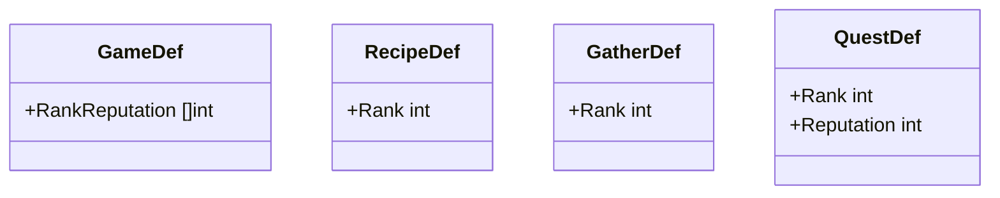
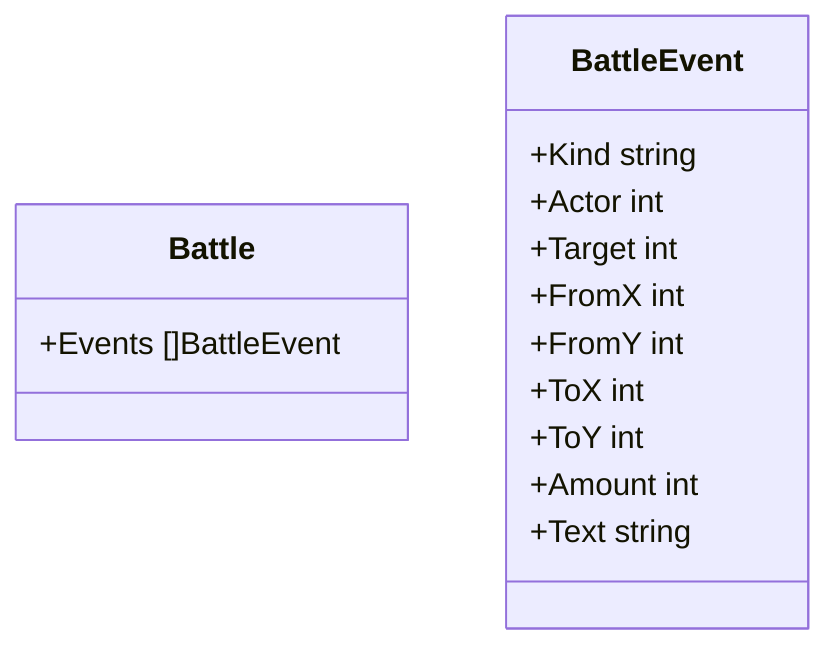

# 設計書（反復 4: 品質が上がっていく進行と、戦闘で起きたことが分かる画面）

- 文書 ID: DES-IT04
- 版: 0.1（ドラフト。開発者の承認待ち）
- 作成日: 2026-10-15
- 対象: [反復 4 計画書](../iterations/it04/plan.md) の範囲
- 入力: [SRS-001](../02_requirements/srs.md) v0.4、[ユースケース](../02_requirements/use-cases.md) v0.4、設計書（反復 1〜3）

反復 1〜3 の設計書に書き足す形で、反復 4 で増やす点だけを書く。ここに書いていない規則は、前の設計書のまま使う。

## 1. 工房のランク（FR-PRG-04、FR-ALC-07）

### 1.1 定義データ（DES-DEF-08）



| 項目 | 意味 |
|---|---|
| `GameDef.RankReputation` | ランク 2 以降に上がるのに要る評判の合計。`[r2, r3, r4]` のように、ランクの低い順に並べる。値は増えていく |
| `RecipeDef.Rank`・`GatherDef.Rank`・`QuestDef.Rank` | 解放されるランク。書かなければ 1（最初から使える） |
| `QuestDef.Reputation` | 納品したときに増える評判。書かなければ 0 |

```toml
# data/base/game.toml（追加分の例）
rank_reputation = [3, 8, 15]

# data/base/recipes.toml（例）
[[recipe]]
id = "potion_moss"
rank = 2

# data/base/gathers.toml（例）
[[gather]]
id = "old_forest"
name = "古い森"
rank = 2

# data/base/quests.toml（例）
[[quest]]
id = "q_potion_50"
item = "potion"
min_quality = 50
count = 2
reward = 200
rank = 2
reputation = 3
```

### 1.2 ランクの求め方（DES-PRG-01）

- `World.Reputation` は、これまでに納品で得た評判の合計（減らない）
- **ランク** = 1 ＋（`RankReputation` のうち、値が `Reputation` 以下のものの数）。最大は `len(RankReputation) + 1`
- 計算例: `RankReputation` = [3, 8, 15] のとき、評判 0〜2 はランク 1、3〜7 はランク 2、8〜14 はランク 3、15 以上はランク 4
- `World.Rank()` で求める。状態として持たない（評判から決まる）

### 1.3 解放の規則（DES-PRG-02）

- ランクが `Rank` より低いレシピ・採取地・依頼は「まだ解放されていない」
- 次の操作は、解放されていないものを使おうとすると、状態を変えずに `ErrLocked` を返す
  - `Craft`・`PreviewCraft`（レシピ）、`AssignGolem`（レシピと採取地）、`Gather`・`StartBattle`（採取地）
- 検査の順は、既存の検査の「目録にない（`ErrUnknownID`）」の直後に入れる
- すでにゴーレムに割り当て済みの物は、解放の検査をしない（ランクは下がらないので、起きない）
- `SlotCandidates` は解放を問わない（レシピの検査は `Craft` で行う）

### 1.4 依頼と評判（DES-QST-03）

- 依頼板の抽選（DES-QST-01）の候補は、解放されている依頼だけにする
- `Deliver` が成功すると、`Reputation` に `QuestDef.Reputation` を足す。そのあとで依頼板を入れ替える（入れ替えの候補には、上がったランクで解放された依頼も入る）
- ランクが上がったときは、`World.RankUps` に上がった先のランクを足す（2 段上がったときは、2・3 のように低い順に足す）。ui は読んだら空にする（DES-UI-11）
- 計算例: 評判 2、`RankReputation` = [3, 8, 15]、依頼の `Reputation` = 7 を納品 → 評判 9、ランク 1 → 3、`RankUps` = [2, 3]
- ランクが上がっても、依頼板にすでにある依頼は入れ替えない（次の納品から新しい候補が入る）

## 2. 戦闘の出来事（IF-07）

### 2.1 出来事の記録（DES-BTL-05）

戦闘の記録（`Battle.Log`、文字列）に加えて、画面が出来事を順に見せられるように、構造を持った出来事を残す。



| `Kind` | 起きたこと | 使う項目 |
|---|---|---|
| `move` | 移動 | `Actor`、`FromX`・`FromY`、`ToX`・`ToY` |
| `attack` | 攻撃 | `Actor`、`Target`、`Amount`（ダメージ） |
| `use` | アイテムを使った | `Actor`、`ToX`・`ToY`（狙ったマス） |
| `damage`・`heal`・`attack_up`・`speed_up` | アイテムの効果 | `Actor`、`Target`、`Amount` |
| `fall` | 倒れた | `Target` |
| `wait` | 待機 | `Actor` |
| `win`・`lose` | 勝ち・負け | ― |

- `Actor`・`Target` は `Units` の添字。使わないときは -1
- `Text` は同じ時点で `Log` に足した文と同じ（表示名で書く。DES-WLD-02）
- `Log` に 1 行足すときは、必ず対応する出来事を 1 つ足す（`Log` と `Events` は同じ数・同じ順）
- 出来事は戦闘が終わると `BattleReport.Events` にも残す
- 規則（ダメージ・行動順・判定）は変えない

## 3. 画面（ui）（IF-07、DES-UI-11〜13）

| ID | 画面の決まり | 関連 |
|---|---|---|
| DES-UI-11 | ランクが上がったら、画面の上の操作結果に「工房ランク N: 作れるようになった物・行けるようになった採取地・新しい依頼」を出す。物語の文章は付けない。工房の画面の上と街の依頼板に、今のランクと次のランクまでの評判（例:「ランク 2 / 評判 5 / 8」）を出す。解放されていないレシピと採取地は、一覧に出さない | FR-PRG-04、FR-ALC-07、IT04 P-04 |
| DES-UI-12 | 仲間が行動したあと、その行動と続く敵の行動で増えた出来事（DES-BTL-05）を、1 つずつ 0.5 秒（30 フレーム）の間を置いて見せる。見せている出来事の行動したユニットと相手のマス（移動なら移動元と移動先）を強調し、記録の最新の行に出す。見せている間は盤面の操作を受け付けない。画面のどこかを押すと、残りの出来事を飛ばして最後まで見せる。ユニットの位置と体力は、見せ終わった状態（core の今の状態）で描く | IF-07、IT04 P-05 |
| DES-UI-13 | 操作できなかった理由（誤り）は、戦闘の画面の操作のボタンの下に、目立つ色で出す。今の番の仲間の射程に生きている敵がいないときは「攻撃」を押せない表示にし、「届く敵がいません。移動するか、待機で番を終えます」と案内する。使えるアイテムで狙える相手がいないときも、同じように案内する | IF-07、K-06 |

## 4. 設計と SRS の対応（反復 4 の追加分）

| 要求 | 設計要素 |
|---|---|
| FR-PRG-04 | DES-DEF-08、DES-PRG-01、02、DES-QST-03、DES-UI-11 |
| FR-ALC-07 | DES-PRG-02（レシピ）、DES-UI-11 |
| FR-MAT-03 | DES-PRG-02（解放される採取地の探索の報酬） |
| IF-07 | DES-BTL-05、DES-UI-12、13 |
| NFR-06 | DES-QST-03（候補が解放で増えても、抽選の規則は DES-QST-01 のまま） |

## 5. 定義データの検証（defload）

DES-VAL-01〜13 に、次を足す。

| ID | 規則 | 関連要求 |
|---|---|---|
| DES-VAL-14 | `RankReputation` の値は 1 以上で、狭義に増えていく。レシピ・採取地・依頼の `Rank` は 1 以上、`len(RankReputation) + 1` 以下 | FR-PRG-04 |
| DES-VAL-15 | 依頼の `Reputation` は 0 以上。ランク 1 の依頼のうち、少なくとも 1 つは `Reputation` が 1 以上（最初のランクから上がれる）。ランク N の依頼で評判が得られ、ランク N+1 に届く（各ランクに、評判が 1 以上の依頼が少なくとも 1 つある。最高ランクは除く） | FR-PRG-04（進行が詰まらない） |
| DES-VAL-16 | 解放されるレシピの材料は、そのランクまでに手に入る（採取地・店・それ以前に解放されたレシピの出力のどれかで作れる） | FR-PRG-04（進行が詰まらない） |

## 6. 定義データの値の目安（DES-DAT-02）

| 対象 | 目安 |
|---|---|
| `RankReputation` | [3, 8, 15]（ランク 1 の依頼を 2〜3 回でランク 2） |
| ランク 1 の依頼 | 評判 1〜2。品質の条件 20 |
| ランク 2 の採取地 | 採取の品質 20〜50、探索の報酬 60〜120。敵を 1 種類足す |
| ランク 3 の採取地 | 採取の品質 40〜80、探索の報酬 90〜160 |
| ランク 2・3 の依頼 | 評判 2〜4。品質の条件 50・100（段階の効果に届く品質） |
| ランクで解放するレシピ | 回復薬（ひかり苔の経路）、元気の薬、ごちそうバーガー、ひかりランタンなどを、ランク 2〜3 に振り分ける |

## 7. この設計で仮置きした事項

| ID | 仮置きの内容 |
|---|---|
| DES-PRG-01 | ランクは 4 段階で、評判だけで上がる |
| DES-QST-03 | ランクが上がっても、依頼板の依頼はすぐには入れ替えない |
| DES-UI-12 | 出来事の間は 0.5 秒 |
| DES-DAT-02 | 定義データの値 |

## 8. 変更履歴

| 版 | 日付 | 内容 |
|---|---|---|
| 0.1 | 2026-10-15 | 初版 |
