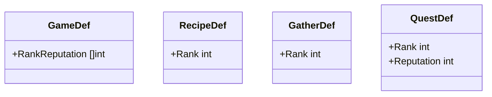
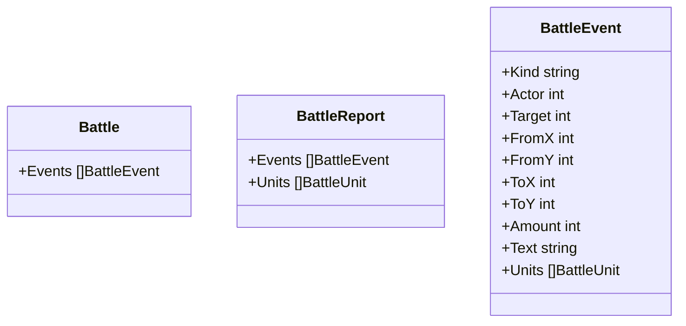

# 設計書（反復 4: 品質が上がっていく進行と、戦闘で起きたことが分かる画面）

- 文書 ID: DES-IT04
- 版: 0.2（承認、REV-034）
- 作成日: 2026-10-15
- 対象: [反復 4 計画書](../iterations/it04/plan.md) の範囲
- 入力: [SRS-001](../02_requirements/srs.md) v0.4、[ユースケース](../02_requirements/use-cases.md) v0.4、設計書（反復 1〜3）

反復 1〜3 の設計書に書き足す形で、反復 4 で増やす点だけを書く。ここに書いていない規則は、前の設計書のまま使う。

## 1. 工房のランク（FR-PRG-04、FR-ALC-07）

### 1.1 定義データ（DES-DEF-08）



| 項目 | 意味 |
|---|---|
| `GameDef.RankReputation` | ランク 2 以降に上がるのに要る評判の合計。`[r2, r3, r4]` のように、ランクの低い順に並べる。空ならランクの仕組みを使わない（ランクは常に 1） |
| `RecipeDef.Rank`・`GatherDef.Rank`・`QuestDef.Rank` | 解放されるランク。書かなければ 1（最初から使える）。書いたときは 1 以上（DES-VAL-14） |
| `QuestDef.Reputation` | 納品したときに増える評判。書かなければ 0 |

- defload は、`rank` を書いたかどうかを区別して読む（中間の構造体で `*int` を使う）。書かなければ 1、0 以下を書いたら誤りにする

```toml
# data/base/game.toml（追加分の例）
rank_reputation = [3, 8, 15]

# data/base/gathers.toml（例）
[[gather]]
id = "old_forest"
name = "古い森"
rank = 2

# data/base/quests.toml（例）
[[quest]]
id = "q_potion_50"
item = "potion"
min_quality = 50
count = 2
reward = 200
rank = 2
reputation = 3
```

### 1.2 ランクの求め方（DES-PRG-01）

- `World.Reputation` は、これまでに納品で得た評判の合計（減らない）
- **ランク** = 1 ＋（`RankReputation` のうち、値が `Reputation` 以下のものの数）。最大は `len(RankReputation) + 1`
- 計算例: `RankReputation` = [3, 8, 15] のとき、評判 0〜2 はランク 1、3〜7 はランク 2、8〜14 はランク 3、15 以上はランク 4（最高）
- `World.Rank()` で求める。状態として持たない（評判から決まる）
- `World.NextRankReputation() (int, bool)` は、次のランクに要る評判の合計を返す。最高ランクなら false

### 1.3 解放の規則（DES-PRG-02）

- ランクが `Rank` より低いレシピ・採取地・依頼は「まだ解放されていない」
- 次の操作は、解放されていないものを使おうとすると、状態を変えずに `ErrLocked` を返す
  - `Craft`・`PreviewCraft`（レシピ）、`AssignGolem`（レシピと採取地）、`Gather`・`StartBattle`（採取地）
- 検査の順は、既存の検査の「目録にない（`ErrUnknownID`）」の直後に入れる
- 誤り文は、表示名と解放されるランクを書く（例:「古い森はランク 2 で解放されます」）（DES-WLD-02）
- すでにゴーレムに割り当て済みの物は、解放の検査をしない（ランクは下がらないので、起きない）
- `SlotCandidates` は解放を問わない（レシピの検査は `Craft` で行う）
- `World.Unlocked(rank int)` は、そのランクで新しく解放されるレシピ・採取地・依頼の ID を返す（画面の知らせに使う。DES-UI-11）

### 1.4 依頼と評判（DES-QST-03）

- 依頼板の抽選（DES-QST-01）の候補は、解放されている依頼だけにする。抽選の規則（ID の昇順、`IntN`、別の乱数列）は変えない
- `Deliver` の検査の順は DES-QST-02 のまま。最後の「お金があふれる」と並べて、「評判があふれる（`ErrInvalidCount`）」を検査する。失敗したときは、評判とランクの知らせも変えない
- `Deliver` が成功すると、`Reputation` に `QuestDef.Reputation` を足す。そのあとで依頼板を入れ替える（入れ替えの候補には、上がったランクで解放された依頼も入る）
- ランクが上がったときは、上がった先のランクを知らせの列に足す（2 段上がったときは、2・3 のように低い順に足す）。画面は `World.TakeRankUps() []int` で読み、読むと列は空になる（DES-UI-11）
- 計算例: 評判 2、`RankReputation` = [3, 8, 15]、依頼の `Reputation` = 7 を納品 → 評判 9、ランク 1 → 3、`TakeRankUps()` は [2, 3] を返し、次に呼ぶと [] を返す
- ランクが上がっても、依頼板にすでにある依頼は入れ替えない（次の納品から新しい候補が入る）
- 依頼板の空いた位置が埋まらなくなることは、定義データの検証で防ぐ（ランク 1 の依頼は 3 件以上。DES-VAL-15、E-90）

## 2. 戦闘の出来事（IF-07）

### 2.1 出来事の記録（DES-BTL-05）

戦闘の記録（`Battle.Log`、文字列）に加えて、画面が出来事を順に見せられるように、構造を持った出来事を残す。



| `Kind` | 起きたこと | `Actor` | `Target` | `FromX`・`FromY` | `ToX`・`ToY` | `Amount` |
|---|---|---|---|---|---|---|
| `start` | 戦闘が始まった（最初の配置） | -1 | -1 | 0 | 0 | 0 |
| `move` | 移動 | 動いたユニット | -1 | 移動元 | 移動先 | 0 |
| `attack` | 攻撃 | 攻撃したユニット | 相手 | 攻撃したユニットのマス | 相手のマス | ダメージ |
| `use` | アイテムを使った | 使ったユニット | -1 | 使ったユニットのマス | 狙ったマス | 0 |
| `damage`・`heal`・`attack_up`・`speed_up` | アイテムの効果 | 使ったユニット | 効果を受けたユニット | 使ったユニットのマス | 受けたユニットのマス | `Text` に書いた数 |
| `fall` | 倒れた | -1 | 倒れたユニット | 0 | 0 | 0 |
| `wait` | 待機 | 待機したユニット | -1 | そのマス | そのマス | 0 |
| `reward_lost` | 報酬を捨てた・抽選に失敗した | -1 | -1 | 0 | 0 | 捨てた個数（失敗なら 0） |
| `win`・`lose` | 勝ち・負け | -1 | -1 | 0 | 0 | 0 |

- `Actor`・`Target` は `Units` の添字。使わないときは -1。使わない座標と `Amount` は 0
- `Text` は同じ時点で `Log` に足した文と同じ（表示名で書く。DES-WLD-02）。`start` だけは `Log` に足さず、`Text` は空
- `Log` に 1 行足すときは、必ず対応する出来事を 1 つ足す。`Events` から `start` を除いたものと `Log` は、同じ数・同じ順になる
- 回復しなかった `heal`（体力が満タン）は、`Log` にも出来事にも足さない
- `Units` は、その出来事が起きた直後の全ユニットの写し（位置と体力）。画面はこれで盤面を描く（E-90）
- 戦闘が終わると、`BattleReport.Events` に `Events` を、`BattleReport.Units` に最後の `Units` を残す
- 規則（ダメージ・行動順・判定）は変えない

### 2.2 出来事の計算例

DES-IT03 2.5 節の戦闘（`Units` の並びは剣士 0、術士 1、スライム 1 が 2、オオカミ 3）。

| 時点 | 増える出来事 |
|---|---|
| `StartBattle` | `start` ／ `move` 3（5,3）→（2,3） |
| 術士の `BattleAttack(2,3)` | `attack` 1→3（0,3）→（2,3）、5 |
| 剣士の `BattleMove(2,2)` | `move` 0（1,2）→（2,2） |
| 剣士の `BattleAttack(2,3)` | `attack` 0→3（2,2）→（2,3）、6 ／ `attack` 2→0（3,2）→（2,2）、3 ／ `attack` 3→0（2,3）→（2,2）、5 |

ここで `len(Events)` = 7、`len(Log)` = 6。剣士の攻撃のあとに画面が見せるのは、添字 4〜6 の 3 件になる。

### 2.3 届く相手の判定（DES-BTL-06）

画面の案内（DES-UI-13）のために、core に次の関数を足す。状態は変えない。

- `World.AttackTargets() [][2]int`: 今の番の仲間が攻撃で狙える、生きている敵のマス
- `World.UseTargets(key ItemKey) [][2]int`: 今の番の仲間がそのアイテムで狙えるマス（`Target`・`Range`・盤面の中・生きている該当ユニット。在庫がない・使えないアイテムなら空）

## 3. 画面（ui）（IF-07、DES-UI-11〜13）

| ID | 画面の決まり | 関連 |
|---|---|---|
| DES-UI-11 | ランクが上がったら（`TakeRankUps`）、画面の上の操作結果に「工房ランク N: 作れるようになった物・行けるようになった採取地・新しい依頼が出るようになった」を出す。何も解放されないランクは「工房ランク N」だけ。2 段上がったときは「工房ランク 2: …／工房ランク 3: …」と続ける。物語の文章は付けない。工房の画面の上と街の依頼板に、今のランクと次のランクまでの評判（例:「ランク 2 / 評判 5 / 8」、最高なら「ランク 4（最高）/ 評判 N」）を出す。解放されていないレシピと採取地は、工房のレシピの一覧、ゴーレムの割り当ての一覧、採取地の一覧に出さない | FR-PRG-04、FR-ALC-07、IT04 P-04 |
| DES-UI-12 | 次のときに増えた出来事（DES-BTL-05）を、1 つずつ 0.5 秒（30 フレーム）の間を置いて見せる。(a) `StartBattle` が成功したあと（`Events` の最初から）、(b) 仲間の操作（移動・攻撃・アイテム・待機）が成功したあと（操作の前の件数 n を覚えておき、`Battle` があれば `Battle.Events[n:]`、なければ `LastBattle.Events[n:]`）。見せている出来事の `Units` で盤面の位置と体力を描き、行動したユニットと相手のマス（移動なら移動元と移動先）を強調し、記録には見せた出来事までの行を出す。見せている間の押す操作は、残りの出来事を飛ばして最後まで見せることにだけ使い、盤面やボタンの操作として扱わない。間はフレームで数え、時間の倍率（F11）に従わない。戦闘が終わったときは、出来事を見せ終わる（または飛ばす）→ `LastBattle` の結果（DES-UI-10）→ 採取地へ戻る、の順にする | IF-07、IT04 P-05、E-90 |
| DES-UI-13 | 操作できなかった理由（誤り）は、戦闘の画面の操作のボタンの下に、目立つ色で出す。`AttackTargets` が空のときは「攻撃」を押せない表示にし、移動していなければ「届く敵がいません。移動するか、待機で番を終えます」、移動したあとなら「届く敵がいません。待機で番を終えます」と案内する。アイテムの一覧では、`UseTargets` が空の行を押せない表示にし、「狙える相手がいません」と出す | IF-07、K-06、IT04 P-05 |

## 4. 設計と SRS の対応（反復 4 の追加分）

| 要求 | 設計要素 |
|---|---|
| FR-PRG-04 | DES-DEF-08、DES-PRG-01、02、DES-QST-03、DES-VAL-14〜16、DES-UI-11 |
| FR-ALC-07 | DES-PRG-02（レシピ）、DES-UI-11 |
| FR-ECO-05 | DES-QST-03（評判、解放された依頼だけを抽選） |
| FR-MAT-03 | DES-DAT-02（解放される採取地の探索の報酬の品質） |
| IF-07 | DES-BTL-05、06、DES-UI-12、13 |
| NFR-06 | DES-QST-03（候補が解放で増えても、抽選の規則は DES-QST-01 のまま） |

## 5. 定義データの検証（defload）

DES-VAL-01〜13 に、次を足す。DES-VAL-15・16 は、`len(RankReputation)` ≥ 1 のときだけ行う（ランクを使わない定義データ、MOD、既存のテスト用データは対象にしない）。

| ID | 規則 | 関連要求 |
|---|---|---|
| DES-VAL-14 | `RankReputation` の値は 1 以上で、狭義に増えていく。レシピ・採取地・依頼の `Rank` は、書いたときは 1 以上、`len(RankReputation) + 1` 以下 | FR-PRG-04 |
| DES-VAL-15 | 依頼の `Reputation` は 0 以上。ランク 1 の依頼は 3 件以上（依頼板の空きを防ぐ。E-90）。最高ランクを除く各ランク r に、`Rank` = r で `Reputation` ≥ 1 の依頼がある。すべての依頼の `Item` は、その依頼の `Rank` で手に入る（下の S_r に入る） | FR-PRG-04、FR-ECO-05（進行が詰まらない） |
| DES-VAL-16 | `Rank` = r のレシピの出力は、S_r に入る（材料がランク r までに手に入る） | FR-PRG-04、FR-ALC-07（進行が詰まらない） |

**手に入る物の集合 S_r の求め方**（ランク r = 1〜最高、ごとに）

1. 店の品ぞろえのアイテムと、`Rank` ≤ r の採取地の `Drops` と `Battle.Drops` のアイテムを S_r に入れる
2. 次を、増えなくなるまで繰り返す: `Rank` ≤ r のレシピで、どの入力枠にも S_r の中に合う物（`Item` が一致する、または `Attribute` を持つ）があれば、`Output` を S_r に入れる。個数は問わない（何度でも手に入るため）。循環は、増えなくなったら止まる
3. 誤り文の例:「レシピ X はランク r で材料が手に入りません」「依頼 Y の品物はランク r で手に入りません」

## 6. 定義データの値の目安（DES-DAT-02）

| 対象 | 目安 |
|---|---|
| `RankReputation` | [3, 8, 15]（ランク 1 の依頼を 2〜3 回でランク 2） |
| ランク 1 の依頼 | 3 件以上。評判 1〜2。品質の条件 20 |
| ランク 2 の採取地 | 採取の品質 20〜50、探索の報酬 60〜120。敵を 1 種類足す |
| ランク 3 の採取地 | 採取の品質 40〜80、探索の報酬 90〜160 |
| ランク 2・3 の依頼 | 評判 2〜4。品質の条件 50・100（段階の効果に届く品質） |
| ランク 4 | 品質の条件 150 の依頼（報酬が多い）と、上位のレシピ（ごちそうバーガーなど）を解放する（E-90） |
| ランクで解放するレシピ | 回復薬（ひかり苔の経路）、元気の薬、ひかりランタンなどをランク 2・3 に、ごちそうバーガーなどをランク 4 に振り分ける |

- 依頼の品質の条件に、そのランクの素材の品質とボーナス（DES-QLT-02）で届くかは、データの Issue で経路を計算して PR に示す（DES-DAT-01 と同じ扱い）
- 既存のレシピを上のランクへ移すので、本体データの件数を確かめるテスト（TC-FR-MOD-02-04）や、本体データを使う依頼の抽選の期待値が変わる。データの Issue で直す

## 7. この設計で仮置きした事項

| ID | 仮置きの内容 |
|---|---|
| DES-PRG-01 | ランクは 4 段階で、評判だけで上がる |
| DES-QST-03 | ランクが上がっても、依頼板の依頼はすぐには入れ替えない |
| DES-UI-12 | 出来事の間は 0.5 秒 |
| DES-DAT-02 | 定義データの値 |

## 8. 変更履歴

| 版 | 日付 | 内容 |
|---|---|---|
| 0.1 | 2026-10-15 | 初版 |
| 0.2 | 2026-10-15 | REV-034 の指摘を反映。出来事の種類・項目の値・盤面の写し・計算例、戦闘の始まりと終わりの見せ方、届く相手の判定（DES-BTL-06）、`TakeRankUps`、`ErrLocked` の文、評判のあふれ、DES-VAL-15・16 の判定手順、画面の表示の細部。H-01〜H-03 は開発者が決定（E-90） |
