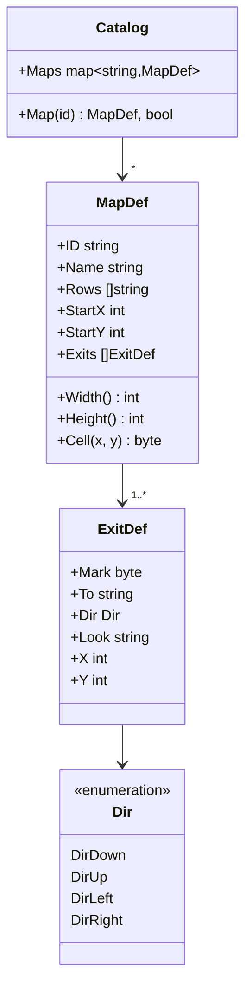
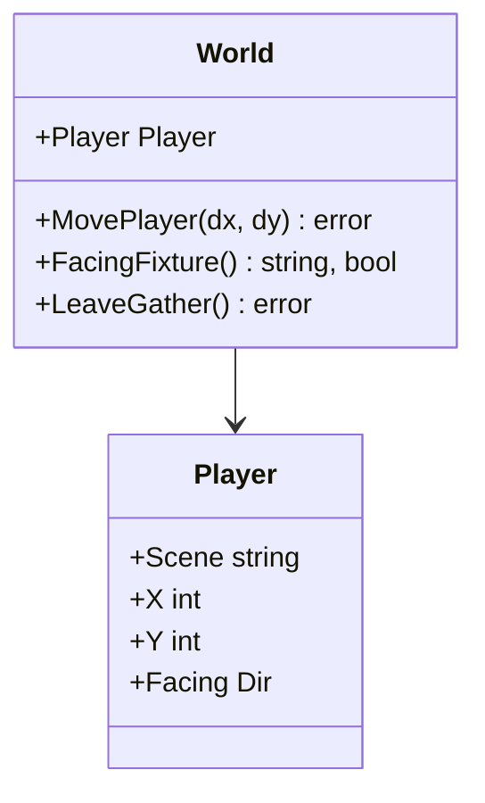
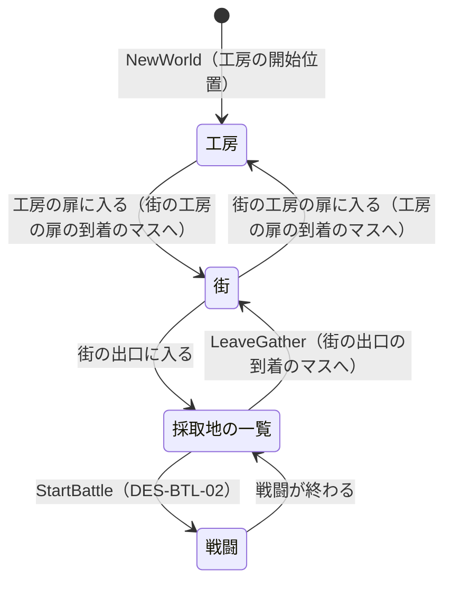
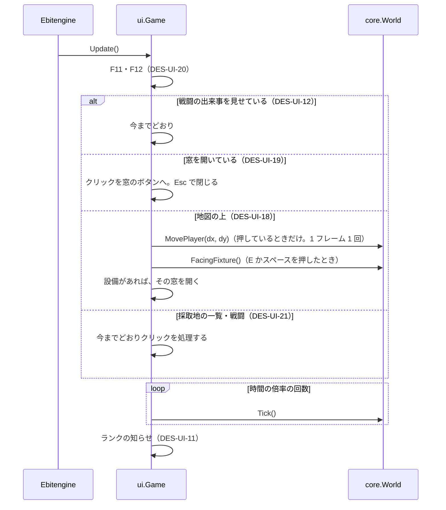

# 設計書（反復 5: 主人公を操作して、工房と街を歩く）

- 文書 ID: DES-IT05
- 版: 0.1（案）
- 作成日: 2026-10-15
- 対象: [反復 5 計画書](../iterations/it05/plan.md) の範囲
- 入力: [SRS-001](../02_requirements/srs.md) v0.5、[ユースケース](../02_requirements/use-cases.md) v0.5（案）、設計書（反復 1〜4）、[ADR-0003](../adr/0003-image-assets.md)（案）

反復 1〜4 の設計書に書き足す形で、反復 5 で増やす点と変える点だけを書く。ここに書いていない規則は、前の設計書のまま使う。採取地の一覧と戦闘の画面は変えない（IT05 P-01）。

## 1. 地図の定義データ（FR-FLD-01、04）

### 1.1 型（DES-DEF-09）



| 項目 | 意味 |
|---|---|
| `MapDef.ID` | 地図の ID。反復 5 では `workshop`（工房）と `town`（街）の 2 つだけ（IT05-PLAN 4 章。3 枚目は作らない）。定数 `defs.MapWorkshop`・`defs.MapTown` を置く |
| `MapDef.Name` | 表示名（例:「工房」）。上の表示と出入り口の名前に使う |
| `MapDef.Rows` | 文字の地図。1 行が地図の 1 行で、1 文字が 1 マス。検証済みの `Rows` は、すべて同じ長さの ASCII の文字列（DES-VAL-18・19） |
| `MapDef.StartX`・`StartY` | 開始位置のマス。工房の開始位置は、ゲームを始めたときの主人公の位置（DES-FLD-01） |
| `MapDef.Cell(x, y)` | マス (x, y) の文字。地図の外なら 0 を返す（壁として扱う。DES-FLD-03） |
| `ExitDef.Mark` | 地図の上で出入り口を表す数字（`1`〜`9`） |
| `ExitDef.To` | 行き先。地図の ID か、`gather`（採取地の一覧。定数 `defs.ExitGather`） |
| `ExitDef.Dir` | 出入り口から地図の中へ向かう向き。出入り口のマスからこの向きに 1 マス進んだマスを **到着のマス** とする。ほかの場面からこの出入り口を通って来たとき、主人公は到着のマスに立ち、この向きを向く（DES-FLD-05） |
| `ExitDef.Look` | 出入り口の絵。`stone_door`（石の扉）、`wood_door`（木の扉）、`road`（道）のどれか（DES-UI-15） |
| `ExitDef.X`・`Y` | 出入り口のマス。TOML には書かず、defload が `Rows` から求める |

- 座標は、戦闘の盤面（DES-DEF-06）と同じく、左上を (0, 0) とし、x は右へ、y は下へ増える。マスの座標は 0 始まり
- 向き `Dir` は defs に置く（出入り口の定義と core の主人公の向きで共有する）。TOML では `up`・`down`・`left`・`right` と書く
- `Catalog` に `Maps`（`maps.toml` の `[[map]]`）を足し、`Map(id)` で引く（DES-DEF-04 と同じ形）

### 1.2 文字の表

地図の文字の意味は、コードで決めた固定の表にする（DES-DEF-03 と同じ考え方。MOD で文字の種類は足せない。IT05-PLAN 4 章）。表は defs に置き、defload・core・ui で共有する。

| 文字 | 種類 | 通れるか | 意味 | 必須の地図 |
|---|---|---|---|---|
| `.` | 床 | 通れる | 室内の床 | |
| `,` | 床 | 通れる | 草地 | |
| `:` | 床 | 通れる | 道 | |
| `#` | 壁 | 通れない | 石の壁 | |
| `W` | 壁 | 通れない | 家の壁 | |
| `^` | 壁 | 通れない | 屋根 | |
| `T` | 壁 | 通れない | 木 | |
| `K` | 設備 `cauldron` | 通れない | 錬金釜 | `workshop` |
| `S` | 設備 `shelf` | 通れない | 在庫の棚 | `workshop` |
| `G` | 設備 `workbench` | 通れない | ゴーレムの作業台 | `workshop` |
| `M` | 設備 `shop` | 通れない | 店 | `town` |
| `Q` | 設備 `quest_board` | 通れない | 依頼板 | `town` |
| `F` | 設備 `facility_board` | 通れない | 施設の看板（施設の建設と強化） | `town` |
| `1`〜`9` | 出入り口 | 通れる | `exits` で行き先を決める（1.4 節） | |

- 設備の種類は文字列の定数（`defs.FixtureCauldron` など）にし、表示名（「錬金釜」など）も表に持つ
- 設備は、どの地図に置いてもよい。必須の地図は、その地図に 1 個以上なければならないという意味（DES-VAL-21）
- 同じ設備の文字が 2 マス以上あってもよい。どのマスも同じ窓を開く
- 設備は 1 マスで、通れない。設備の「前のマス」は、設備のマスに上下左右で隣り合う床のマス
- 「施設」（`FacilityDef`、街に建てる建物）と「設備」（地図の上の物）は別の物である（SRS 1.3）。コードでは設備を `Fixture` と呼び、施設の `Facility` と区別する

### 1.3 TOML の形

```toml
# data/base/maps.toml（例。本体の値は 5 章）
[[map]]
id = "workshop"
name = "工房"
start = { x = 9, y = 8 }
rows = [
  "####################",
  "#..................#",
  "#....S...K...G.....#",
  "#..................#",
  "#########1##########",
]
exits = [
  { mark = "1", to = "town", dir = "up", look = "stone_door" },
]
```

- 地図は、文字列の配列 `rows` で書く。複数行の文字列（`'''`）にしないのは、誤りの位置を「何行目の何文字目」で示しやすくするため（FR-MOD-04）
- `start` は開始位置のマス。`exits` は、地図に書いた数字ごとの行き先・向き・絵

### 1.4 出入り口の決まり

- 出入り口の数字は、1 つの地図の中でちょうど 1 マスに書く（2 マス以上の幅の出入り口は作らない）
- 地図 A の出入り口の行き先が地図 B なら、B には行き先が A の出入り口がちょうど 1 つある（戻り道）。A の出入り口を通ると、B の「行き先が A の出入り口」の到着のマスに立つ
- 行き先が `gather`（採取地の一覧）の出入り口は、`town` にちょうど 1 つだけ置く。採取地の一覧から戻ると、その出入り口の到着のマスに立つ（IT05 P-07）
- 1 つの地図の中で、同じ行き先の出入り口は 1 つまで（戻る先が 1 つに決まるように）
- 必要な出入り口: `workshop` に `town` 行き、`town` に `workshop` 行きと `gather` 行き（FR-FLD-03）

## 2. 主人公と地図の上の規則（core）（FR-FLD-01〜03、IF-08）

### 2.1 位置の単位と主人公の状態（DES-FLD-01）



- **位置の単位**: 1 マス = **96 単位**。位置は整数で持つ（IT05 P-02、NFR-06。浮動小数を使わない）。96 はタイルの 16 px の 6 倍で、画面では 1 単位 = 0.5 px になる（DES-UI-16）
- `Player.Scene` は、主人公のいる場面。地図の ID（`workshop`・`town`）か、`gather`（採取地の一覧の画面。定数 `core.SceneGather`）
- `Player.X`・`Y` は、主人公の当たり判定の中心（足元）の位置。マス (cx, cy) の中心は (cx × 96 + 48, cy × 96 + 48)
- `Player.Facing` は主人公の向き（上下左右の 4 つ）
- `NewWorld` は、目録に `workshop` の地図があれば、主人公をその開始位置のマスの中心に置き、下を向かせる。地図のない目録（既存のテストの目録など）では、`Scene` を空にする（主人公は地図の上にいない）
- 主人公の状態を変えるのは `MovePlayer` と `LeaveGather` だけ。窓を開く・閉じるは ui の状態で、core は変えない（DES-UI-19）

### 2.2 移動（DES-FLD-02）

`World.MovePlayer(dx, dy int) error` を足す。ui が 1 フレームに 1 回呼ぶ（DES-TIME-02）。`dx`・`dy` は -1・0・1 で、押している向きを表す（右と下が +1）。

1. 次の順に検査し、最初に見つかった誤りを、状態を変えずに返す（DES-WLD-01）
   1. `dx` か `dy` が -1・0・1 のどれでもない（`ErrInvalidDirection`）
   2. 主人公が地図の上にいない。`Scene` が `gather` か空、または `Scene` の地図が目録にない（`ErrNotOnMap`）
2. `dx` = `dy` = 0 なら、何も変えずに nil を返す
3. **向き**を変える。片方だけが 0 でなければ、その向きにする。斜め（両方が 0 でない）なら、今の向きが押している 2 つの向きのどちらかならそのまま、そうでなければ左右のほうにする
4. **1 回に進む量**: まっすぐ（片方だけ 0 でない）なら 7 単位。斜めなら x と y にそれぞれ 5 単位（斜めの速さは √(5² + 5²) ≈ 7.07 で、まっすぐとほぼ同じ）
5. まず x の向きに進め、当たり判定（DES-FLD-03）で壁や設備に当たるなら、当たる手前で止める。次に、進めたあとの x で、y の向きに同じように進める。これで、斜めに押して片方だけふさがっているときは、もう片方にだけ進む（壁に沿って滑る）
6. 進めたあとの位置（当たり判定の中心）が出入り口のマスに入ったら、場面を移る（DES-FLD-05）
7. 壁に当たって位置が変わらなくても、誤りにしない（向きは変わる）

- 歩く速さは 7 単位 × 60 フレーム = 420 単位/秒 = 4.375 マス/秒
- 1 回に進む量（7）は 1 マス（96）より小さいので、1 回の移動で壁を飛び越えることはない

### 2.3 当たり判定（DES-FLD-03）

- 主人公の当たり判定は、中心 (X, Y) の **64 × 64 単位** の正方形（1 マスの 2/3）。範囲は x が X − 32 以上 X + 32 未満、y が Y − 32 以上 Y + 32 未満
- マス (cx, cy) の範囲は、x が cx × 96 以上 (cx + 1) × 96 未満、y も同じ。当たり判定と 1 単位でも重なるマスを「重なるマス」とする
- **通れないマス**: 壁・設備の文字のマス、地図の外のマス。表にない文字のマスと、行き先の地図が目録にない出入り口のマスも、通れないものとして扱う（検証済みの定義データでは起きないが、core は異常終了しない）
- 位置 v（単位）のマスの番号は ⌊v ÷ 96⌋（負の数は小さいほうへ切り捨てる。Go の `/` は 0 へ切り捨てるので、負の値では -1 にする）
- **x の向きに d（> 0）進めるとき**: 新しい右端 X + d + 32 − 1 のマスの列 c に、当たり判定が重なる行のどれかで通れないマスがあれば、X = c × 96 − 32 にする（右端がその列の左端にぴったり付く）。左（d < 0）は、新しい左端 X + d − 32 の列 c に通れないマスがあれば、X = (c + 1) × 96 + 32 にする。y の向きも同じ
- 当たり判定が 1 マスより小さいので、幅 1 マスの通路と扉を通れる。中心が通路の真ん中から ±16 単位以内なら、ぶつからずに入れる

### 2.4 設備の前の判定（DES-FLD-04）

`World.FacingFixture() (string, bool)` を足す。主人公が向いている設備の種類（`defs.FixtureCauldron` など）を返す。状態は変えない。ui が、決定のキーで開く窓を決めることと、設備の名前を強調して出すこと（DES-UI-15）に使う。

1. 主人公が地図の上にいなければ、("", false)
2. **前の帯**を、当たり判定を向きの方へ 16 単位広げた部分とする。例えば上を向いているとき、x が X − 32 以上 X + 32 未満、y が Y − 48 以上 Y − 32 未満
3. 前の帯と重なるマスのうち、設備のマスを候補にする
4. 候補がなければ ("", false)。1 つならその設備。2 つ以上なら、前の帯と重なる面積が大きいマスの設備にする。面積が同じなら、y の小さいマス、次に x の小さいマスにする

- 設備との隙間が 16 単位より小さいとき（当たって止まっているときを含む）だけ、その設備を向いていることになる
- 中心が設備の列から外れていても、当たり判定の一部が設備の前にかかっていれば使える。2 つの設備の間に立っているときは、より正面にあるほうを使う

### 2.5 出入り口と場面の移り方（DES-FLD-05）



- **出入り口に入る**: `MovePlayer` で進めたあと、当たり判定の中心 (X, Y) のマスが出入り口なら、その出入り口の行き先へ移る。当たり判定の一部が出入り口にかかっただけでは移らない
- **行き先が地図 B のとき**: `Scene` = B とし、B の出入り口のうち行き先が今の地図のもの（1.4 節）の、到着のマスの中心に置き、その出入り口の `Dir` を向かせる。到着のマスは出入り口のマスではないので、着いたとたんに戻ることはない
- **行き先が `gather` のとき**: `Scene` = `gather` とする。`X`・`Y`・`Facing` は変えない（採取地の一覧の画面では使わない）
- **`World.LeaveGather() error`**: 採取地の一覧から街へ戻る。次の順に検査し、最初に見つかった誤りを、状態を変えずに返す。`Scene` が `gather` でない（`ErrNotInGather`）→ 戦闘中（`ErrInBattle`）。通れば、`gather` 行きの出入り口のある地図（`town`）を `Scene` にし、その出入り口の到着のマスの中心に置き、その出入り口の `Dir` を向かせる
- 戦闘中に場面を移れないことは、これまで ui だけで守っていた（DES-BTL-01）。反復 5 では `LeaveGather` でも検査する。戦闘は採取地の一覧から始めるので、戦闘中に主人公が地図の上にいることはない
- 場面の移り方は、core の内部の 1 つの関数（地図と到着の出入り口を受け取り、位置と向きを決める）にまとめる。H-12 が否定されて場面のタブを戻すとき（IT05 P-07 b）は、この関数を呼ぶ公開の操作を足すだけで済むようにする。反復 5 では、タブのための操作は作らない
- 場面を移っても、時間とゴーレムの作業は止まらない（IT03 P-08）

### 2.6 移動と時間（DES-TIME-02）

- `MovePlayer` は `World.Tick` と分ける。ui は、時間の倍率（F11）にかかわらず、1 フレームに 1 回だけ `MovePlayer` を呼ぶ。F11 で時間を 10 倍にしても、歩く速さは変わらない（IT05 P-11。戦闘の出来事の間（DES-UI-12）と同じ考え方）
- `MovePlayer` は `Now` を進めず、乱数を使わない。結果は、呼ぶ前の状態と引数だけで決まる（NFR-06）
- 歩いている間も、窓を開いている間も、ui は今までどおり 1 フレームに倍率の分だけ `Tick` を呼ぶ（IT05 P-08）

### 2.7 誤り（DES-WLD-01、02）

| 誤り | 文 | 返す操作 |
|---|---|---|
| `ErrInvalidDirection` | 向きが正しくありません | `MovePlayer` |
| `ErrNotOnMap` | 主人公が地図の上にいません | `MovePlayer` |
| `ErrNotInGather` | 採取地の一覧にいません | `LeaveGather` |
| `ErrInBattle`（既存） | 戦闘中です | `LeaveGather` |

- 壁に当たる、設備を向いていない、は誤りにしない（プレイヤーの操作として普通に起きるため）

### 2.8 計算例

単体テストの期待値にできるように、次の 2 枚の小さな地図で計算する（本体の地図とは別。テストでは Go のコードで目録を組み立てる）。

例の工房（8 × 6、開始位置 (4, 3)。出入り口 `1` は行き先 `town`、向き `up`）

```text
   x 01234567
y 0  ########
y 1  #.KS..G#
y 2  #......#
y 3  #......#
y 4  #......#
y 5  ####1###
```

例の街（7 × 5、開始位置 (3, 2)。出入り口 `1` は行き先 `workshop`、向き `down`。`2` は行き先 `gather`、向き `up`）

```text
   x 0123456
y 0  TTTTTTT
y 1  TWW1WWT
y 2  TM,,,QT
y 3  TF,,,,T
y 4  TTT2TTT
```

| # | 前の状態（場面、X、Y、向き） | 操作 | 後の状態・結果 | 確かめること |
|---|---|---|---|---|
| 1 | — | `NewWorld` | 工房、(432, 336)、下 | 開始位置 (4, 3) の中心 |
| 2 | 工房、(432, 336)、下 | `MovePlayer(1, 0)` | 工房、(439, 336)、右 | まっすぐは 7 |
| 3 | 工房、(432, 336)、下 | `MovePlayer(1, 1)` | 工房、(437, 341)、下 | 斜めは 5 ずつ。今の向き（下）が押した向きに入るので変えない |
| 4 | 工房、(432, 336)、下 | `MovePlayer(-1, -1)` | 工房、(427, 331)、左 | 今の向きが押した向きに入らないので、左右のほう |
| 5 | 工房、(432, 336)、下 | `MovePlayer(0, 0)` | 変わらない、nil | 押していないときは何もしない |
| 6 | 工房、(636, 336)、右 | `MovePlayer(1, 0)` | 工房、(640, 336)、右 | 右端 643 + 31 = 674 は列 7（壁）。右端を列 7 の左端 672 に付ける: 672 − 32 = 640 |
| 7 | 工房、(640, 336)、右 | `MovePlayer(1, 0)` | 変わらない、nil | 壁に付いたまま。誤りにしない |
| 8 | 工房、(640, 336)、右 | `MovePlayer(1, 1)` | 工房、(640, 341)、右 | x はふさがり、y にだけ 5 進む（壁に沿って滑る） |
| 9 | 工房、(240, 336)、下 | `MovePlayer(0, -1)` を 17 回 | 工房、(240, 224)、上 | 16 回目で (240, 224)（上端 192 が錬金釜の下端に付く）。17 回目は 217 で行 1 の錬金釜に重なるので 224 に戻す |
| 10 | 工房、(240, 224)、上 | `FacingFixture()` | `cauldron`、true | 前の帯は x 208〜271、y 176〜191。マス (2, 1) の錬金釜だけ |
| 11 | 工房、(288, 224)、上 | `FacingFixture()` | `cauldron`、true | 前の帯 x 256〜319 は、列 2（錬金釜）と列 3（在庫の棚）に 32 ずつ重なる。同じなので x の小さい錬金釜 |
| 12 | 工房、(290, 224)、上 | `FacingFixture()` | `shelf`、true | 列 2 に 30、列 3 に 34 重なる。在庫の棚 |
| 13 | 工房、(240, 224)、下 | `FacingFixture()` | ""、false | 前の帯は行 2 の床 |
| 14 | 工房、(240, 240)、上 | `FacingFixture()` | ""、false | 隙間 16。前の帯 y 192〜207 は行 2 の床だけ |
| 15 | 工房、(240, 239)、上 | `FacingFixture()` | `cauldron`、true | 隙間 15。前の帯 y 191〜206 が行 1 に 1 単位かかる |
| 16 | 工房、(400, 432)、下 | `MovePlayer(0, 1)` を 3 回 | 工房、(400, 448)、下 | 当たり判定の x 368〜431 は列 3（壁）と列 4（扉）にかかる。列 3 の壁で止まる: 480 − 32 = 448 |
| 17 | 工房、(432, 432)、上 | `MovePlayer(0, 1)` を 7 回 | 街、(336, 240)、下 | 7 回目で Y = 481 になり、中心が扉のマス (4, 5) に入る。街の出入り口 `1` の到着のマス (3, 2) の中心へ、向きは `down` |
| 18 | 街、(336, 336)、上 | `MovePlayer(0, 1)` を 7 回 | 採取地の一覧、(336, 385)、下 | 7 回目で中心が出口のマス (3, 4) に入る。位置と向きは変えない |
| 19 | 採取地の一覧 | `MovePlayer(0, 1)` | `ErrNotOnMap`、変わらない | |
| 20 | 採取地の一覧 | `LeaveGather()` | 街、(336, 336)、上 | 出口 `2` の到着のマス (3, 3) の中心、向きは `up` |
| 21 | 採取地の一覧、戦闘中 | `LeaveGather()` | `ErrInBattle`、変わらない | |
| 22 | 街 | `LeaveGather()` | `ErrNotInGather`、変わらない | |
| 23 | 工房 | `MovePlayer(2, 0)` | `ErrInvalidDirection`、変わらない | 向きの検査が先 |
| 24 | 地図のない目録 | `NewWorld`、`MovePlayer(1, 0)` | `Scene` は空、`ErrNotOnMap` | |

- 例 9 の途中: 16 回目までは床の上を 7 ずつ進み、Y = 336 − 7 × 16 = 224 で上端がちょうど 192 になる
- 例 1〜18・20 の値は、この節の規則を写したスクリプトで計算して確かめた（設計のとき）
- テストでは、`Tick` を何回呼んでも `Player` が変わらないこと、`MovePlayer` を何回呼んでも `Now` が変わらないことも確かめる（DES-TIME-02）

### 2.9 歩く距離の上限（DES-FLD-06）

H-12（設備まで歩く手間が面倒にならないか）を確かめるため、よく使う設備の間の歩く距離に上限を決める。

- **歩く距離**: 2 つの場所の「前のマス」どうしの、床のマスを上下左右にたどる最短の歩数（マス）。前のマスが複数あれば、いちばん短い組を使う。設備の前のマスは、設備に上下左右で隣り合う床のマス。出入り口の前のマスは、その到着のマス
- **上限**: 次の組は、どれも **8 マス以内**（IT05-PLAN 2 章の例のとおり）
  - 工房: 錬金釜・在庫の棚・ゴーレムの作業台・扉（街行きの出入り口）のすべての組
  - 街: 工房の扉・店・依頼板・施設の看板・採取地への出口のすべての組
- 上限は本体の地図（DES-DAT-03）の目標で、defload の検証の規則にはしない（MOD の地図は縛らない）。本体のデータのテストで、最短の歩数を計算して確かめる
- 8 マスは、まっすぐ歩いて 8 × 96 ÷ 420 ≈ 1.8 秒
- 振り返りでは、本体の地図の実際の距離（5 章の表）を示して、どの作業が面倒だったかを聞く（H-12）

## 3. 地図の検証（defload）（FR-FLD-04、FR-MOD-04、NFR-08）

DES-VAL-01〜16 に、次を足す。地図の規則は、定義データに `[[map]]` が 1 つ以上あるときだけ行う（地図を持たないテスト用の定義データは対象にしない）。本体のデータに 2 枚の地図があることは、本体のデータのテストで確かめる。

| ID | 規則 | 関連要求 |
|---|---|---|
| DES-VAL-17 | 地図の ID は `workshop` か `town` で、重複しない（DES-VAL-01）。`[[map]]` があるときは、`workshop` と `town` の両方がある | FR-FLD-01 |
| DES-VAL-18 | `rows` は 1 行以上 100 行以下。各行の文字数（バイト数ではなく文字の数）は 1 以上 100 以下で、すべての行で同じ | FR-FLD-04 |
| DES-VAL-19 | 各行の文字は、文字の表（1.2 節）にある。表にない文字は、行ごとに最初の 1 つを報告する | FR-FLD-04 |
| DES-VAL-20 | `start` は地図の中のマスで、床の文字（`.`・`,`・`:`）のマス | FR-FLD-01 |
| DES-VAL-21 | `workshop` に錬金釜（`K`）・在庫の棚（`S`）・ゴーレムの作業台（`G`）、`town` に店（`M`）・依頼板（`Q`）・施設の看板（`F`）が、それぞれ 1 個以上ある | FR-FLD-01、IF-08 |
| DES-VAL-22 | 出入り口（1.4 節）: `exits` の `mark` は数字 1 文字で、地図の中で重複しない。`mark` は `rows` にちょうど 1 マスある。`rows` にある数字は、すべて `exits` に定義がある。`to` は自分以外の地図の ID か `gather`。`dir` は `up`・`down`・`left`・`right` のどれか。`look` は `stone_door`・`wood_door`・`road` のどれか。到着のマスは地図の中の床のマス。同じ地図に同じ `to` の出入り口は 1 つまで。`to` が地図 B なら、B に `to` が自分の出入り口がある。`gather` 行きは `town` にちょうど 1 つあり、ほかの地図にはない。`workshop` に `town` 行き、`town` に `workshop` 行きがある | FR-FLD-03 |
| DES-VAL-23 | 開始位置から、すべての設備の前のマスの少なくとも 1 つと、すべての出入り口の到着のマスへ、床のマスだけを通って行ける（下の塗りつぶし） | FR-FLD-01、02（進行が詰まらない） |
| DES-VAL-24 | 地図の読み込みと検証は、どんな入力でも異常終了せず、誤りとして報告する。ファジングのテストで確かめる | NFR-08 |

**塗りつぶしの手順**（DES-VAL-23）

1. 開始位置のマスから始め、上下左右に隣り合う床のマスを、たどれなくなるまでたどる。出入り口・壁・設備のマスには入らない（出入り口に入ると場面を移るので、その先は同じ地図の続きではない）
2. 設備ごとに、隣り合う床のマスに 1 つでもたどれたマスがあるかを調べる。出入り口ごとに、到着のマスにたどれたかを調べる
3. 当たり判定は 1 マスより小さい（DES-FLD-03）ので、上下左右に隣り合う床のマスへは必ず歩いて移れる。斜めにだけ接するマスはたどらない（実際に通れることもあるが、検証では通れないとみなす）

**検証の進め方**

- DES-VAL-18・19 の誤りがある地図では、DES-VAL-20〜23 を行わない（形が壊れた地図で、位置の誤りを重ねて出さないため）
- 地図は最大 100 × 100 マスなので、塗りつぶしは 1 万マス以内で終わる
- 誤り文は、ファイル名・キーの経路・理由の形にする（FR-MOD-04、DES-IT01 2.3）。マスの位置は `rows[y][x]`（0 始まり）で書く

| 規則 | 誤り文の例 |
|---|---|
| DES-VAL-18 | `maps.toml: map[id=town].rows[4]: 行の長さが 1 行目と違う（29 文字。1 行目は 30 文字）` |
| DES-VAL-19 | `maps.toml: map[id=town].rows[4][7]: 知らない文字 "X"` |
| DES-VAL-20 | `maps.toml: map[id=workshop].start: 開始位置 (0, 0) が床ではない（"#"）` |
| DES-VAL-21 | `maps.toml: map[id=town]: 依頼板（Q）がない` |
| DES-VAL-22 | `maps.toml: map[id=workshop].exits[0].to: 行き先がない: market` ／ `maps.toml: map[id=town].rows[19][14]: 出入り口 "3" の定義がない` |
| DES-VAL-23 | `maps.toml: map[id=town].rows[15][19]: 開始位置から行けない: 店` |

**ファジングのテスト**（DES-VAL-24）

- `FuzzLoadMaps`: 任意のバイト列を `maps.toml` の中身にして、地図のほかの定義がそろった `fstest.MapFS` で `Load` を呼ぶ。異常終了しないことと、誤りがなければ読み込んだ地図が DES-VAL-17〜23 を満たす（行の長さがそろう、開始位置が床、など）ことを確かめる
- 種（シード）には、本体の `maps.toml`、各規則の誤りの例、表にない複数バイトの文字を含む行、空の `rows` を入れる
- `go test` では種だけを実行する（CI の時間を延ばさない）。長く回すのは手で行う

## 4. 画面（ui）（IF-06、IF-08、DES-UI-14〜21）

反復 3〜4 の画面のうち、工房と街の場面を、地図と窓に作り直す。窓の中身・採取地の一覧・戦闘の画面の決まり（DES-UI-01〜05、08〜13）は変えない。DES-UI-07 の工房と街の欄は、設備ごとの窓に分け直す（4.4 節。採取地の欄は変えない）。場面のタブ（DES-UI-06）はなくし、DES-UI-20・21 に置き換える。ui は引き続き使い捨て前提とする（DES-PKG-05）。

### 4.1 フレームの流れ



### 4.2 画面の決まり

| ID | 画面の決まり | 関連 |
|---|---|---|
| DES-UI-14 | **画像の読み込み**: `internal/ui/assets/` の `tiny_town.png`・`tiny_dungeon.png` を、ui が `go:embed` で埋め込む（ADR-0003）。起動時に `image/png` で読み、`ebiten.NewImageFromImage` で画像にし、タイルを切り出す。**タイル番号** n は、配布物の `Tiles/tile_NNNN.png`（NNNN は n の 4 桁の 0 埋め）と同じ絵で、`tilemap_packed.png` の左上から右へ 0〜11、次の行が 12〜23、と数える（12 列 × 11 行、132 枚。どちらの素材も同じ並び）。切り出す範囲は、左上 ((n mod 12) × 16, ⌊n ÷ 12⌋ × 16) から 16 × 16 px。2 つの素材の 132 枚すべてで、`Tiles` の画像と切り出した絵が一致することを確かめた（2026-10-15）。読み込みに失敗したら、`ui.Run` が誤りを返し、`cmd` は起動を中止する。画像を `image.Image` まで読む関数は Ebitengine を使わない形に分け、埋め込んだ画像が読めて大きさが 192 × 176 px であることを単体テストで確かめる。以下、Tiny Town の番号を「TT n」、Tiny Dungeon の番号を「TD n」と書く | CST-04、IT05 P-04、P-13 |
| DES-UI-15 | **地図の描画**: マスごとに、まず**下地**（その地図でいちばん多い床の文字の絵。同じ数なら `.`・`,`・`:` の順に先のもの）を描き、その上に文字の絵を描く（下の表）。設備と出入り口のマスの上には、名前（設備は表示名、出入り口は「街へ」「工房へ」「採取地へ」のように行き先の名前）を小さな文字で出す。主人公が向いている設備（`FacingFixture`）は、名前を「E: 錬金釜」のように明るい色で出す | FR-FLD-01、IF-08 |
| DES-UI-16 | **拡大率とカメラ**: タイル 16 px を **3 倍**の 48 px で描く。位置 v 単位は画面で ⌊v ÷ 2⌋ px（48 ÷ 96）。地図を描く範囲（**表示枠**）は、上の表示の帯（高さ 72 px）の下の 1600 × 868 px。地図の幅（または高さ）× 48 が表示枠に収まるときは、表示枠の中央に置く。収まらないときは、主人公を表示枠の中央にするようにずらし、地図の端より外が見えないように止める（カメラ）。工房（20 × 12 → 960 × 576 px）は動かない。街（30 × 20 → 1440 × 960 px）は、横は中央に置き、縦は 92 px の範囲でずれる。地図は表示枠の中だけに描き、上の表示の帯に重ねない。見える範囲のマスだけを描く（NFR-01） | FR-FLD-01、IT05 8 章 |
| DES-UI-17 | **主人公の絵と向き**: TD 84（紫の帽子の魔法使い、正面の 1 コマ）を使う。右向きと下向きはそのまま、左向きは左右を反転して描く。上向きは、直前の左右の向きの絵のまま描く。4 方向が見分けられるように、当たり判定の向きの側の端に、小さな三角（向きの印）を描く。絵は、横は当たり判定の中心に合わせ、下端を当たり判定の下端に合わせる（頭が上のマスにかかって見える）。歩く絵の切り替え（アニメーション）は作らない | IF-08、IT05-PLAN 5 章 |
| DES-UI-18 | **地図の上の操作**: 移動は WASD と矢印キー（IT05 P-05）。押しているキーから、dx =（右か D）−（左か A）、dy =（下か S）−（上か W）を求め、0 でなければ 1 フレームに 1 回 `MovePlayer(dx, dy)` を呼ぶ（DES-TIME-02）。E かスペースを押した瞬間に `FacingFixture` が設備を返したら、その設備の窓を開く。設備を向いていなければ何もしない。地図の上では、マウスのクリックは何もしない。移動のあと `Scene` が `gather` になったら、採取地の一覧の画面（DES-UI-21）を出す。地図が変わったら、その地図を描く | IF-08、IT05 P-05、P-06 |
| DES-UI-19 | **窓**: 窓を開いている間は、移動のキー・E・スペースを受け付けない（`MovePlayer` を呼ばない）。窓は、Esc を押すか、窓の「閉じる」を押すと閉じる。閉じても、主人公の位置と向きは開く前のまま（core の `Player` を変えない）。窓は、地図を描いたあと、表示枠の全体を半透明の暗い色で覆い、その上に今の場面の画面の欄を、反復 4 と同じ位置・同じ大きさで描く（下の表）。窓の名前と「閉じる」のボタンは、反復 4 で場面のタブがあった位置に出す。窓の中の操作はマウスで行い、決まり（DES-UI-01〜05、07、09、11）は変えない。窓を開いている間も、時間は進む（IT05 P-08） | IF-08、IF-01、IT05 P-06、P-08 |
| DES-UI-20 | **上の表示**: 画面の上の高さ 72 px の帯に、どの場面でも次を出す（DES-UI-06 の表示を引き継ぐ）。1 行目: 「ふしぎ錬金」、場所（地図の名前か「採取地」）、お金、経過時間、ゴーレムの数と枠、時間の倍率。工房にいるときは、今のランクと評判（DES-UI-11）も出す。2 行目から: 操作結果（「／」で区切った行。DES-UI-11）。右上: 「F12: チート（お金と素材）  F11: 時間 ×10」。地図の上にいて窓を開いていないときは、その下に「移動: WASD・矢印  使う: E・スペース」、窓を開いているときは「閉じる: Esc」を出す。操作結果が 3 行以上のときは、帯の下の地図に重ねて描き、文字の後ろを帯の色で塗る。起動したときの操作結果は「WASD・矢印キーで歩き、設備の前で E かスペースを押してください」にする。F12・F11 は、地図・窓・採取地の一覧・戦闘のどこでも今までどおり効く（チートの内容は変えない） | IF-06、DES-UI-11、IT05 8 章 |
| DES-UI-21 | **採取地の一覧と戦闘**: 採取地の一覧の画面は、反復 4 の採取地の場面と同じ（採取地の一覧と探索の結果。DES-UI-07、10）。反復 4 で場面のタブがあった位置に「街へ戻る」のボタンを置き、押すと `LeaveGather` を呼ぶ。戦闘中と、戦闘の出来事を見せている間は、このボタンを出さない。戦闘の画面と、戦闘が終わったら採取地の一覧に戻ることは、反復 4 のまま（DES-UI-08〜10、12、13） | FR-FLD-03、IT05 P-01、P-07 |

### 4.3 文字とタイルの対応（DES-UI-15）

| 文字 | 絵 | 備考 |
|---|---|---|
| `.` 床 | TD 48（土の床） | |
| `,` 草地 | TT 0 | |
| `:` 道 | TT 25（土の道） | |
| `#` 石の壁 | TD 40（石の壁） | |
| `W` 家の壁 | TT 73（木の壁） | |
| `^` 屋根 | 上のマスが `^` でなければ TT 53（屋根の上の段）、そうなら TT 65（屋根の下の段） | 2 段の屋根を想定 |
| `T` 木 | 下地の上に TT 4（緑の木） | |
| `K` 錬金釜 | TD 32（緑の液の入った石の鉢） | 背景が土の床の色。草地の上に置くと土の色が見える |
| `S` 在庫の棚 | TD 75（引き出しの棚） | |
| `G` ゴーレムの作業台 | TD 74（金床） | |
| `M` 店 | TT 57（屋台の車） | |
| `Q` 依頼板 | TT 83（立て札） | |
| `F` 施設の看板 | TT 83（立て札） | 依頼板と同じ絵。上に出す名前で見分ける |
| 出入り口 `stone_door` | TD 45（石の枠の木の扉） | |
| 出入り口 `wood_door` | TT 86（木の壁の扉） | |
| 出入り口 `road` | TT 25（土の道） | 名前（「採取地へ」）で出口と分かるようにする |
| 主人公 | TD 84 | DES-UI-17 |

- 絵は、素材のプレビューで選んだ（仮置き）。実装の Issue で、本体の地図を描いて見た目を確かめ、合わない絵は同じ素材の中で差し替えてよい。差し替えたら、この表を直す
- 合う絵が見つからない設備は、色の四角と文字で描いてよい（IT05 P-04 の c と同じ扱い）

### 4.4 窓の中身（DES-UI-19）

窓には、反復 4 の場面の画面の欄を、同じ位置で描く（DES-UI-07 の欄の分け方を、設備ごとに分ける）。

| 設備 | 窓に出す欄 | 反復 4 の場面 |
|---|---|---|
| 錬金釜 | 在庫（売れない）、錬金の素材候補、レシピ、手作り錬金 | 工房 |
| 在庫の棚 | 在庫（売れない） | 工房 |
| ゴーレムの作業台 | ゴーレム、ゴーレムの割り当て | 工房 |
| 店 | 売買数、在庫（クリックで売る物を選択）、店 | 街 |
| 依頼板 | 依頼板（ランクと評判を含む。DES-UI-11） | 街 |
| 施設の看板 | 施設 | 街 |

- 錬金釜の窓に在庫を出すのは、反復 4 の工房の画面と同じく、素材を選びながら在庫を見られるようにするため
- 売却は店の窓でだけ行う（DES-UI-03 のとおり、在庫のクリックは売る物の選択だけ）
- 欄の中の選択（選んだレシピ、ページなど）は、窓を閉じても残す（反復 4 で場面を切り替えたときと同じ）

## 5. 本体の地図の値（DES-DAT-03）

### 5.1 地図

工房（20 × 12、開始位置 (9, 8)）

```toml
[[map]]
id = "workshop"
name = "工房"
start = { x = 9, y = 8 }
rows = [
  "####################",
  "#..................#",
  "#..................#",
  "#..................#",
  "#..................#",
  "#....S...K...G.....#",
  "#..................#",
  "#..................#",
  "#..................#",
  "#..................#",
  "#..................#",
  "#########1##########",
]
exits = [
  { mark = "1", to = "town", dir = "up", look = "stone_door" },
]
```

街（30 × 20、開始位置 (10, 15)。工房の家は x 8〜12、店の家は x 17〜21。広場は y 15〜17）

```toml
[[map]]
id = "town"
name = "街"
start = { x = 10, y = 15 }
rows = [
  "TTTTTTTTTTTTTTTTTTTTTTTTTTTTTT",
  "T,,,,,,,,,,,,,,,,,,,,,,,,,,,,T",
  "T,,^^^^^,,,,,,,,,,,,,,^^^^^,,T",
  "T,,^^^^^,,,,,,,,,,,,,,^^^^^,,T",
  "T,,WWWWW,,,,,,,,,,,,,,WWWWW,,T",
  "T,,,,,,,,,,,,,::,,,,,,,,,,,,,T",
  "T,,,,,,,,,,,,,::,,,,,,,,,,,,,T",
  "T,,T,,,,,,,,,,::,,,,,,,,,,T,,T",
  "T,,,,,,,,,,,,,::,,,,,,,,,,,,,T",
  "T,,,,,,,,,,,,,::,,,,,,,,,,,,,T",
  "T,,,,,,,,,,,,,::,,,,,,,,,,,,,T",
  "T,,,,,,,,,,,,,::,,,,,,,,,,,,,T",
  "T,,,,,,,^^^^^,::,^^^^^,,,,,,,T",
  "T,,,,,,,^^^^^,::,^^^^^,,,,,,,T",
  "T,,,,,,,WW1WW,::,WWWWW,,,,,,,T",
  "T,,,,,,,,::::::::::M,,,,,,,,,T",
  "T,,,,,,,,::::Q::F::,,,,,,,,,,T",
  "T,,,,,,,,::::::::::,,,,,,,,,,T",
  "T,,,,,,,,,,,,,::,,,,,,,,,,,,,T",
  "TTTTTTTTTTTTTT2TTTTTTTTTTTTTTT",
]
exits = [
  { mark = "1", to = "workshop", dir = "down", look = "wood_door" },
  { mark = "2", to = "gather", dir = "up", look = "road" },
]
```

- 街の上半分（y 1〜11）の家と木は飾り（通れない）。家に入る出入り口は、工房の家だけ
- 工房の家の扉 (10, 14) の到着のマスは (10, 15)、街の出口 (14, 19) の到着のマスは (14, 18)、工房の扉 (9, 11) の到着のマスは (9, 10)
- 地図の文字・大きさ・設備の位置は、データの Issue で遊んで調整してよい。調整しても、DES-VAL-17〜23 と、下の歩く距離の上限（DES-FLD-06）を守る

### 5.2 歩く距離（DES-FLD-06）

上の地図で、前のマスどうしの最短の歩数（設計のときに計算した値）。

| 工房 | 在庫の棚 | ゴーレムの作業台 | 扉 |
|---|---|---|---|
| 錬金釜 | 2 | 2 | 4 |
| 在庫の棚 | | 8 | 8 |
| ゴーレムの作業台 | | | 8 |

| 街 | 店 | 依頼板 | 施設の看板 | 採取地への出口 |
|---|---|---|---|---|
| 工房の扉 | 8 | 3 | 6 | 7 |
| 店 | | 5 | 2 | 7 |
| 依頼板 | | | 1 | 2 |
| 施設の看板 | | | | 3 |

- 本体のデータのテストで、同じ方法で計算し、すべて 8 以下であることを確かめる
- 本体の地図を足すので、本体のデータの件数を確かめるテストに、地図の件数（2）を足す

## 6. 設計と SRS の対応（反復 5 の追加分）

| 要求 | 設計要素 |
|---|---|
| FR-FLD-01 | DES-DEF-09、DES-FLD-01、DES-VAL-17、20、21、23、DES-UI-15、16、DES-DAT-03 |
| FR-FLD-02 | DES-FLD-02、03、DES-VAL-23 |
| FR-FLD-03 | DES-DEF-09（出入り口）、DES-FLD-05、DES-VAL-22、DES-UI-18、21 |
| FR-FLD-04 | DES-DEF-09、DES-VAL-17〜24、DES-DAT-03 |
| IF-08 | DES-FLD-02、04、DES-UI-17〜19 |
| IF-06 | DES-FLD-05、DES-UI-20、21（場面のタブ DES-UI-06 を置き換える） |
| IF-01 | DES-UI-18、19（地図はキーボード、窓の中はマウス） |
| CST-04 | ADR-0003、DES-UI-14 |
| NFR-04 | DES-FLD-01〜06 は core に置き、Ebitengine を使わない。画像は ui だけ（DES-UI-14） |
| NFR-06 | DES-FLD-01（整数の単位）、DES-TIME-02（乱数を使わない、tick と分ける） |
| NFR-08 | DES-VAL-24 |
| FR-MOD-04 | DES-VAL-17〜23 の誤り文 |

## 7. 計画書 8 章「設計で決めること」の対応

| 決めること | 決めた内容 | 設計 ID |
|---|---|---|
| 位置の単位 | 1 マス = 96 単位の整数 | DES-FLD-01 |
| 主人公の当たり判定の大きさ | 64 × 64 単位（1 マスの 2/3）の正方形 | DES-FLD-03 |
| 斜めに動くときの速さ | まっすぐは 1 フレーム 7 単位、斜めは x と y に 5 単位ずつ（約 7.07） | DES-FLD-02 |
| タイルの大きさと拡大率・カメラ | 16 px を 3 倍（48 px）。表示枠は 1600 × 868 px。収まらない向きだけ主人公を追い、地図の端で止める（街は縦に 92 px ずれる） | DES-UI-16 |
| 窓を開いている間は移動のキーを受け付けないこと | 窓を開いている間は `MovePlayer` を呼ばない。E・スペースも受け付けない | DES-UI-19 |
| 窓を閉じたときの位置と向き | 開く前のまま（窓は core の状態を変えない） | DES-FLD-01、DES-UI-19 |
| 上の表示 | 高さ 72 px の帯に、場所・お金・時刻・ゴーレム・倍率・ランク（工房）・操作結果・キーの案内 | DES-UI-20 |
| F12（チート）と F11 の案内 | 右上に今までどおり出し、どの画面でも効く。F11 は歩く速さを変えない | DES-UI-20、DES-TIME-02 |
| よく使う設備の間の歩く距離の上限 | 8 マス以内。本体のデータのテストで確かめる | DES-FLD-06、DES-DAT-03 |

## 8. この設計で仮置きした事項

| ID | 仮置きの内容 |
|---|---|
| DES-FLD-01 | 1 マス = 96 単位 |
| DES-FLD-02 | 歩く速さ（1 フレーム 7 単位、4.375 マス/秒）。斜めのときの向きの決め方 |
| DES-FLD-03 | 当たり判定 64 × 64 単位 |
| DES-FLD-04 | 設備を向いていると見なす隙間（16 単位未満）と、2 つの設備にかかるときの選び方 |
| DES-FLD-06 | 歩く距離の上限 8 マス |
| DES-VAL-18 | 地図の大きさの上限 100 × 100 マス |
| DES-UI-15 | 文字とタイルの対応（4.3 節）、下地の決め方、屋根の段の選び方 |
| DES-UI-16 | 拡大率 3 倍、上の表示の帯の高さ 72 px |
| DES-UI-17 | 主人公は正面の 1 コマ。上下は向きの印で見分ける |
| DES-DAT-03 | 本体の地図の形と設備の位置 |

## 9. 確認したい点

計画書の決定事項（8 章）と違う判断はしていない。次の 2 点は、計画書の文の読み方で決めたので、確認したい。

| # | 点 | この設計の決め方 | 他の案 |
|---|---|---|---|
| C-01 | 開始位置（P-12「開始位置が 1 つで床の上」） | 地図ごとに `start` を 1 つ持つ。工房の開始位置はゲームを始める位置。街の開始位置は、到達の検証（DES-VAL-23）の出発点にだけ使う（反復 5 では、街に入るのは出入り口からだけ） | 開始位置は工房にだけ持ち、街の検証は出入り口の到着のマスから塗りつぶす |
| C-02 | 「よく使う設備」の範囲（H-12） | 工房は錬金釜・在庫の棚・ゴーレムの作業台・扉、街は工房の扉・店・依頼板・施設の看板・採取地への出口の、すべての組を 8 マス以内にする | 計画書の例のとおり、工房の錬金釜・在庫の棚・扉の間だけを 8 マス以内にする |

## 10. 変更履歴

| 版 | 日付 | 内容 |
|---|---|---|
| 0.1 | 2026-10-15 | 初版（案） |
