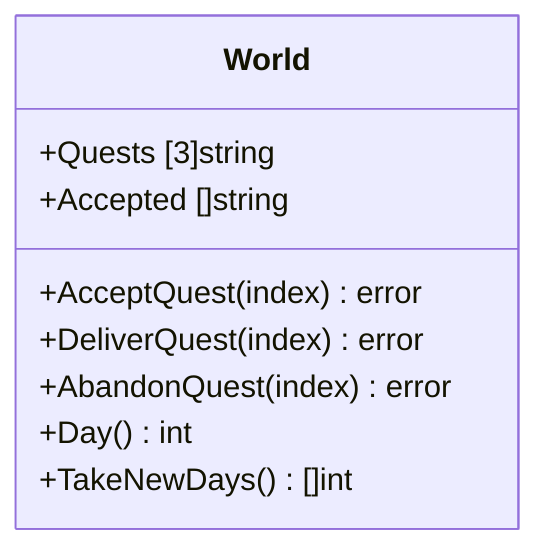
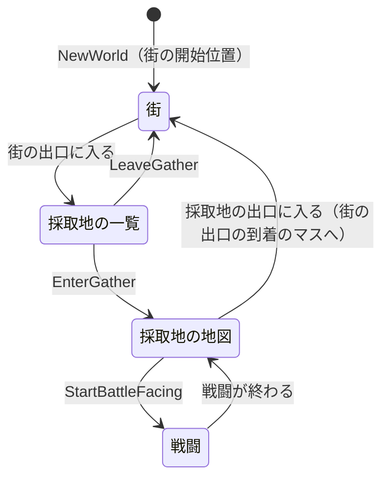

# 設計書（反復 6: 街が育つのを見に歩き、採取地を歩いて拾う）

- 文書 ID: DES-IT06
- 版: 0.4（承認、E-111・E-112。0.3 は E-110、0.2 は E-109 で承認）
- 作成日: 2026-10-16
- 対象: [反復 6 計画書](../iterations/it06/plan.md) v1.0 の範囲
- 入力: [SRS-001](../02_requirements/srs.md) v0.6、[ユースケース](../02_requirements/use-cases.md) v0.6（案）、設計書（反復 1〜5）、[ADR-0003](../adr/0003-image-assets.md)

反復 1〜5 の設計書に書き足す形で、反復 6 で増やす点と変える点だけを書く。ここに書いていない規則は、前の設計書のまま使う。

反復 6 で変える前の設計（置き換えるもの）

| 前の設計 | 反復 6 での扱い |
|---|---|
| 工房の地図（DES-DAT-03 の `workshop`、DES-VAL-17・21 の工房の規則、DES-FLD-06 の工房の距離） | なくす。工房の作業は、街の工房の扉から開く窓で行う（IT06 P-05、4 章） |
| 設備 `K`・`S`・`G`・`F`（錬金釜・在庫の棚・ゴーレムの作業台・施設の看板） | 文字の表から外す（IT06 P-05、P-06） |
| 依頼板の補充（DES-QST-01 の「納品すると入れ替える」）、納品（DES-QST-02 の位置の意味） | 依頼を受ける形に変える（2 章） |
| 採取（DES-GAT-01 の `World.Gather` と採取地ごとの再使用待ち） | 採取地の地図の拾う場所で拾う形に変える（3.4 節）。ゴーレムの採取（DES-GOL-08）は変えない |
| 探索の開始（採取地の一覧の「探索」のボタン） | 採取地の地図の敵の前で始める（3.5 節）。戦闘の規則（DES-BTL）は変えない |
| `World.FacingFixture` | `World.FacingTarget` に置き換える（3.3 節） |
| DES-QST-03 の「納品のあとに入れ替える（上がったランクの依頼も候補に入る）」 | 納品では入れ替えない。解放された依頼は次の日から候補に入る（DES-QST-04） |
| DES-PRG-02 の `ErrLocked` を返す操作のうち `Gather` | `EnterGather` に変える（3.6 節）。`StartBattle` はそのまま |
| DES-GAT-02・03 の採取の再使用待ち | なくす（3.4 節）。抽選の規則（DES-GAT-01）と、ゴーレムの採取（DES-GAT-03 のうちゴーレムの部分、DES-GOL-08）は変えない |
| DES-FLD-01 の「`NewWorld` は工房の開始位置に置き、下を向かせる」 | 街の開始位置に置き、上を向かせる。位置は X が中心、Y は当たり判定の上端をマスの上端にそろえる（3.6 節、E-108・E-110） |
| DES-FLD-05 の「戦闘中に主人公が地図の上にいることはない」と、出入り口の戻り道の処理 | 戦闘中も採取地の地図の上にいる（3.5 節）。街と採取地の地図の間の移り方は 3.6 節 |
| DES-UI-07（工房・街・採取地の欄）、DES-IT05 4.4 節（設備ごとの窓） | 工房の窓（DES-UI-22）、区画の窓（DES-UI-23）、依頼板の窓（DES-UI-25）、採取地の一覧（DES-UI-26）に置き換える。店の窓は今のまま |
| DES-UI-10・21（採取地の一覧の「探索の結果」の欄、「街へ戻る」の位置） | 戦闘の結果は採取地の地図の上の窓で見せる（DES-UI-29）。「街へ戻る」の位置は DES-UI-28 |
| DES-UI-11 の「解放されていない採取地は採取地の一覧に出さない」 | 採取地の一覧には「ランク n で解放」と出す（DES-UI-26、E-108）。レシピの一覧とゴーレムの割り当ての一覧は今のまま（出さない） |
| DES-UI-15・18、DES-IT05 4.3 節の文字とタイルの表 | 文字の表の変更に合わせて書き足す（DES-UI-24・26・28） |
| DES-DAT-02 の「ランク 1 の依頼 3 件以上」に合わせた本体の依頼 | 6 件以上にする（2.4 節、5.2 節） |
| DES-DAT-03（本体の工房と街の地図） | 5.4 節の街の地図と、採取地の地図 4 枚に置き換える |

## 1. 日（FR-PRG-05）

### 1.1 日の数え方（DES-DAY-01）

- `GameDef` に `DaySeconds int` を足す（`game.toml` の `[game]` の `day_seconds`）。本体の値は **300**（実時間の 5 分。IT06 P-01）
- 1 日の tick 数は `DaySeconds × 60`（DES-TIME-01 の 1 秒 = 60 tick）
- `World.Day() int` を足す。今日が何日目かを返す: `Now ÷ (DaySeconds × 60) + 1`（整数の割り算）。`DaySeconds` が 0（書いていない定義データ。既存のテスト用の目録など）のときは、いつも 1 を返す
- `Now` が 1 日の tick 数の倍数になった `Tick` で、日が変わる。`Tick` の中の順番は、`Now` を 1 進める → ゴーレムを並び順に進める（今のまま）→ 日が変わったかを調べ、変わったら日替わりの処理（DES-DAY-02）をする
- 日は `Now` から計算するので、`World` に別の値として持たない（セーブとロードでも `Now` だけを保てばよい）

### 1.2 日替わりの処理（DES-DAY-02）

1. 依頼板の候補を引き直す（DES-QST-04）
2. 新しい日を知らせの列に足す。画面は `World.TakeNewDays() []int` で読み、読むと列は空になる（`TakeRankUps` と同じ形。DES-UI-11）
3. 拾う場所と敵は、日替わりでは変えない（拾う場所は時間で戻る。DES-PCK-02。敵は消えない。IT06 P-10）

- F11 で時間を 10 倍にすると、1 回の `Update` で `Tick` を 10 回呼ぶ。そのうちの 1 回で日が変わる。規則は tick の数だけで決まるので、結果は 1 倍のときと同じ（DES-TIME-01 の補足）

### 1.3 計算例（DES-DAY-01・02）

`DaySeconds` = 1（1 日 = 60 tick）の目録で計算する。

| # | 前の状態 | 操作 | 結果 |
|---|---|---|---|
| D-1 | `NewWorld` の直後（`Now` = 0） | `Day()` | 1 |
| D-2 | `Now` = 0 | `Tick` を 59 回 | `Now` = 59、`Day()` = 1、`TakeNewDays()` は空 |
| D-3 | `Now` = 59 | `Tick` を 1 回 | `Now` = 60、`Day()` = 2、`TakeNewDays()` = [2]。もう一度読むと空 |
| D-4 | `Now` = 0 | `Tick` を 120 回して読む | `Day()` = 3、`TakeNewDays()` = [2, 3] |
| D-5 | `DaySeconds` = 0 の目録 | `Tick` を 1000 回 | `Day()` = 1、`TakeNewDays()` は空、依頼板は変わらない |

## 2. 依頼を受ける（FR-ECO-05〜07）

### 2.1 状態（DES-QST-04）



- `World.Quests` は、依頼板の**候補**（受けていない依頼）。`[3]string` のまま。空いた位置は ""
- `World.Accepted` を足す。**受けた依頼**の ID を、受けた順に並べる。最大 3 件（定数 `core.MaxAcceptedQuests` = 3。IT06 P-02）
- 同じ依頼は、候補と受けた依頼を合わせて 1 か所にしか出ない
- **候補の引き方**: 候補にするのは、解放されている依頼（DES-QST-03）のうち、今の `Quests` にも `Accepted` にもないもの。並べ方と選び方（ID の昇順に並べ、依頼用の乱数列 `rand.NewPCG(seed, 1)` で `IntN(候補の数)`）は DES-QST-01 のまま。候補がなければ ""
- **`NewWorld`**: 位置 0・1・2 の順に、上の引き方で埋める（今のまま）
- **日替わり（DES-DAY-02 の 1）**: まず 3 つの位置をすべて "" にし、そのあと位置 0・1・2 の順に、上の引き方で埋める。前の日の候補も、また引かれることがある（FR-ECO-07「同じ依頼が出ることもある」）。受けた依頼は引かれない
- 日替わりのほかに、候補を埋めることはない。受けて空いた位置は、次の日まで "" のまま（IT06 P-02）。ランクが上がって解放された依頼も、次の日から候補に入る

### 2.2 操作（DES-QST-05）

**`World.AcceptQuest(index int) error`**（依頼を受ける）。次の順に検査し、最初に見つかった誤りを、状態を変えずに返す（DES-WLD-01）。

1. `index` が 0〜2 でない、または `Quests[index]` が ""（`ErrNoQuest`。範囲外の位置は、3 つの操作のどれも `ErrNoQuest` にそろえる）
2. `len(Accepted)` が 3（`ErrQuestLimit`）

通れば、`Quests[index]` を `Accepted` の最後に足し、`Quests[index]` を "" にする。

**`World.DeliverQuest(index int) error`**（納品する）。今の `Deliver` を、名前を変えて置き換える。`index` は `Accepted` の位置に変わるので、名前を変えて、古い呼び方が残らないようにする（呼び残しはコンパイルで見つかる）。

1. `index` が 0〜`len(Accepted)` − 1 でない（`ErrNoQuest`）
2. 依頼の ID が目録にない（`ErrUnknownID`）
3. 条件を満たす在庫が足りない（`ErrNotEnoughItems`。DES-QST-02 の低品質から使う規則のまま）
4. お金・評判があふれる（`ErrInvalidCount`。DES-QST-03 のまま）

通れば、在庫を減らし、報酬と評判を足し、ランクの知らせを足し（DES-QST-03 のまま）、`Accepted` から `index` の依頼を取り除く（後ろの依頼を 1 つずつ前に詰める）。**依頼板の候補は変えない**（DES-QST-01 の「納品すると入れ替える」をやめる）。

**`World.AbandonQuest(index int) error`**（受けた依頼をやめる。IT06 P-03）

1. `index` が 0〜`len(Accepted)` − 1 でない（`ErrNoQuest`）

通れば、`Accepted` から `index` の依頼を取り除く（後ろを前に詰める）。お金・評判・在庫は変えない。やめた依頼は、次の日から、また候補として引かれることがある。

| 誤り | 文 | 返す操作 |
|---|---|---|
| `ErrQuestLimit`（新） | 受けられる依頼は 3 件までです | `AcceptQuest` |
| `ErrNoQuest`（既存） | 依頼がありません | `AcceptQuest`、`DeliverQuest`、`AbandonQuest` |

- 受けた依頼には期限がない。日が変わっても `Accepted` は変わらない（FR-PRG-02。IT06 4 章）

### 2.3 計算例（DES-QST-04・05）

依頼 q1〜q6（どれもランク 1。依頼の中身は検査に関係しない）と、`DaySeconds` = 1 の目録で計算する。依頼の抽選の結果は乱数で決まるので、例では「どの位置が空か」「どの依頼が候補になりうるか」を確かめる。

| # | 前の状態 | 操作 | 結果 |
|---|---|---|---|
| Q-1 | `NewWorld` の直後 | — | `Quests` の 3 つはどれも "" でなく、互いに違う。`Accepted` は空 |
| Q-2 | Q-1 の状態で `Quests` = [A, B, C] | `AcceptQuest(1)` | `Accepted` = [B]、`Quests` = [A, "", C] |
| Q-3 | Q-2 | `AcceptQuest(1)` | `ErrNoQuest`、変わらない |
| Q-4 | `Accepted` = [B, A, C]、`Quests` = ["", "", ""] | `AcceptQuest(0)` | `ErrNoQuest`（位置が空の検査が先） |
| Q-5 | `Accepted` = [B, A, C]、`Quests` = [D, "", ""] | `AcceptQuest(0)` | `ErrQuestLimit`、変わらない |
| Q-6 | `Quests` = [A, B, C] | `AcceptQuest(3)` | `ErrNoQuest`、変わらない |
| Q-7 | `Accepted` = [B, A]、B の条件を満たす在庫がある | `DeliverQuest(0)` | `Accepted` = [A]。お金と評判が増える。`Quests` は変わらない |
| Q-8 | `Accepted` = [B, A] | `DeliverQuest(2)` | `ErrNoQuest`、変わらない |
| Q-9 | `Accepted` = [B, A]、A の在庫が足りない | `DeliverQuest(1)` | `ErrNotEnoughItems`、変わらない |
| Q-10 | `Accepted` = [B, A]、お金 100 | `AbandonQuest(0)` | `Accepted` = [A]、お金 100 のまま |
| Q-11 | `Accepted` = [] | `AbandonQuest(0)` | `ErrNoQuest` |
| Q-12 | `Accepted` = [A, B, C]、`Now` = 59 | `Tick` | 日が変わり、`Quests` は D・E・F を 1 つずつ並べたもの（候補がちょうど 3 件なので、どの位置も "" にならない）。`Accepted` は変わらない |
| Q-13 | 依頼が q1〜q4 だけの目録、`Accepted` = [A, B, C]、`Now` = 59 | `Tick` | `Quests` = [D, "", ""]（候補は D だけ） |
| Q-14 | `Accepted` = []、`Quests` = [A, "", ""]、`Now` = 59 | `Tick` | 3 つの位置をすべて引き直す。`Quests` の 3 つは互いに違い、A がまた出てもよい |
| Q-15 | 同じシードの World を 2 つ作り、同じ操作をする | — | `Quests` と `Accepted` が同じ（NFR-06） |

### 2.4 依頼の定義の検証（DES-VAL-15 の変更）

- DES-VAL-15 の「ランク 1 の依頼は 3 件以上」を、「**ランク 1 の依頼は 6 件以上**」に変える。受けた依頼が 3 件あっても、ランク 1 だけで候補の 3 つの位置を埋められるようにするため（依頼板 3 件 ＋ 受けた依頼 3 件。REV-052 F-04）
- 誤り文: `quests.toml: ランク 1 の依頼が 4 件しかない（6 件以上が必要）`

## 3. 採取地の地図（FR-FLD-01〜05、FR-MAT-01、FR-BTL-10）

### 3.1 地図の種類と文字の表（DES-DEF-09 の変更、DES-DEF-10）

- 地図は、**街**（ID `town`）と、**採取地の地図**の 2 種類。採取地の地図の ID は、採取地の ID と同じにする（例: `meadow`）。工房の地図（`workshop`）はなくす。定数 `defs.MapWorkshop` も消す
- 文字の表（DES-IT05 1.2 節）を次のように変える。床・壁・出入り口の文字は今のまま

| 文字 | 種類 | 通れるか | 意味 | 置く地図 |
|---|---|---|---|---|
| `K`・`S`・`G`・`F` | — | — | 表から外す（知らない文字になる） | |
| `D` | 設備 `workshop_door` | 通れない | 工房の扉（窓は 4 章） | `town` に 1 個以上 |
| `M` | 設備 `shop` | 通れない | 店（今のまま） | `town` に 1 個以上 |
| `Q` | 設備 `quest_board` | 通れない | 依頼板（今のまま） | `town` に 1 個以上 |
| `a`〜`i` | 区画 | 通れない | 施設の区画（3.2 節） | `town` だけ |
| `*` | 拾う場所 | 通れない | 草むら（3.4 節） | 採取地の地図だけ |
| `o` | 拾う場所 | 通れない | 岩（3.4 節） | 採取地の地図だけ |
| `E` | 敵 | 通れない | 戦闘を始める敵（3.5 節） | 採取地の地図だけ |
| `~` | 壁 | 通れない | 水 | |

- `defs.CellKind` に `CellLot`（区画）、`CellPick`（拾う場所）、`CellEnemy`（敵）を足す
- 草むらと岩は、絵が違うだけで、規則は同じ（どちらも、その採取地の採取の表から拾う）

### 3.2 施設の区画（DES-DEF-11）

```toml
# data/base/maps.toml の town（抜粋）
lots = [
  { mark = "a", facility = "market" },
  { mark = "b", facility = "workshop" },
]
```

- `MapDef` に `Lots []LotDef` を足す。`LotDef` は `Mark byte`、`Facility string`、`X`・`Y int`（区画の左上のマス。defload が `Rows` から求める）
- 区画は **3 × 3 マス**の四角で、同じ文字を 9 マスに書く（IT06 5 章の見た目を 3 × 3 の絵で描くため。DES-UI-24）
- 区画のマスは、施設を建てる前も建てたあとも通れない（空き地の柵、または建物）
- 区画を向いて決定のキーを押すと、その施設の窓を開く（DES-UI-23）。施設の建設と強化の規則（DES-TWN-01）は変えない

**施設の見た目**（DES-DEF-12）

- `FacilityLevel` に `Look string` を足す（`buildings.toml` の `levels` の `look`）。その段階まで建てたときの区画の絵の種類
- `Look` は、コードで決めた固定の一覧から選ぶ: `stall`（屋台）、`cottage`（小さな家）、`house`（家）、`manor`（大きな家）。段階 0（まだ建てていない）は、いつも空き地の絵
- 同じ `Look` が続いてもよい（見た目を変えない段階を作れる）。ただし、本体のデータでは、各段階で見た目を変える（FR-TWN-07）

### 3.3 向いている物（DES-FLD-04 の変更、DES-FLD-07）

`World.FacingFixture` を `World.FacingTarget() (Target, bool)` に置き換える。

```go
type TargetKind int // TargetFixture, TargetLot, TargetPick, TargetEnemy

type Target struct {
	Kind TargetKind
	ID   string // 設備の種類（defs.FixtureShop など）か、区画の施設の ID。拾う場所と敵では ""
	X, Y int    // 向いているマス
}
```

- 選び方は DES-FLD-04 のまま（前の帯と重なるマスのうち、面積が大きいもの、同じなら y、次に x の小さいもの）。候補にするマスを、設備のマスから「設備・区画・拾う場所・敵のマス」に広げる
- 主人公が地図の上にいなければ、(Target{}, false)

### 3.4 拾う（DES-PCK-01・02）

**`World.PickFacing() ([]Stack, error)`**（DES-PCK-01）。向いている拾う場所から素材を拾う。次の順に検査し、最初に見つかった誤りを、状態を変えずに返す。

1. 戦闘中（`ErrInBattle`）
2. 向いている物が拾う場所でない（`FacingTarget` が拾う場所を返さない）（`ErrNothingToPick`）
3. その場所が空（戻る tick に達していない）（`ErrPickNotReady`。文に残り秒数を入れる: 「あと 12 秒で拾えます」。秒数は残り tick を 60 で割って切り上げ）
4. 採取地の定義がない、または `RespawnSeconds` が 1 未満か大きすぎて tick があふれる（`ErrUnknownID`、`ErrInvalidCount`）

通れば、その採取地の採取の表で抽選し（`Rolls` 回。DES-GAT-01・03 の `gatherIntoInventory` をそのまま使う。失敗したら在庫と乱数を戻す）、その場所を空にする。拾った物を返す。

**拾う場所の状態**（DES-PCK-02）

- `World` に、拾う場所ごとの「戻る tick」を持つ（`map[PickKey]uint64`。`PickKey` は地図の ID とマスの x・y）。まだ拾っていない場所は、表にない（拾える）
- 拾うと、戻る tick を `Now + RespawnSeconds × 60` にする。`Now` が戻る tick 以上なら、拾える
- `GatherDef` に `RespawnSeconds int` を足す（`gathers.toml` の `respawn_seconds`）。採取地の地図がある採取地には必須（DES-VAL-28）。本体の値は 5 章
- 場面を出て戻っても、日が変わっても、状態は続く（時間でだけ戻る）
- 採取地ごとの再使用待ち（`gatherReady`、`ErrGatherCooldown`）と `World.Gather` はなくす。`CooldownSeconds` は、ゴーレムの採取の時間（DES-GOL-08）にだけ使う
- 解放されていない採取地の地図には入れないので（3.6 節）、`PickFacing` ではランクを検査しない
- **`World.PickRemaining(mapID string, x, y int) uint64`**: その拾う場所が戻るまでの残り tick を返す（0 なら拾える。拾う場所でないマスも 0）。状態を変えない。ui が、空の拾う場所を薄く描き、残り秒数を出すのに使う（DES-UI-26）
- 戻る tick の表は非公開のフィールドにする。セーブとロード（ゴールテープで作る）で公開の形を決める

| 誤り | 文 | 返す操作 |
|---|---|---|
| `ErrNothingToPick`（新） | 拾える物がありません | `PickFacing` |
| `ErrPickNotReady`（新） | まだ拾えません（前に「あと n 秒で拾えます」を付ける） | `PickFacing` |
| `ErrNoEnemy`（新） | 戦う相手がいません | `StartBattleFacing` |
| `ErrNoGatherMap`（新） | この採取地には地図がありません | `EnterGather` |
| `ErrInBattle`（既存） | 戦闘中です | `PickFacing`、`StartBattleFacing`、`EnterGather` |

### 3.5 敵の前で戦闘を始める（DES-BTL-07）

**`World.StartBattleFacing() error`**。次の順に検査する。

1. 戦闘中（`ErrInBattle`。`PickFacing` と同じく、戦闘中の検査を先にする）
2. 向いている物が敵でない（`ErrNoEnemy`。文: 「戦う相手がいません」）
3. あとは `StartBattle(今の地図の ID)` と同じ（解放、`ErrNoBattle`、`ErrInjured`。DES-BTL-02）

- 敵は消えない。勝っても負けても、同じ敵とまた戦える（IT06 P-10 c。E-82 のまま、探索に再使用待ちはない）
- 戦闘中も、主人公は採取地の地図にいる（`Scene` は変えない）。戦闘中は `MovePlayer` が `ErrInBattle` を返す（DES-FLD-02 のまま）。戦闘が終わると、同じ位置から歩ける
- `StartBattle(gatherID)` はそのまま残す（テストと、`StartBattleFacing` の中で使う）。画面からは呼ばない

### 3.6 場面の移り方（DES-FLD-05 の変更）



- **`NewWorld`**: 目録に `town` の地図があれば、主人公をその開始位置に置き、**上**を向かせる（工房の地図を街に変える。本体の街では、開始位置の上が工房の扉なので、始めてすぐ決定のキーで工房の窓を開ける。E-108）。位置は開始マスの中心ではなく、X = StartX × 96 + 48、Y = StartY × 96 + 32（当たり判定の上端をマスの上端にそろえる）とする。中心に置くと、前の帯（DES-FLD-04）が開始マスの中に収まり、工房の扉を向いている物と判定しないため（REV-058 F-01、E-110）
- **`World.EnterGather(gatherID string) error`**（新）: 採取地の一覧から、採取地の地図に入る。次の順に検査する
  1. `Scene` が `gather` でない（`ErrNotInGather`）
  2. 戦闘中（`ErrInBattle`）
  3. 採取地が目録にない（`ErrUnknownID`）
  4. 解放されていない（`ErrLocked`。DES-PRG-01）
  5. その採取地の地図がない（`ErrNoGatherMap`。文: 「この採取地には地図がありません」）。検証済みの定義データでは起きない（DES-VAL-17 で、地図を使うときはすべての採取地に地図がある）。core が異常終了しないための守りの検査

  通れば、`Scene` をその地図にし、地図の出口（行き先 `town`）の到着のマスの中心に置き、出口の `Dir` を向かせる
- **採取地の地図の出口**: 採取地の地図には、行き先が `town` の出入り口をちょうど 1 つ置く。そこに入ると、街の `gather` 行きの出入り口の到着のマスに立つ（`LeaveGather` と同じ位置と向き。IT06 P-08）
- DES-IT05 1.4 節の「戻り道」の規則は、街と採取地の地図の間には当てはめない（街の出口は採取地の一覧に向かい、採取地の地図の出口は街に向かう）
- 採取地の一覧から入れるのは、解放されている採取地だけ。負傷中でも入れる（戦闘だけができない。E-108）

### 3.7 計算例（DES-FLD-05・07、DES-PCK-01・02、DES-BTL-07）

次の 2 枚の小さな地図で計算する（本体の地図とは別）。位置の単位は DES-FLD-01 のまま（1 マス = 96 単位、マス (cx, cy) の中心は (cx × 96 + 48, cy × 96 + 48)）。

例の街（9 × 7、開始位置 (5, 5)。区画 `a` は施設 `market`。出入り口 `2` は行き先 `gather`、向き `up`）

```text
   x 012345678
y 0  TTTTTTTTT
y 1  T,aaa,,QT
y 2  T,aaa,,,T
y 3  T,aaa,,DT
y 4  T,,,,,,MT
y 5  T,,,,,,,T
y 6  TTTT2TTTT
```

例の草原（ID `meadow`、7 × 5。出入り口 `1` は行き先 `town`、向き `up`。`RespawnSeconds` = 2、`Rolls` = 3、戦闘あり）

```text
   x 0123456
y 0  TTTTTTT
y 1  T*,,,ET
y 2  T,,o,,T
y 3  T*,,,,T
y 4  TTT1TTT
```

| # | 前の状態（場面、X、Y、向き） | 操作 | 後の状態・結果 | 確かめること |
|---|---|---|---|---|
| F-1 | — | `NewWorld` | 街、(528, 512)、上 | 開始位置 (5, 5) の X は中心、Y は当たり判定の上端がマスの上端にそろう位置。向きは上（E-110） |
| F-2 | 街、(512, 240)、左 | `FacingTarget()` | 区画 `market`、(4, 2) | 前の帯 x 464〜479 は列 4（区画 `a`） |
| F-3 | 街、(640, 336)、右 | `FacingTarget()` | 設備 `workshop_door`、(7, 3) | 前の帯 x 672〜687 は列 7 |
| F-4 | 採取地の一覧 | `EnterGather("meadow")` | 草原、(336, 336)、上 | 出口 `1` の到着のマス (3, 3) |
| F-5 | 街 | `EnterGather("meadow")` | `ErrNotInGather`、変わらない | |
| F-6 | 採取地の一覧、ランク 2 で解放される採取地 | `EnterGather` | `ErrLocked`、変わらない | |
| F-7 | 草原、(336, 336)、上 | `MovePlayer(0, -1)` を 3 回 | 草原、(336, 320)、上 | 3 回目で上端 283 が行 2 の岩に重なるので、(2 + 1) × 96 + 32 = 320 に戻す |
| F-8 | 草原、(336, 320)、上 | `FacingTarget()` | 拾う場所、(3, 2) | 前の帯 y 272〜287 は行 2 |
| F-9 | F-8、`Now` = 0 | `PickFacing()` | 在庫が 3 個増える（採取の表から 3 回抽選）。(meadow, 3, 2) の戻る tick = 120 | |
| F-10 | F-9 のあと `Now` = 50 | `PickFacing()` | `ErrPickNotReady`（「あと 2 秒で拾えます」: 残り 70 tick を 60 で割って切り上げ）、変わらない | |
| F-11 | F-9 のあと `Now` = 120 | `PickFacing()` | 拾える。戻る tick = 240 | 戻る tick ちょうどで拾える |
| F-12 | 草原、(336, 336)、上 | `PickFacing()` | `ErrNothingToPick` | 前の帯 y 288〜303 は行 3 の床 |
| F-13 | 草原、(528, 224)、上 | `FacingTarget()` | 敵、(5, 1) | 前の帯 y 176〜191 は行 1 |
| F-14 | F-13 | `StartBattleFacing()` | 戦闘が始まる（`Battle.GatherID` = `meadow`）。`Scene` は草原のまま | |
| F-15 | F-14 のあと勝つ | `StartBattleFacing()` | また戦闘が始まる | 敵は消えない |
| F-16 | 草原、戦闘中 | `PickFacing()` | `ErrInBattle` | |
| F-17 | 草原、(336, 336)、下 | `MovePlayer(0, 1)` を 7 回 | 街、(432, 528)、上 | 7 回目で Y = 378 + 7 = 385 になり、中心が出口 (3, 4) に入る。街の出口 `2` の到着のマス (4, 5) |
| F-18 | F-9 のあと（(meadow, 3, 2) の戻る tick = 120） | 草原を出て、採取地の一覧から `EnterGather("meadow")` で入り直し（(336, 336)、上）、`MovePlayer(0, -1)` を 3 回して (336, 320)・上に立ち、`Now` = 50 で `PickFacing()` | `ErrPickNotReady` | 拾う場所の状態は場面を出ても続く |

- 例 F-17 の途中: 1 回目から 6 回目は (336, 343)〜(336, 378)。3 回目から当たり判定の下端が行 4 にかかるが、当たるのは出口のマス (3, 4) だけなので通れる。7 回目で 385 になり、行 4 の始まり 384 を超える
- 例 F-1〜F-17 の位置の値は、DES-IT05 2 章の規則を写したスクリプトで確かめた（設計のとき）
- テストでは、`PickFacing` と `StartBattleFacing` が、`FacingTarget` と同じマスを使うことも確かめる

## 4. 工房の窓（IF-06、IF-08、IT06 P-05）

- 工房の地図をなくし、街の工房の扉（設備 `workshop_door`）を向いて決定のキーを押すと、**工房の窓**を開く（DES-UI-22）
- core に工房のための新しい操作は足さない。錬金・ゴーレム・在庫の操作は今のまま

## 5. 定義データ（DES-DAT-04）

### 5.1 施設と製品（IT06 P-07、P-11）

施設は 4 つ。効果の種類は今ある `golem_slots` と `sell_rate` だけ（IT06 4 章）。値は仮置きで、データの Issue で遊んで調整してよい。

| 施設 | 段階 | お金 | 材料 | 効果 | 見た目 |
|---|---|---|---|---|---|
| `workshop` 錬金工房 | 1 | 60 | パン ×2 | ゴーレムの枠 +1 | `cottage` |
| | 2 | 140 | 鉄の延べ棒 ×2、ひかりランタン ×1 | ゴーレムの枠 +1 | `house` |
| `market` 街の市場 | 1 | 70 | ハンバーガー ×2 | 売値 +10% | `stall` |
| | 2 | 150 | 薬草の縄 ×3、チーズ ×2 | 売値 +10% | `house` |
| `golem_shed` ゴーレム小屋（新） | 1 | 100 | 鉄の延べ棒 ×3 | ゴーレムの枠 +1 | `cottage` |
| | 2 | 220 | 鉄の延べ棒 ×4、ひかり結晶 ×2 | ゴーレムの枠 +1 | `manor` |
| `inn` 旅人の宿（新） | 1 | 90 | 薬草の縄 ×2、パン ×3 | 売値 +5% | `cottage` |
| | 2 | 200 | ハンバーガー ×3、回復薬 ×2 | 売値 +10% | `manor` |

新しい製品（ランク 1。素材の種類は今のまま）

| 製品 | 入力 | 秒数 | 属性 | 基本の売値 |
|---|---|---|---|---|
| `iron_ingot` 鉄の延べ棒 | 鉄鉱石 ×3 | 5 | 金属、硬質 | 30 |
| `herb_rope` 薬草の縄 | 薬草 ×2、小麦 ×1 | 4 | 繊維、しなやか | 20 |

- 手作りのボーナス（`bonuses`）は、データの Issue で、今のレシピにならって 1 つずつ決める
- 新しい製品は戦闘で使わない（`use` を持たない）
- 鉄の延べ棒は、ひかり結晶・爆弾と材料が重ならないように鉄鉱石だけにした。薬草の縄には「草」の属性を付けない（チーズや回復薬の「草」の入力枠に入らないように）。属性の「硬質」は、鉄鉱石と同じ表記

### 5.2 依頼（REV-052 F-04）

ランク 1 の依頼を 3 件足して 6 件にし（DES-VAL-15）、ランク 2〜4 にも足す（E-108）。

| 依頼 | ランク | 評判 | 製品 | 品質 | 個数 | 報酬 |
|---|---|---|---|---|---|---|
| `q_flour` | 1 | 1 | 小麦粉 | 20 | 3 | 45 |
| `q_potion_easy` | 1 | 1 | 回復薬 | 20 | 2 | 50 |
| `q_rope` | 1 | 1 | 薬草の縄 | 20 | 2 | 55 |
| `q_ingot` | 2 | 3 | 鉄の延べ棒 | 50 | 2 | 90 |
| `q_rope_fine` | 3 | 4 | 薬草の縄 | 100 | 3 | 120 |
| `q_ingot_fine` | 3 | 4 | 鉄の延べ棒 | 100 | 2 | 140 |
| `q_bomb_master` | 4 | 0 | 爆弾 | 150 | 2 | 200 |
| `q_lantern_master` | 4 | 0 | ひかりランタン | 150 | 1 | 220 |

### 5.3 日と採取

- `game.toml` に `day_seconds = 300`
- `gathers.toml` の各採取地に `respawn_seconds`: 風の草原 45、泉の洞窟 45、陽だまりの丘 60、水晶の森 75（1 か所で `Rolls` = 3 個拾える）

### 5.4 本体の地図

街（30 × 20、開始位置 (10, 15)。工房の扉は (10, 14)。区画 `a`〜`d` は 3 × 3）

```toml
[[map]]
id = "town"
name = "街"
start = { x = 10, y = 15 }
rows = [
  "TTTTTTTTTTTTTTTTTTTTTTTTTTTTTT",
  "T,,,,,,,,,,,,,,,,,,,,,,,,,,,,T",
  "T,,aaa,,,,,,,,,,,,,,,,,,bbb,,T",
  "T,,aaa,,,,,,,,::,,,,,,,,bbb,,T",
  "T,,aaa,,,,,,,,::,,,,,,,,bbb,,T",
  "T,,,,,,,,,,,,,::,,,,,,,,,,,,,T",
  "T,,,,::::::::::::::::::::,,,,T",
  "T,,T,,,,,,,,,,::,,,,,,,,,,T,,T",
  "T,,ccc,,,,,,,,::,,,,,,,,ddd,,T",
  "T,,ccc,,,,,,,,::,,,,,,,,ddd,,T",
  "T,,ccc,,,,,,,,::,,,,,,,,ddd,,T",
  "T,,,,,,,,,,,,,::,,,,,,,,,,,,,T",
  "T,,,,,,,^^^^^,::,^^^^^,,,,,,,T",
  "T,,,,,,,^^^^^,::,^^^^^,,,,,,,T",
  "T,,,,,,,WWDWW,::,WWWWW,,,,,,,T",
  "T,,,,,,,,::::::::::M,,,,,,,,,T",
  "T,,,,,,,,::::Q:::::,,,,,,,,,,T",
  "T,,,,,,,,::::::::::,,,,,,,,,,T",
  "T,,,,,,,,,,,,,::,,,,,,,,,,,,,T",
  "TTTTTTTTTTTTTT2TTTTTTTTTTTTTTT",
]
exits = [
  { mark = "2", to = "gather", dir = "up", look = "road" },
]
lots = [
  { mark = "a", facility = "market" },
  { mark = "b", facility = "inn" },
  { mark = "c", facility = "workshop" },
  { mark = "d", facility = "golem_shed" },
]
```

- 反復 5 の街からの変更: 工房の家の扉（出入り口 `1`）を工房の扉の設備 `D` に、施設の看板 `F` を道 `:` に変えた。上半分の飾りの家 2 軒（行 2〜4）を区画 `a`・`b` に、行 8〜10 の草地に区画 `c`・`d` を置き、行 6 に横の道を足した
- よく使う場所の間の歩く距離（DES-FLD-06。前のマスどうしの最短の歩数。設計のときにスクリプトで計算した）

| 街 | 店 | 依頼板 | 採取地への出口 |
|---|---|---|---|
| 工房の扉 | 8 | 3 | 7 |
| 店 | | 5 | 7 |
| 依頼板 | | | 2 |

- 区画までの距離は上限を設けない（区画は街を歩いて見に行く場所。IT06 1 章）。参考: 工房の扉から区画 `a` 15、`b` 24、`c` 9、`d` 18
- DES-FLD-06 の上限（8 マス）は、街の工房の扉・店・依頼板・採取地への出口の組だけに当てはめる（工房の地図がなくなったので、工房の組はなくす）

**採取地の地図の決まり**（データの Issue で 4 枚を作る）

- 大きさは 20〜30 × 12〜20 マス。表示枠（DES-UI-16）に収まらなければ、カメラで追う
- 拾う場所（`*`・`o`）を 4〜8 か所。戦闘のある採取地は、敵 `E` を 1 か所
- 出口 `1`（行き先 `town`、絵は `road`）を 1 つ。出口の到着のマスから、拾う場所と敵の前のマスへ行ける（DES-VAL-29）
- 出口の到着のマスから、いちばん遠い拾う場所の前のマスまで 15 マス以内（歩いて約 3.4 秒。拾い集める手間が大きくなりすぎないように。仮置き）。本体のデータのテストで確かめる
- 採取地ごとに景色を変える（草原は草地と木、洞窟は石の床と壁と水、など）。床・壁の文字は今の表から選ぶ

## 6. 地図と定義データの検証（defload）（FR-FLD-04、FR-MOD-04、NFR-08）

DES-VAL-17・20〜23 を次のように変え、DES-VAL-25〜29 を足す。地図の規則は、今までどおり `[[map]]` が 1 つ以上あるときだけ行う。

| ID | 規則 | 関連要求 |
|---|---|---|
| DES-VAL-17（変更） | 地図の ID は `town` か、採取地の ID で、重複しない。`[[map]]` があるときは、`town` と、すべての採取地の地図がある。また、採取地の ID は `town`・`gather` でない（地図の ID と `SceneGather` とぶつかるため） | FR-FLD-01 |
| DES-VAL-20（変更） | `town` には `start` が書かれていて、床のマス。採取地の地図には `start` を書かない（書いたら誤り。開始位置は出口の到着のマス） | FR-FLD-01 |
| DES-VAL-21（変更） | `town` に工房の扉 `D`・店 `M`・依頼板 `Q` が 1 個以上ある。区画 `a`〜`i`・拾う場所 `*`・`o`・敵 `E` の置き場所は 3.1 節の表のとおり（違う地図にあれば誤り） | FR-FLD-01、IF-08 |
| DES-VAL-22（変更） | 出入り口の規則（DES-IT05）のうち、地図の種類によるものを次に変える。`town` には行き先 `gather` の出入り口がちょうど 1 つで、ほかの出入り口はない。採取地の地図には行き先 `town` の出入り口がちょうど 1 つで、ほかの出入り口はない。戻り道の規則は当てはめない | FR-FLD-03 |
| DES-VAL-23（変更） | 塗りつぶしの出発点は、`town` では `start`、採取地の地図では出口の到着のマス。設備・区画・拾う場所・敵のどれにも、前のマス（上下左右で隣り合う床のマス）の少なくとも 1 つへ行ける | FR-FLD-01、02 |
| DES-VAL-25 | 区画: `lots` は `town` にだけ書く（採取地の地図に書いたら誤り）。`lots` の `mark` は `a`〜`i` の 1 文字で、重複しない。`rows` の中で、その文字のマスはちょうど 3 × 3 の四角を 1 つ作る（9 マスで、ほかの場所にない）。`rows` にある `a`〜`i` は、すべて `lots` に定義がある。`facility` は目録の施設で、1 つの施設は 1 つの区画にだけ置く。目録のすべての施設に区画がある（そのため、地図を使うときの施設は 9 つまで） | FR-TWN-07、FR-FLD-01 |
| DES-VAL-26 | `[[map]]` があるときは、施設の段階の `look` は `stall`・`cottage`・`house`・`manor` のどれかで、書いていなければ誤り。`[[map]]` がないときは、書いたときだけ同じ一覧で確かめる | FR-TWN-07 |
| DES-VAL-27 | 戦闘のある採取地の地図には敵 `E` がちょうど 1 マス、戦闘のない採取地の地図には敵がない。拾う場所は 1 マス以上 | FR-FLD-05 |
| DES-VAL-28 | `respawn_seconds` は、書くなら 1 以上 86400 以下。`[[map]]` があるときは、すべての採取地に必須 | FR-FLD-05 |
| DES-VAL-29 | `game.toml` の `day_seconds` は、書くなら 1 以上 86400 以下（0 と書いたら誤り。書いたかどうかは `meta.IsDefined` で見分ける。DES-VAL-20 の `start` と同じ考え方）。`[[map]]` があるときは必須 | FR-PRG-05 |
| DES-VAL-15（変更） | 2.4 節（ランク 1 の依頼は 6 件以上） | FR-ECO-07 |

| 規則 | 誤り文の例 |
|---|---|
| DES-VAL-17 | `maps.toml: 採取地 sunny_hill の地図がない` |
| DES-VAL-20 | `maps.toml: map[id=meadow].start: 採取地の地図には開始位置を書かない` |
| DES-VAL-21 | `maps.toml: map[id=town]: 工房の扉（D）がない` ／ `maps.toml: map[id=meadow].rows[3][5]: 区画（b）は街にしか置けない` |
| DES-VAL-25 | `maps.toml: map[id=town].lots[1]: 区画 "b" が 3 × 3 の四角になっていない` ／ `maps.toml: map[id=town]: 施設 inn の区画がない` |
| DES-VAL-26 | `buildings.toml: facility[id=inn].levels[0].look: 知らない見た目 "castle"` |
| DES-VAL-27 | `maps.toml: map[id=meadow]: 敵（E）が 2 マスある（戦闘のある採取地は 1 マス）` |
| DES-VAL-28 | `gathers.toml: gather[id=meadow].respawn_seconds: 1 以上 86400 以下にする（0）` |
| DES-VAL-29 | `game.toml: game.day_seconds: 書かれていない（地図を使うときは必須）` |

**検証の進め方**（DES-IT05 3 章に足す）

- DES-VAL-25 の誤りがある地図では、DES-VAL-23 を行わない（区画の位置が決まらないため）。DES-VAL-27 の誤りは塗りつぶしに関係しないので、DES-VAL-23 を行う
- 拾う場所・敵の前のマスへ行けるかも、DES-VAL-23 の塗りつぶしで確かめる（DES-VAL-23 の変更）

- ファジングのテスト（DES-VAL-24）の種に、区画・拾う場所・敵を含む地図と、各規則の誤りの例を足す
- 本体のデータのテストで、地図の件数を 5（街と採取地 4 か所）、施設の件数を 4、依頼の件数を 17 に変える

## 7. 画面（ui）（IF-06、IF-07、IF-08、FR-TWN-07、FR-PRG-05、DES-UI-22〜29）

窓の決まり（DES-UI-19）、上の表示（DES-UI-20）、地図の描画（DES-UI-15・16）は、ここに書いた点のほかは変えない。

| ID | 画面の決まり | 関連 |
|---|---|---|
| DES-UI-22 | **工房の窓**: 工房の扉を向いて決定のキーを押すと開く。窓の見出しの行に、「閉じる」の右に「錬金」「ゴーレム」「在庫」の 3 つのタブを置く（見出しの名前は「工房」）。タブの中身は、反復 5 の錬金釜・ゴーレムの作業台・在庫の棚の窓の欄と同じ（DES-IT05 4.4 節）。開いたときのタブは、前に閉じたときのタブ（始めは「錬金」）。タブの切り替えはマウスで行う | IF-06、IT06 P-05 |
| DES-UI-23 | **区画の窓**: 区画を向いて決定のキーを押すと、その施設の窓を開く。見出しの名前は施設の名前。中身は、在庫（売れない）と、その施設 1 つだけの施設の欄（今の段階、次の段階の費用と効果、「建設」のボタン。DES-UI-07 の施設の欄を 1 つに絞ったもの）。最大の段階なら「最大の段階です」と出し、ボタンを出さない | FR-TWN-02、IT06 P-06 |
| DES-UI-24 | **区画の絵**: 区画の 3 × 3 マスに、施設の今の段階の `Look`（段階 0 は空き地）の絵を描く。空き地は草地に柵と立て札。`stall` は草地に屋台（TT 57）。`cottage`・`house`・`manor` は、上 2 段が屋根、下 1 段が壁と扉の家で、屋根の色や飾りで見分ける。絵のタイル番号は実装の Issue で Tiny Town から選び、DES-IT05 4.3 節の表のように書き足す。区画の上に「街の市場 Lv1」のように施設の名前と段階を出す（段階 0 は「街の市場（空き地）」）。主人公が向いている区画は、名前を明るい色で出す（DES-UI-15 と同じ） | FR-TWN-07 |
| DES-UI-25 | **依頼板の窓**: 2 つの欄に分ける。上の欄「今日の依頼」: 候補 3 件と、それぞれ「受ける」のボタン（空いた位置は「（明日また来てください）」）。下の欄「受けた依頼（n/3）」: 受けた依頼と、それぞれ「納品」「やめる」のボタン。依頼の行の書き方（製品、品質、個数、報酬、評判）とランクの表示は今のまま（DES-UI-11）。「やめる」は確認を出さずにすぐやめる | FR-ECO-05〜07、IT06 P-02、P-03 |
| DES-UI-26 | **採取地の地図と採取地の一覧**: 採取地の一覧は、採取地ごとに名前と「行く」のボタン（`EnterGather`）を並べる。解放されていない採取地は「ランク n で解放」と出してボタンを出さない（DES-UI-11 の「出さない」を、採取地の一覧について変える。E-108）。負傷中は「負傷中（残り n 秒）」を出す（地図には入れる。戦闘だけができない）。反復 5 の「採取」「探索」のボタンはなくす。採取地の地図では、拾う場所を向いて決定のキーで `PickFacing`、敵を向いて決定のキーで `StartBattleFacing` を呼ぶ。拾う場所が空のときは、絵を薄く描き、名前の代わりに残り秒数を出す（`PickRemaining`）。敵のマスの絵と名前は 4.3 節の表の変更のとおり。拾った物と誤り（「あと n 秒で拾えます」など）は、操作結果に出す | FR-FLD-05、FR-MAT-01、FR-BTL-10 |
| DES-UI-27 | **日**: 上の表示の 1 行目の経過時間の右に「n 日目」を出す。日が変わったら、操作結果に「n 日目になりました。依頼板の依頼が入れ替わりました」を足す（`TakeNewDays`。ランクの知らせと同じ扱い） | FR-PRG-05、FR-ECO-07 |
| DES-UI-28 | **反復 5 から残した見た目の点**（IT06 P-12）。U-3: 街の採取地への出口は、名前「採取地へ」をいつも明るい色で出し、出口のマスに下向きの矢印を重ねて描く。U-4: 向きの印（DES-UI-17）は、上向きのときは絵の頭の上の外側、下向きのときは足もとの外側に描き、顔に重ねない。U-5: 店の窓の「売買数」の操作を店の欄の見出しの行の中に置く。採取地の一覧の「街へ戻る」は、窓の見出しの行と同じ位置（x 10、y 76、幅 120、高さ 28）に置き、一覧の欄はその下（y 112〜）から描く | IT06 P-12、REV-050 U-3〜U-5 |
| DES-UI-29 | **戦闘の結果**: 戦闘が終わり、出来事を見せ終えたら（DES-UI-12）、採取地の地図の上に「戦闘の結果」の窓を開く。中身は、反復 5 の採取地の一覧の「探索の結果」の欄と同じ（勝ち負け、報酬、負傷の残り秒数、記録のページ送り。DES-UI-10）。Esc か「閉じる」で閉じ、地図に戻る | UC-12、IF-07 |

**4.3 節の文字とタイルの表の変更**（DES-UI-15）

| 文字 | 絵 | 備考 |
|---|---|---|
| `K`・`S`・`G`・`F` | 行を消す | 文字の表から外したため |
| `D` 工房の扉 | TT 86（木の壁の扉） | 反復 5 の工房の家の扉と同じ絵 |
| `*` 草むら | TT 5（#108 で選択、緑の丸い茂み） | 空のときは同じ絵を半透明で描く |
| `o` 岩 | 灰色の岩をコードで描く（背景なしで床の上に描く）。Tiny Dungeon に背景が透明な岩の絵がなく、岩は草地の採取地にも石の床の洞窟にもあるため（E-112） | 空のときは同じ絵を半透明で描く |
| `~` 水 | 青で塗ったマス（コードで描く。少し暗い青の縁を付ける） | Tiny Town に水のタイルがないため（E-111） |
| `E` 敵 | 採取地の戦闘の最初の敵（`[gather.battle]` の `enemies` の 1 番目）のユニットの ID から、ui の表で Tiny Dungeon の魔物の絵を引く。スライム（`slime`）は TD 108 のスライム。Tiny Dungeon に狼・甲虫・石のゴーレムの絵がないので、近い絵で代用する。甲殻虫（`beetle`）は TD 110 の赤い蟹、オオカミ（`wolf`）は TD 123 の茶色の獣、石ゴーレム（`stone_golem`）は TD 109 の一つ目の巨人（E-111）。表にないユニット（MOD）は、色の四角にユニットの名前の 1 文字目を描く | 上に出す名前は、敵が 1 体なら「スライム」、2 体以上なら最初の敵の名前に「たち」を付ける（「スライム たち」） |
| 区画 `a`〜`i` | DES-UI-24 | |
| 区画・空き地 | TT 上段 44,45,46 / 中段 56,0,58 / 下段 68,83,70 | #107 で選択。草地・柵・立て札 |
| 区画・`stall` | TT 上段 0,0,0 / 中段 0,57,0 / 下段 0,0,0 | #107 で選択。草地・屋台 |
| 区画・`cottage` | TT 上段 52,53,54 / 中段 64,65,66 / 下段 72,86,75 | #107 で選択。赤い屋根 |
| 区画・`house` | TT 上段 48,49,50 / 中段 60,61,62 / 下段 84,86,87 | #107 で選択。灰色の屋根 |
| 区画・`manor` | TT 上段 48,51,50 / 中段 60,63,62 / 下段 84,86,87 | #107 で選択。灰色の屋根に飾り |

- 選んだタイルの番号は、実装の Issue でこの表に書き足す（DES-IT05 4.3 節の扱いと同じ）

- 上の表示（DES-UI-20）の「工房にいるときは、今のランクと評判も出す」は、「街と採取地の地図では」に変える（工房の地図がなくなるため）
- 起動したときの操作結果は「WASD・矢印キーで歩き、工房の扉や店の前で E かスペースを押してください」にする
- 戦闘の画面と出来事の見せ方（DES-UI-08、09、12、13）は変えない。戦闘が終わったら、採取地の地図に戻り、結果の窓を開く（DES-UI-29）

## 8. 設計と SRS の対応（反復 6 の追加分）

| 要求 | 設計要素 |
|---|---|
| FR-PRG-05 | DES-DAY-01、02、DES-VAL-29、DES-UI-27 |
| FR-ECO-05 | DES-QST-05（受けた依頼に納品する `DeliverQuest`） |
| FR-ECO-06 | DES-QST-04、05、DES-UI-25 |
| FR-ECO-07 | DES-QST-04、DES-DAY-02、DES-VAL-15、DES-UI-25、27 |
| FR-TWN-02 | DES-DEF-11、DES-UI-23、DES-DAT-04 |
| FR-TWN-07 | DES-DEF-11、12、DES-VAL-25、26、DES-UI-24 |
| FR-FLD-01 | DES-DEF-09、10、DES-VAL-17、20、21、23、DES-DAT-04 |
| FR-FLD-02 | DES-FLD-03（採取地の地図にも同じ当たり判定）、DES-VAL-23 |
| FR-FLD-03 | DES-FLD-05、DES-VAL-22、DES-UI-26 |
| FR-FLD-04 | DES-DEF-10、11、DES-VAL-17〜29 |
| FR-FLD-05 | DES-DEF-10、DES-FLD-07、DES-PCK-01、02、DES-BTL-07、DES-VAL-27、28、DES-UI-26 |
| FR-MAT-01 | DES-PCK-01、02 |
| FR-BTL-10 | DES-BTL-07（敵の前で決定のキーを押したときだけ始まる） |
| IF-06 | DES-FLD-05、DES-UI-22 |
| IF-08 | DES-FLD-07、DES-UI-22〜26、28 |
| IF-07 | DES-UI-29（戦闘の結果を地図の上の窓で見せる） |
| CST-04 | DES-UI-24、26 で足す絵の出典（ADR-0003） |
| NFR-06 | DES-DAY-01（`Now` から計算）、DES-QST-04（抽選の規則と乱数列は DES-QST-01 のまま）、DES-PCK-01（採取の抽選は今のまま） |
| NFR-08 | DES-VAL-24（種を足す） |

## 9. 計画書 8 章「設計で決めること」の対応

| 決めること | 決めた内容 | 設計 ID |
|---|---|---|
| 日の数え方 | `Now` から計算し、別の値を持たない。日替わりは `Tick` の最後 | DES-DAY-01、02 |
| 依頼板の状態と日替わりの抽選 | 候補 `Quests` と受けた依頼 `Accepted`。日替わりで 3 つとも引き直す。乱数列は依頼用のまま | DES-QST-04 |
| 施設の区画の書き方と検証 | 地図の `a`〜`i` で 3 × 3 の四角。`lots` で施設を結ぶ。見た目は段階ごとの `look` | DES-DEF-11、12、DES-VAL-25、26 |
| 拾う場所と敵の書き方、戻る時間、検証 | `*`・`o` と `E`。採取地ごとの `respawn_seconds` | DES-DEF-10、DES-PCK-02、DES-VAL-27、28 |
| 工房の窓と、反復 5 の工房の設備の扱い | 工房の扉から開く、3 つのタブの窓。`K`・`S`・`G` は表から外す | DES-UI-22 |
| 拾う場所と敵の状態を `World` に持つこと | 拾う場所の戻る tick を `World` に持つ。敵は消えないので状態を持たない | DES-PCK-02 |
| 足す施設・製品・依頼の定義と値 | 施設 4 つ、製品 2 つ、依頼 8 件 | DES-DAT-04 |
| 依頼の設計と検証の見直し | 納品で補充しない。ランク 1 の依頼は 6 件以上 | DES-QST-05、DES-VAL-15 |
| 採取地の敵の定義の形 | 今の `[gather.battle]` を 1 組のまま使う（1 つの採取地に敵のマスは 1 つ） | DES-VAL-27 |

## 10. この設計で仮置きした事項

| ID | 仮置きの内容 |
|---|---|
| DES-DAY-01 | 1 日 = 300 秒 |
| DES-QST-04 | 受けられる依頼は 3 件まで |
| DES-DEF-11 | 区画は 3 × 3 マス |
| DES-DEF-12 | 見た目の種類 4 つ（`stall`・`cottage`・`house`・`manor`） |
| DES-PCK-01 | 1 か所で `Rolls` 回分を拾う |
| DES-DAT-04 | 施設・製品・依頼の値、`respawn_seconds`、採取地の地図の大きさと拾う場所の数、いちばん遠い拾う場所まで 15 マス |
| DES-UI-24 | 区画の絵のタイル |

## 11. 確認したい点

C-01・C-03 は開発者が決めた（E-108）。C-02 はレビュー（REV-054）で妥当とされた。

| # | 点 | 決定 | 他の案 |
|---|---|---|---|
| C-01 | 1 か所で拾える量 | 今の 1 回の採取と同じ `Rolls` 個（3 個）。戻るまで 45〜75 秒。値は仮置きで、データの Issue で遊んで調整する（E-108） | 1 か所 1 個にして、戻る時間を短くする |
| C-02 | 拾う場所と区画を通れないマスにするか | 通れない（設備と同じく、前に立って向いて使う） | 拾う場所は通れるマスにして、上に乗って決定のキーで拾う |
| C-03 | 負傷中に採取地の地図に入れるか | 入れる（拾うことはできる。戦闘だけができない。E-108） | 負傷中は採取地の地図に入れない |
| C-04 | 解放されていない採取地を一覧に出すか | 「ランク n で解放」と出す（E-108） | 今までどおり出さない |
| C-05 | 始まりの向き | 上（工房の扉を向く。E-108） | 下 |

## 12. 実装の Issue の分け方（案）

| # | Issue | 内容 | 依存 |
|---|---|---|---|
| 1 | 反復 5 の exe を残す | H-14 の遊び比べのために、タグ `it05` を付けて exe を残す | なし |
| 2 | defs・defload: 地図の文字・区画・拾う場所・敵と検証 | DES-DEF-09〜12、DES-VAL-15・17・20〜29（ファジングの種を含む）。テスト仕様書 `test-spec-it06.md` の雛形を作る | なし |
| 3 | core: 日と依頼を受ける | DES-DAY-01・02、DES-QST-04・05。計算例 D・Q | なし（2 と並行してよい） |
| 4 | core: 向いている物・拾う・敵・場面 | DES-FLD-05・07、DES-PCK-01・02、DES-BTL-07。計算例 F。`Gather` と `FacingFixture` をなくす | 2 |
| 5 | data: 施設・製品・依頼・日・街と採取地 4 枚の地図 | DES-DAT-04。歩く距離と 15 マスのテスト | 2・3 |
| 6 | ui: 工房の窓・区画の窓・依頼板・日の表示 | DES-UI-22〜25・27・28（U-4・U-5） | 3・4・5 |
| 7 | ui: 採取地の地図と一覧、戦闘の結果、絵の追加 | DES-UI-24・26・28（U-3）・29、CST-04 の記録 | 4・5（6 のあと） |
| 8 | 振り返り | H-13〜H-15 の検証 | 6・7 |

- 期待値が変わる既存のテスト（依頼板の補充 TC-FR-ECO-05 の一部、採取の再使用待ち TC-FR-MAT-01 の一部、`FacingFixture` の TC-IF-08 の一部、工房の地図の TC-FR-FLD-01・04 の一部、DES-VAL-15 の TC-FR-MOD-04 の一部）は、各 Issue で一覧にし、テスト仕様書に「反復 6 で変更」と書いて置き換える

## 12. 変更履歴

| 版 | 日付 | 内容 |
|---|---|---|
| 0.1 | 2026-10-16 | 初版（案） |
| 0.2 | 2026-10-16 | REV-054 の指摘を反映（案）。置き換える設計の一覧、F-18、`ErrNoQuest` にそろえる、`DeliverQuest`、`PickRemaining`、戦闘中の検査の順、DES-VAL-17・25・26・28・29 と検証の進め方、製品の材料と属性、依頼 8 件、街の地図の説明、DES-UI-28（U-3〜U-5）・29（戦闘の結果）、4.3 節の表、Issue の分け方。C-01・C-03〜C-05 は開発者が決定（E-108） |
| 0.3 | 2026-10-22 | `NewWorld` の開始位置の Y をマスの上端に寄せ、F-1 を (528, 512) にした。始めてすぐ決定のキーで工房の窓を開けるという 3.6 節の意図と、F-1・DES-FLD-04 が両立しなかったため（REV-058 F-01）。開発者が決定（E-110） |
| 0.4 | 2026-10-23 | 7 章の文字とタイルの表で、`~` 水を青で塗ったマスにし、`E` 敵の絵を Tiny Dungeon の近い絵で代用することにした。今の素材に水のタイルと、狼・甲虫・石のゴーレムの絵がないため（#108）。開発者が決定（E-111）。`*` 草むらは TT 5（#108 で選択）、`o` 岩はコードで描く灰色の岩にした（REV-060 F-02、開発者が決定、E-112） |
