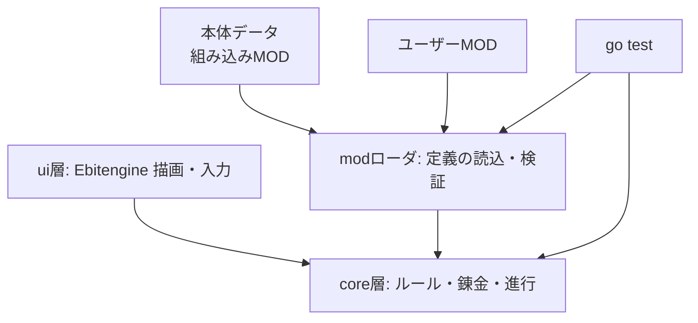

# ADR-0001: 技術スタックの選定

- 状態: 承認
- 日付: 2026-10-13
- 根拠: [要求抽出記録 ELI-001](../01_concept/elicitation-notes.md) E-01〜E-06

## 背景

- 2D ゲームを MVP 規模で作る
- 第一の目的は就活用のポートフォリオ。志望先は Web・SaaS 系の企業（ゲーム業界ではない）（E-01, E-02）
- 見せ場は、MOD で拡張できること（E-04）
- 主な実行環境は個人の PC（E-03）
- 開発者の言語経験は Go 3 年、Python 1 年、Java・C は 1 年未満（E-05）
- 開発環境は WSL2（Linux）

## 決定

| 用途 | 採用 |
|---|---|
| 言語 | Go |
| ゲームライブラリ | [Ebitengine](https://ebitengine.org/)（2D） |
| テスト | `go test`（標準）、必要に応じて表駆動テスト |
| 静的解析 | `gofmt`、`go vet`、staticcheck または golangci-lint |
| CI | GitHub Actions |
| 配布 | デスクトップ向けの実行ファイル（Windows / Linux）。デモ用に WebAssembly 版のビルドも検討する |
| MOD（第 1 段階） | データ MOD: 素材・レシピ・依頼などを設定ファイルで定義する |
| MOD（第 2 段階） | スクリプト MOD: wazero（WebAssembly 実行環境）か gopher-lua（Lua 実行環境）で、サンドボックス内で動かす。どちらにするかは別の ADR で決める |

### 構成方針

ゲームのルールは Ebitengine に依存しない純粋な Go パッケージ（`core`）に置き、描画と入力は `ui` 層に分ける。本体の素材やレシピも MOD と同じ仕組みで読み込む（本体＝組み込み MOD）。

## 理由

- **最も慣れた言語を使える**: 言語を覚える時間を、設計と MOD の仕組みに回せる
- **志望先との相性**: Go は志望先の企業で使われている。Web・SaaS の面接で通用する設計の話ができる
- **MOD の仕組みが就活の話題になる**: 外部向けの拡張 API の設計、サンドボックス化、バージョン互換は、SaaS のプラグイン基盤や公開 API と同じ問題
- **テストしやすい**: ルールを描画から切り離し、乱数をシード付きにすることで、`go test` で決定的に検証できる
- **自前の設計を見せられる**: Ebitengine はゲームループと描画だけを提供するライブラリなので、構造は自分で設計し、その設計書がそのままコードに対応する

## 検討した代替案

| 案 | 採用しなかった理由 |
|---|---|
| TypeScript ＋ Canvas | 有力だが、開発者にとって新しい言語になる。Go の方が経験を活かせ、志望先とも合う |
| Unity | 開発者は興味があるが、構造の大部分をエンジンが決めるため、自前の設計を見せにくい。ゲーム業界志望ではないので、Unity の経験は就活で優先度が低い |
| Godot | Unity と同じ理由。加えて、Go 経験を活かせない |
| Python ＋ pygame | 型が弱く、MOD API の契約を型で表現しにくい。配布も手間がかかる |

## 影響

- Go の開発環境と、Ebitengine のビルドに必要なライブラリ（Linux では X11 や OpenGL の開発用パッケージなど）が必要になる
- WSL2 で画面を表示するには WSLg を使う。動かない場合は Windows 側でビルドして実行する
- スプライトアニメーションなどの描画機能は自前で用意する。MVP では図形と文字を中心にして負担を抑える
